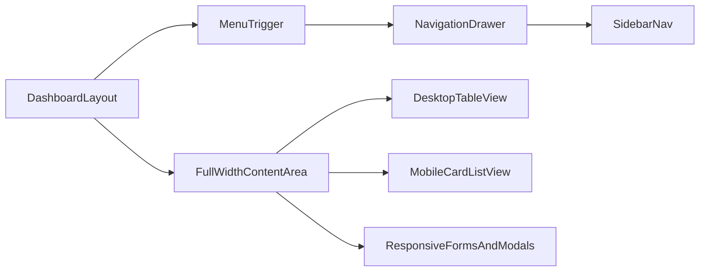

# Admin Drawer + Full Responsive Pass

## Goal

- Ukloniti desktop sidebar koji sužava sadržaj i prebaciti admin navigaciju na `Drawer` na svim breakpointima.
- Proći kroz sve admin stranice i ukloniti poznate mobile responsive probleme (overflow, fiksne širine, ne-wrapping layout, prenatrpane tabele i forme).

## Implementation Phases

### 1) Admin shell refactor (navigation as drawer everywhere)

- Refaktorisati [DashboardLayout](frontend/src/layouts/DashboardLayout.tsx):
  - ukloniti desktop-only sidebar blok (`w='240px'`),
  - zadržati jedan izvor navigacije (`SidebarNav`) unutar `Drawer`-a za sve veličine,
  - osigurati da je content kontejner uvijek full-width (`minW={0}`, bez skupljanja zbog navigacije),
  - prikazati menu trigger dugme na svim breakpointima.
- Uskladiti header/breadcrumb redove da na `base` prelaze u vertikalni raspored i ne uzrokuju horizontalni overflow.

### 2) Shared responsive patterns (reusable approach)

- Definisati konzistentan obrazac kroz admin stranice:
  - tabele: desktop tabela + mobile card/list fallback gdje je tabela preširoka,
  - forme/modali: `SimpleGrid`/`Flex` sa `columns={{ base: 1, md: 2 }}` ili `direction={{ base: 'column', md: 'row' }}`,
  - izbaciti fiksne width vrijednosti na mobile (`w='90px'`, `w='130px'`, itd.) i prebaciti na responsive width,
  - osigurati `overflowX='auto'` samo kao fallback, ne kao glavno mobile UX rješenje.

### 3) Full admin page pass (high → medium)

- High-priority dorade:
  - [Users](frontend/src/pages/Users.tsx)
  - [Reservations](frontend/src/pages/Reservations.tsx)
  - [DailyLog](frontend/src/pages/DailyLog.tsx)
  - [Finance](frontend/src/pages/Finance.tsx)
- Medium-priority dorade:
  - [Services](frontend/src/pages/Services.tsx)
  - [Stylists](frontend/src/pages/Stylists.tsx)
  - [Salon](frontend/src/pages/Salon.tsx)
  - [ClientAnalytics](frontend/src/pages/ClientAnalytics.tsx)
  - [Gallery](frontend/src/pages/Gallery.tsx)
  - [Analytics](frontend/src/pages/Analytics.tsx)
  - [Reviews](frontend/src/pages/Reviews.tsx)
  - [Blog](frontend/src/pages/Blog.tsx)
  - [Notifications](frontend/src/pages/Notifications.tsx)
  - [Loyalty](frontend/src/pages/Loyalty.tsx)
  - [Dashboard](frontend/src/pages/Dashboard.tsx)

### 4) Route-level sanity check

- Verifikovati da admin mount i auth flow ostaju netaknuti kroz [App](frontend/src/App.tsx) (posebno `/admin` grana).

### 5) Verification

- Pokrenuti lint na frontendu i riješiti nove greške vezane za izmjene.
- Ručno provjeriti ključne breakpointe (telefon, tablet, desktop) za:
  - otvaranje/zatvaranje drawer menija,
  - čitljivost tabela i forma,
  - odsustvo horizontalnog skrola na glavnim ekranima,
  - stabilnost modal dijaloga i akcijskih dugmadi.

## Delivery Strategy

- Prvo isporučiti layout promjenu (`Drawer` na svim veličinama), zatim stranice u batch-evima (high-priority pa medium-priority) da se rizik regresije drži pod kontrolom.
- Nakon svakog batch-a uraditi kratki responsive smoke-check prije prelaska na sljedeći.

## Responsive Architecture (target state)

