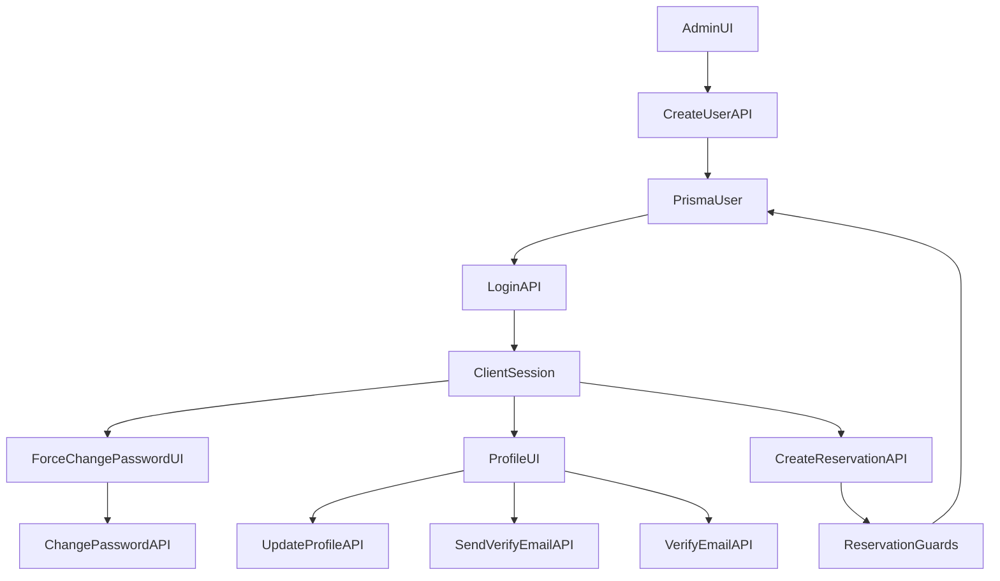

## Scope i pravila

- **Admin kreiranje korisnika**: admin unosi `firstName`, `lastName`, bira `role`, opcionalno avatar. **Ne unosi** email/telefon/lozinku.
- **Username**: auto-generacija `ime.prezime` (latinica, lowercase, bez dijakritike), provjera dostupnosti u bazi; UI prikazuje dostupnost i nudi prijedloge sa sufiksom.
- **Init lozinka**: backend postavlja inicijalnu lozinku `**Init2026!`** i označava korisnika da **mora promijeniti lozinku**.
- **Prva prijava**: nakon login-a, korisnik je preusmjeren na obaveznu promjenu lozinke (ne može dalje dok ne promijeni).
- **Kontakt + verifikacija**:
  - **Telefon mora postojati** (bez SMS verifikacije u ovoj fazi).
  - **Email mora biti verifikovan** da bi korisnik mogao kreirati rezervaciju.
  - Ako korisnik nema email definisan: nakon promjene lozinke mora dodati email + telefon; rezervacija blokirana dok to ne uradi.
- **Enforcement**: backend je “source of truth” (UI samo poboljšava UX).

## Analiza trenutnog stanja (iz koda)

- Backend auth već ima: `POST /auth/login`, `POST /auth/change-password`, `POST /auth/send-verification-email`, `POST /auth/verify-email` i Prisma polja `isEmailVerified` + token/expiry u `User` (`[backend/src/auth/auth.controller.ts](backend/src/auth/auth.controller.ts)`, `[backend/src/auth/auth.service.ts](backend/src/auth/auth.service.ts)`, `[backend/prisma/schema.prisma](backend/prisma/schema.prisma)`).
- Admin kreiranje korisnika trenutno traži `username` i `password` kroz `POST /api/users` (`[backend/src/users/users.controller.ts](backend/src/users/users.controller.ts)`, `[backend/src/users/users.service.ts](backend/src/users/users.service.ts)`, `[backend/src/users/dto/create-user.dto.ts](backend/src/users/dto/create-user.dto.ts)`).
- Rezervacije se kreiraju samo za auth korisnike (`JwtAuthGuard`) i `ReservationsService.create` je idealna tačka za dodatne uslove (`[backend/src/reservations/reservations.service.ts](backend/src/reservations/reservations.service.ts)`).
- Frontend web nema “profile” i nema UI za change-password nakon login-a; mobile već ima `ChangePasswordScreen` + email verifikaciju u profilu.

## Backend plan (NestJS + Prisma)

### 1) Prisma promjene

U `[backend/prisma/schema.prisma](backend/prisma/schema.prisma)` dodati:

- `mustChangePassword Boolean @default(false)`
- (opcionalno) `passwordChangedAt DateTime?` (audit)

Zadržati postojeća polja za email verifikaciju.

### 2) Username generacija i provjera dostupnosti

- Dodati util za “username base” iz imena/prezimena (lowercase, bez dijakritike, samo `[a-z0-9.]`).
- Implementirati funkciju u `UsersService`:
  - `generateUniqueUsername({ firstName, lastName }): Promise<string>`
  - Strategija: `ime.prezime`, zatim `ime.prezime2`, `ime.prezime3`… dok nije slobodno.
- Dodati endpoint (public ili admin-only, preporuka: admin-only) za provjeru:
  - `GET /api/users/username-availability?username=...` → `{ available: boolean, suggestions: string[] }`

### 3) Admin create user API (sa init lozinkom)

- U `CreateUserDto` (ili novi `CreateUserAdminDto`) napraviti:
  - `username` optional (backend generiše ako nije poslan)
  - `password` optional (backend postavlja na `Init2026!` ako nije poslan)
  - ukloniti email/phone obavezu (i u UI ih ne slati)
- U `UsersService.create`:
  - ako `password` nije poslan → hash `Init2026!`
  - set `mustChangePassword = true`
  - `isEmailVerified = false` (default)
  - return payload koji uključuje `initialPasswordShownOnce: true` i `initialPassword: 'Init2026!'` **samo u admin create response** (ne u profile/login).

### 4) Forced password change enforcement

- Proširiti response iz `AuthService.login` da vraća `user.mustChangePassword`.
- U `AuthService.changePassword`:
  - nakon uspješne promjene: set `mustChangePassword = false`, set `passwordChangedAt = now`.
- Dodati guard ili centralnu provjeru:
  - Minimalno: u `ReservationsService.create` blokirati ako `user.mustChangePassword`.
  - Bolje: novi guard `MustChangePasswordGuard` koji blokira sve osim `auth/change-password`, `api/users/profile`, `auth/send-verification-email`, `auth/verify-email`.

### 5) Contact/email gating za rezervacije

U `ReservationsService.create` (prije slot provjera):

- Load `User` by `clientId`.
- Ako `!user.phone` → `BadRequestException('PHONE_REQUIRED')`
- Ako `!user.email` → `BadRequestException('EMAIL_REQUIRED')`
- Ako `!user.isEmailVerified` → `BadRequestException('EMAIL_NOT_VERIFIED')`

### 6) Profile update API (email/phone)

Provjeriti postojeći `GET /api/users/profile` i postoje li update endpoints. Ako nedostaje:

- Dodati `PUT /api/users/profile` za update `email` i `phone` (validacija + unique email).
- Kad se email promijeni → set `isEmailVerified = false` i invalidate token/expiry; korisnik mora ponovo verifikovati.

### 7) Backend test plan

- Unit test: `generateUniqueUsername` (collision cases).
- E2E/smoke:
  - Admin create returns username + initialPassword and sets `mustChangePassword`.
  - Login returns `mustChangePassword=true`.
  - Reservation create blocked for each reason code.
  - After change-password + profile update + email verify → reservation allowed.

## Frontend (web) plan

### 1) Admin Users create modal

U `[frontend/src/pages/Users.tsx](frontend/src/pages/Users.tsx)`:

- Ukloniti polja email/phone/password iz create forme.
- Auto-popuniti `username` iz `firstName/lastName` i prikazati status dostupnosti (debounce + `username-availability` endpoint).
- Ako nije dostupno: prikazati suggestion listu (click to apply) + opcija manuelnog unosa sa provjerom.
- Nakon uspjeha create: prikazati modal “Kredencijali (prikaži jednom)” sa:
  - username
  - init lozinka `Init2026!`
  - copy buttons

### 2) Forced change-password flow

- Proširiti `AuthContext` (`frontend/src/context/AuthContext.tsx`) da u `user` čuva `mustChangePassword` + `email` + `phone` + `isEmailVerified` (iz `GET /api/users/profile` ili iz login payload).
- Dodati novu rutu/stranicu npr. `frontend/src/pages/ForceChangePassword.tsx`:
  - forma: currentPassword + newPassword + confirm
  - poziva `POST /auth/change-password`
  - nakon uspjeha refresha profil i nastavlja dalje.
- U `ProtectedRoute` i u public rezervaciji dodati redirect: ako `mustChangePassword` → `/force-change-password`.

### 3) Profile completion UI (email + phone)

- Dodati novu public stranicu `frontend/src/pages/Profile.tsx` (ili `Account.tsx`) sa formom za email/phone i akcijom “Pošalji verifikacioni kod na email” + unos koda.
- U `PublicLayout` prikazati banner ako:
  - nema phone ili email, ili email nije verifikovan.
- U `PublicReserve.tsx` prije step-ova blokirati i ponuditi CTA ka `/profile`.

### 4) i18n

- Dodati EN/BS ključeve za nove poruke i reason code mapiranje (PHONE_REQUIRED, EMAIL_REQUIRED, EMAIL_NOT_VERIFIED, MUST_CHANGE_PASSWORD).

## Mobile plan (Expo)

### 1) Forced change-password

- Proširiti tip `User` i `authStore` da čuva `mustChangePassword`, `email`, `phone`, `isEmailVerified` (iz `/api/users/profile`).
- U `mobile/app/(tabs)/_layout.tsx` dodati redirect: ako `user.mustChangePassword` → `/profile/change-password` (ili novi dedicated screen).

### 2) Profile completion + email verification

- U `mobile/src/screens/client/ProfileScreen.tsx` već postoji email verifikacija; dopuniti UX:
  - prikazati “Telefon obavezan” banner ako nema phone.
  - ako nema email → prikazati formu za unos emaila.
- Dodati/koristiti endpoint `PUT /api/users/profile` za unos email/phone.

### 3) Reservation gating UX

- U `mobile/src/screens/client/ReservationScreen.tsx` prije submit-a:
  - ako `!user.phone` ili `!user.email` ili `!user.isEmailVerified` → modal koji vodi na profile.
- I dalje osloniti se na backend error code za finalnu validaciju.

## Data flow (sa enforcement tačkama)

## Implementacijski redoslijed (da bude stabilno)

- Prisma + migracija
- Backend: admin create + username availability + mustChangePassword + profile update + reservation gating
- Mobile: enforce mustChangePassword + profile completion + reservation UX
- Frontend: admin create UX + forced change password page + profile page + reserve gating
- Testovi + ručni end-to-end

## Rizici

- Init lozinka je statična; ako želite veću sigurnost, sljedeća iteracija: generisati random lozinku po korisniku i prikazati adminu jednom.
- Email slanje trenutno izgleda stubirano; verifikacija radi na nivou tokena u bazi, ali bez stvarnog slanja emaila korisnik neće moći dobiti kod. Plan pretpostavlja da je email slanje već riješeno ili će se dodati u istom tasku.
