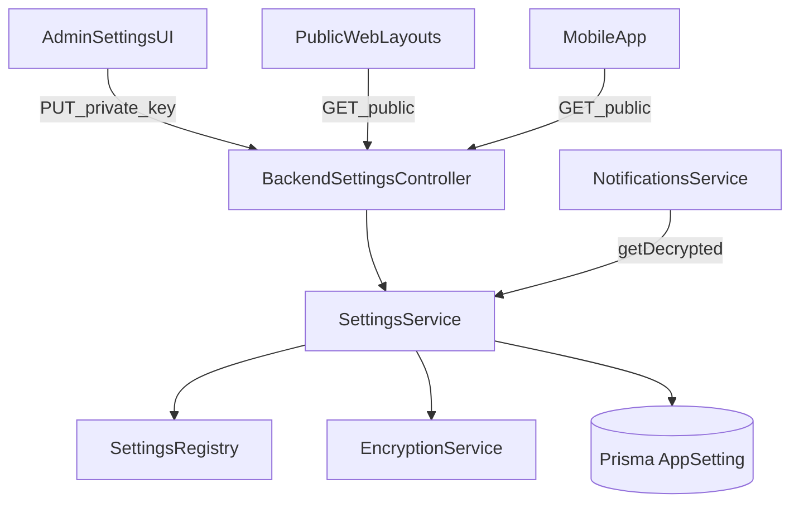

# App settings audit + refactor plan

## Findings (current state)

- **DB model**: `AppSetting` is a KV store (`key` unique, `value` TEXT, `description` TEXT, `updatedBy`, `updatedAt`) mapped to table `app_settings` in `[backend/prisma/schema.prisma](backend/prisma/schema.prisma)`.
- **Backend API**: controller is role-guarded but `GET /api/settings` is marked `@Public()`, so **all keys (including email password) are publicly readable** today.
  - Source: `[backend/src/settings/settings.controller.ts](backend/src/settings/settings.controller.ts)`
- **No typed contract**: everything is string; parsing/validation is scattered (loyalty vs notifications). DTO only validates `value` is string.
  - Source: `[backend/src/settings/dto/set-setting.dto.ts](backend/src/settings/dto/set-setting.dto.ts)`, `[backend/src/settings/settings.service.ts](backend/src/settings/settings.service.ts)`
- **Frontend**: public pages and layouts rely on `SettingsContext` fetching all settings from `GET /api/settings` unauthenticated.
  - Source: `[frontend/src/context/SettingsContext.tsx](frontend/src/context/SettingsContext.tsx)`
- **Frontend admin UI**: `Settings.tsx` defines many keys, including `system_reservation_*` that are currently **not used by backend reservation logic** (backend uses `SalonSettings.reservationLockMinutes`, etc.).
  - Source: `[frontend/src/pages/Settings.tsx](frontend/src/pages/Settings.tsx)`, `SalonSettings` model in `[backend/prisma/schema.prisma](backend/prisma/schema.prisma)`
- **Frontend email settings**: writes many `system_email_*` keys, including `system_email_password`.
  - Source: `[frontend/src/pages/EmailSettings.tsx](frontend/src/pages/EmailSettings.tsx)`
- **Mobile**: does not consume `/api/settings` at all (no branding/public config from backend), theme/i18n are local-only.
  - Source: `[mobile/src/services/api.ts](mobile/src/services/api.ts)`

## Target design

### 1) Settings contract (single source of truth)

Introduce a **typed settings registry** in backend that defines:

- `key` (string literal)
- **scope**: `PUBLIC` or `PRIVATE`
- **type**: `string | boolean | number | json`
- default value (optional)
- validation rules (range, enum, JSON schema-ish validation)
- UI metadata (label/help) for admin UI rendering

This lets us:

- reliably filter what can be returned publicly
- validate on write (fail fast with helpful messages)
- centralize parsing so services don’t duplicate logic

### 2) Public vs private endpoints

Because you chose “keep public endpoint but only public keys”, we’ll split API behavior:

- **GET `/api/settings/public`** (public): returns only `PUBLIC` keys (minimal payload used by public web + mobile)
- **GET `/api/settings`** (admin): returns **all** keys (including encrypted secrets), only for `SYSTEM_ADMIN`/`OWNER`
- Keep per-key admin endpoints for CRUD, but enforce scope rules.

### 3) Encrypted secrets in DB

Because you chose “DB encrypted” for secrets:

- Add backend encryption layer for `PRIVATE`+`isSecret` keys (e.g. `system_email_password`)
- Store ciphertext in `AppSetting.value` (no plaintext at rest)
- Decrypt only inside backend services that need it (notifications/email)
- Add key-rotation plan (configurable KMS-like env key) and safe fallback behavior.

### 4) Align “settings” vs “salon settings”

Right now, reservation behavior is primarily under `SalonSettings` table (not `system_reservation_`*). Decide and enforce a single source of truth:

- Option A (recommended): reservation timing remains in `SalonSettings`; remove or hide `system_reservation_`* from UI (or map UI to SalonSettings endpoints instead of app_settings).
- Option B: move those values into app_settings and update reservation services to read them.

Given current schema already has `SalonSettings.`*, the plan will default to **Option A**: migrate UI to edit `SalonSettings` for reservation behavior, and keep `app_settings` for branding/public content, notifications templates, loyalty global toggles.

### 5) Frontend and mobile consumption

- Frontend public pages + layouts switch from `GET /api/settings` to `GET /api/settings/public`.
- Admin pages (`Settings.tsx`, `EmailSettings.tsx`) use admin endpoints and show grouped editors based on the new contract.
- Mobile adds a lightweight “public config” fetch and uses it for branding (app title/logo) and any public text needed.

## Execution steps (high level)

## Files likely to change

- Backend:
  - `[backend/src/settings/settings.controller.ts](backend/src/settings/settings.controller.ts)`
  - `[backend/src/settings/settings.service.ts](backend/src/settings/settings.service.ts)`
  - new: `backend/src/settings/settings.registry.ts` (contract)
  - new: `backend/src/common/crypto/encryption.service.ts` (or within settings module)
  - `[backend/src/notifications/notifications.service.ts](backend/src/notifications/notifications.service.ts)` (consume decrypted values via SettingsService)
  - `[backend/src/loyalty/loyalty.service.ts](backend/src/loyalty/loyalty.service.ts)` (consume typed getters)
- Frontend:
  - `[frontend/src/context/SettingsContext.tsx](frontend/src/context/SettingsContext.tsx)`
  - `[frontend/src/pages/Settings.tsx](frontend/src/pages/Settings.tsx)`
  - `[frontend/src/pages/EmailSettings.tsx](frontend/src/pages/EmailSettings.tsx)`
  - any public pages that use settings (PublicHome/Reserve/Contact, layouts)
- Mobile:
  - new: `mobile/src/services/publicSettings.ts` (fetch + cache)
  - integrate in relevant screens/components for branding

## Detailed TODOs
