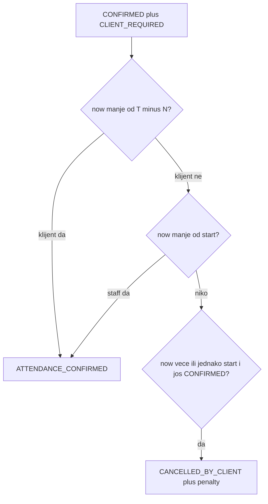

# Attendance policy (A3)

**ID:** `attendance-policy` (POLICY_BACKLOG #4)
**Odluka (Ask):** A3 — klijentski rok `T − N`; staff do starta; CRON na startu.

Nakon odobrenja (prije koda): `.cursor/plans/attendance-policy/` + `POLICY_BACKLOG` → `planned`.

## Pravilo

- **N** = `system_reservation_attendance_hours`. Registry **defaultValue `'12'`** (min 1, max 72). Fallback konstanta `ATTENDANCE_CONFIRM_DEADLINE_HOURS` → 12. Postojeći red u bazi ostaje 24 dok ga owner ne promijeni u Settings.
- Klijent: `POST /:id/confirm-attendance` — vlasnik, `canConfirmAttendance`, `now < start − N h`. `attendanceConfirmedBy=CLIENT`.
- Staff: novi `POST /:id/staff-confirm-attendance` — `STYLIST` (samo `confirmedStylistId`) ili `SYSTEM_ADMIN`/`OWNER`. Status `CONFIRMED` + `CLIENT_REQUIRED`, `now < start`. `attendanceConfirmedBy=STAFF`.
- CRON: `now >= start`, još `CONFIRMED` + `CLIENT_REQUIRED` + `attendanceConfirmedAt` null → cancel + penalty (isti push `attendance_timeout_cancelled`). Query: `reservationDate` jučer–danas (ne 2-dnevni lookahead za `T − N`).
- Direct `STAFF_WAIVED`: bez CTA, bez CRON, start iz `CONFIRMED` — bez izmjene.
- Nema Prisma migracije.

## Backend

- Policy: `canStaffConfirmAttendance` u [reservation-policy.ts](../../backend/src/reservations/reservation-policy.ts).
- Novi [reservation-staff-attendance.service.ts](../../backend/src/reservations/reservation-staff-attendance.service.ts) (ne širiti [reservation-client-actions.service.ts](../../backend/src/reservations/reservation-client-actions.service.ts) — već ~217 linija).
- Ruta u [reservations.controller.ts](../../backend/src/reservations/reservations.controller.ts) + facade [reservations.service.ts](../../backend/src/reservations/reservations.service.ts).
- CRON: [reservation-attendance-cron.service.ts](../../backend/src/reservations/reservation-attendance-cron.service.ts) — cancel na `startAt`, ne na `T − N`.
- Settings: [settings-registry.ts](../../backend/src/settings/settings-registry.ts) default 12; [Settings.tsx](../../frontend/src/pages/Settings.tsx) desc: klijentski rok; auto-otkaz na početku termina.
- List/detail payload: opciono `attendanceClientDeadlineAt` (ISO) za `CLIENT_REQUIRED` + `CONFIRMED`, da UI sakrije klijentski CTA poslije roka. Mapirati u [reservation-queries.service.ts](../../backend/src/reservations/reservation-queries.service.ts) / list mapper.

## UI

Klijent (sakriti dugme kad `now >= attendanceClientDeadlineAt`):

- [my-reservation-card.tsx](../../frontend/src/features/client-reservations/my-reservation-card.tsx) + [client-reservation-actions.ts](../../frontend/src/features/client-reservations/client-reservation-actions.ts)
- [MyReservations.tsx](../../frontend/src/pages/public/MyReservations.tsx)
- [MyReservationsScreen.tsx](../../mobile/src/screens/client/MyReservationsScreen.tsx) + [mobile/src/i18n/bs.ts](../../mobile/src/i18n/bs.ts) (hint s `{{hours}}`, ne hardcode 24)

Staff CTA „Potvrdi dolazak“ na `CONFIRMED` + `CLIENT_REQUIRED` dok `now < start`:

- [frontend/.../reservation-detail-actions.tsx](../../frontend/src/features/stylist-portal/components/reservation-detail-actions.tsx) + API helper
- [mobile/.../reservation-detail-actions.tsx](../../mobile/src/screens/stylist/reservation-detail/reservation-detail-actions.tsx)
- Admin detail u [Reservations.tsx](../../frontend/src/pages/Reservations.tsx)

Bez novog pusha klijentu na staff confirm (status se vidi na listi + socket).

## Testovi + docs

- Staff confirm: happy path, forbidden tuđi stilist, 400 poslije starta, `STAFF_WAIVED` odbijen.
- Klijent i dalje 400 na/poslije `T − N`.
- CRON spec prepisati na cancel **na startu** (ovo i popravlja pre-existing `cancelledCount` 0 ako mock/TZ budu vezani za `combineDateAndTime`).
- [MATRIX.md](../docs/matrices/reservations/MATRIX.md) + CHANGELOG; [RESERVATION_MODULE.md](../docs/reservations/RESERVATION_MODULE.md) §8; POLICY_BACKLOG `done` na zatvaranju.

## Out of scope

- Slot-hold, multi-booking, disposition.
- Promjena auto-start pravila.
- Client reminder push na `T − N`.
- Automatski UPDATE postojećeg settings reda u DB (owner stavi 12 u UI).
