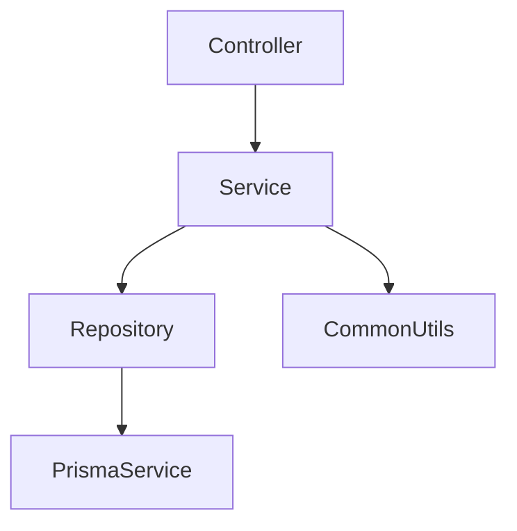

## Lista planiranih izmjena po fajlovima (high-signal)

### `backend/src/reservations/reservations.service.ts`
- Izvući privatne helper metode u manje, fokusirane servise (metode <100 LOC):
  - `reservations/reservation-guards.service.ts`: provjere klijenta/servisa, status transition guardovi (trenutno puno `BadRequestException` guardova u `create` i drugim metodama).
  - `reservations/reservation-reschedule.service.ts`: reschedule/reorder tok (npr. `computeRescheduleDeadlineMinutes`, `getPendingRescheduleKind`, logika odluka i slanje notifikacija).
  - `reservations/reservation-notification.service.ts`: poruke/title/body + `NotificationsService.send/sendToMany` orkestracija (trenutno `notifyStylistAboutClientDecision` i slične stvari u glavnom servisu).
  - `reservations/reservation-date.service.ts`: `parseDateOnly`, “dayStart/dayEnd” i kombinovanje datuma + vremena (trenutno duplirano i po servisima).
- Uvesti repository sloj:
  - `reservations/reservations.repository.ts`: svi `this.prisma.reservation.*`, `reservationStylistResponse.*` i related upiti (centralizuje `select/include` shape i olakšava testiranje).
  - Po potrebi dodatni repo: `reservations/reservations-notifications.repository.ts` (npr. `notification.findFirst` iz `getPendingRescheduleKind`).
- Ujednačiti naming i ukloniti “any” castove gdje je moguće (npr. `type: { in: [...] as any }`).

### `backend/src/reservations/availability.service.ts`
- Izvući duple date-only funkcije (`toDateStr`, `localDateStr`) u zajednički util (vidi `common/utils/date-only.ts`).
- Izvući ponavljajuće “day start/end” konstrukcije u `common/utils/date-range.ts`.
- Uvesti `reservations/availability.repository.ts` za Prisma upite (salon settings, working hours, holidays, reservations).
- Razbiti velike metode (`getAvailableSlots`, `getAvailableDates`) u manje privatne metode: `resolveSalonSettings`, `resolveHolidaysSet`, `resolveStylistsForService`, `resolveReservationsForDay`, `computeSlotCounts`.

### `backend/src/analytics/analytics.service.ts`
- Izvući `resolveDateRange` i `toDateOnly` u zajedničke util-e:
  - `common/utils/date-only.ts` (date-only string, sa jasnim “local vs UTC” izborom)
  - `common/utils/date-range.ts` (range + month iteration)
- Uvesti repository sloj:
  - `analytics/analytics.repository.ts`: `incomeBook/expenseBook/reservation.groupBy/dailyLogEntry` upiti.
- Razbiti `getDashboard` u manje metode: `requireAdminOrOwner`, `buildMonthlyFinance`, `buildCountsAndConversion`.

### `backend/src/settings/settings.service.ts`
- Izvući JSON validacije po ključu iz `normalizeJson` u odvojene validatore:
  - `settings/validators/loyalty-tiers.validator.ts`
  - `settings/validators/loyalty-excluded-services.validator.ts`
  - `settings/validators/email-template.validator.ts`
  - `settings/validators/email-campaign-templates.validator.ts`
- Uvesti “safe JSON parse” helper u `common/utils/json.ts` (konsistentne greške) i koristiti ga i ovdje i u drugim servisima.
- Uvesti `settings/settings.repository.ts` za `appSetting` Prisma upite.
- Dosljedno formatiranje (trenutno ima mjesta bez tačke-zareza i različit stil; cilj je isti lint/format svuda).

### `backend/src/loyalty/loyalty.service.ts`
- Ukloniti duplikate parse logike (`parseNumber/parseBoolean/parseJsonArray`) i prebaciti u:
  - `common/utils/parse.ts` (npr. `parseFiniteNumber`, `parseBooleanString`)
  - `common/utils/json.ts` (parse array)
- Uvesti `loyalty/loyalty.repository.ts` za Prisma upite (`loyaltyAccount`, `loyaltyTransaction`, itd.).
- Razbiti velike metode u “command-style” privatne metode (npr. `resolveEarnSettings`, `calculateEarnPoints`, `applyTransaction`, `recalculateTier`).

### `backend/src/users/users.service.ts`
- Ujednačiti pagination obrazac (ponavlja se u više servisa):
  - `common/utils/pagination.ts`: `normalizePagination({ page, pageSize }, { maxPageSize })` + tip `PaginatedResult<T>`.
- Uvesti repository:
  - `users/users.repository.ts`: svi upiti nad `user`, `role`, `userRoles`.
- Izvući authz helpers u `common/utils/roles.ts` ili `common/services/authorization.service.ts`:
  - `isAdminOrOwner`, `requireAdminOrOwner`, itd.
- Razbiti preduge metode (npr. `create`, `generateUniqueUsername`, itd.) u manje privatne metode.

### `backend/src/notifications/notifications.service.ts`
- Uvesti repository:
  - `notifications/notifications.repository.ts`: `notification`, `notificationPreference`, `pushToken` upiti.
- Izvući mail config + template logiku u:
  - `notifications/email/email-config.service.ts`
  - `notifications/email/email-template.service.ts`
  - `notifications/email/smtp-transporter.factory.ts`
- Standardizovati error handling: izbjeći “local try/catch + console.error” gdje nije namjerno; osloniti se na Nest exception flow.

### `backend/src/auth/auth.controller.ts`
- Smanjiti “orchestration” u controlleru:
  - prebaciti avatar upload validaciju i odabir `thumb/small/original` u `uploads/user-avatar.service.ts` ili proširiti `UploadsService` sa `saveAvatar(file): { avatarPath }`.
  - controller ostaje: prima request → proslijedi DTO/service.
- Opcionalno: izvući `AVATAR_MAX_SIZE` i mime whitelist u shared upload config (vidi `uploads/upload-constants.ts`).

### `backend/src/uploads/uploads.controller.ts`
- Premjestiti `entity -> folder` sanitizaciju u service/pomoćni sloj:
  - `uploads/upload-target-resolver.service.ts` (ili unutar `UploadsService`).
- Ujednačiti file validation ("no file", max size, mime) kroz jedan shared modul:
  - `uploads/upload-validation.ts` (reusable i za `AuthController`).

### `backend/src/uploads/uploads.service.ts`
- Razdvojiti na manje privatne metode: `resolvePaths`, `ensureAllowedMime`, `writeOriginal`, `generateImageVariants`, `persistUploadRow`.
- Uvesti repository:
  - `uploads/uploads.repository.ts` za `upload` CRUD.
- Centralizovati konstante (`IMAGE_SIZES`, `IMAGE_MIMES`, `DOC_MIMES`) u `uploads/upload-constants.ts`.

### `backend/src/finance/expense.controller.ts`
- Razbiti fajl na 4 odvojena controller fajla (svaki <100 LOC i jasniji SoC):
  - `finance/expense-templates.controller.ts`
  - `finance/expense-categories.controller.ts`
  - `finance/expense-books.controller.ts`
  - `finance/expenses.controller.ts`
- Zadržati postojeće rute i servise; samo prepakovati radi maintainability.

### `backend/src/finance/income-books.service.ts`
- Uvesti `finance/income-books.repository.ts` za Prisma upite.
- Izvući “book month” pravila u `finance/finance-date.service.ts` (npr. `isPastMonth`, `ensureDateMatchesBookMonth`, parse/normalize date) radi ponovne upotrebe i testiranja.
- Razbiti preduge metode (`createManualEntry`, `updateManualEntry`, …) u manje privatne metode.

---

## Cross-cutting novi helpers/utils (predloženi)
- `backend/src/common/utils/date-only.ts`: jedinstven `toLocalDateOnlyString(date)` i `parseDateOnlyString('YYYY-MM-DD')` (izbjegava UTC vs local drift).
- `backend/src/common/utils/date-range.ts`: `getDayStartEnd(date)` i iteracija mjeseci.
- `backend/src/common/utils/pagination.ts`: `normalizePagination` + `PaginatedResult<T>`.
- `backend/src/common/utils/json.ts`: `safeJsonParse`, `safeJsonParseArray`, dosljedne poruke greške.
- `backend/src/common/utils/parse.ts`: `parseFiniteNumber`, `parseBooleanString`, itd.
- `backend/src/common/utils/roles.ts` ili `common/services/authorization.service.ts`: `requireAdminOrOwner`, `isAdminOrOwner`.

## Pravila i ograničenja koje poštujemo
- **Controller → Service → Repository → Prisma** (controllers ostaju tanki; business i DB u nižim slojevima).
- **Metode <100 LOC** (prema tvom odabiru); fajl može biti veći, ali preferiramo manje fajlove gdje prirodno razdvajanje ima smisla.
- Bez promjene API ruta/contracta osim ako se eksplicitno dogovorimo.

## Redoslijed implementacije (fajl‑po‑fajl, najmanji rizik prvo)
1. Dodati zajedničke util-e (`common/utils/*`) i refaktorisati `analytics.service.ts` i `availability.service.ts` (najčistiji duplikati: date-only/range).
2. Razbiti `finance/expense.controller.ts` na 4 controllera (mehanička promjena, nizak rizik).
3. Uvesti repositories za `users`, `settings`, `uploads`, `notifications` i prebaciti Prisma pozive.
4. Najveći zahvat: `reservations.service.ts` → izdvajanje sub-servisa + repositories, uz očuvanje reservation-engine pravila.
5. `loyalty.service.ts` i finance servisi (`income-books.service.ts`) nakon što shared utils/repositories pattern bude ustaljen.

## Kratki mermaid prikaz ciljanog layering-a

