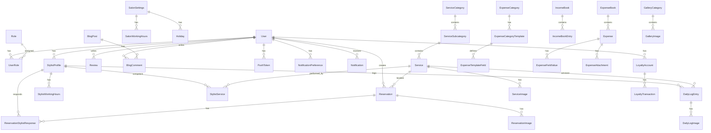
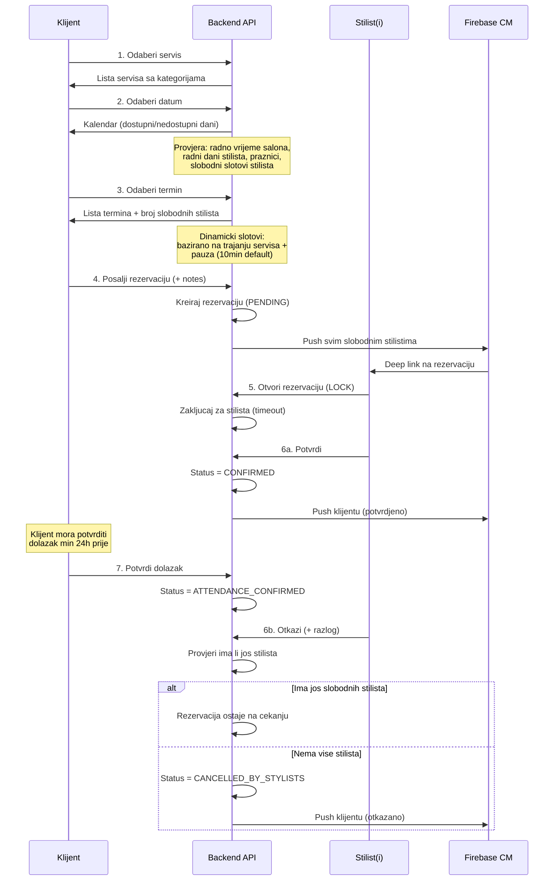
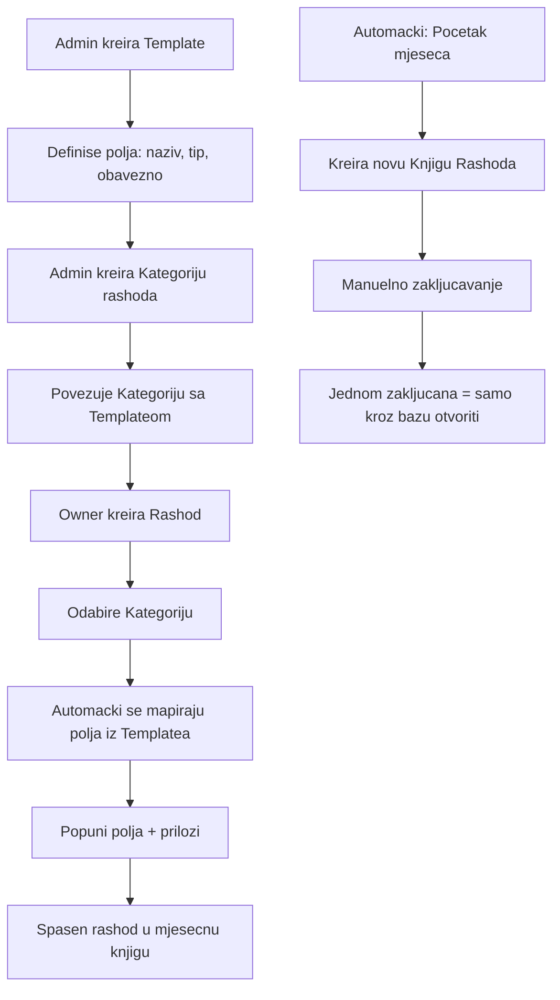

# Beauty Salon Nejra v2 - Kompletni Plan

## Sumarija odluka

- **Backend**: NestJS + Prisma + strict TypeScript
- **Frontend**: Vite + Tailwind CSS + Chakra UI
- **Mobile**: Expo (React Native)
- **Baza**: MySQL (host: `ba101.top`, user: `mudzy`, db: `beauty-salon-v2`)
- **Branding**: Elegantno - Zlatna (#D4A843), Crna (#1A1A1A), Bijela (#FFFFFF), Tamno siva (#2D2D2D), Sampanjac (#F5E6CC), Ruza (#C98BA0)
- **Role**: System Admin, Owner (Vlasnik salona), Stylist, Client, Guest
- **Auth**: Email/Username + Password; Google/Facebook social login za klijente; email verifikacija + auto-aktivacija
- **Push**: Firebase Cloud Messaging (FCM)
- **Email**: Nodemailer (SMTP) - korisnik bira push/email/oba
- **Blogovi**: Pise samo Admin/Owner
- **Placanje**: Bez online placanja, ali pripremljena arhitektura
- **Jezik**: Bosanski default, i18n infrastruktura za buduci engleski
- **Recenzije**: Zvjezdice za servis I stilista posebno + komentar
- **Termini**: Dinamicki bazirano na trajanju servisa + konfigurisana pauza
- **Servisi**: Kategorije + podkategorije
- **Otkazivanje**: Konfigurisano + penalizacija za cesta otkazivanja
- **Galerija**: Kompletna sa kategorijama (Salon, Tim, Radovi...)
- **Loyalty**: Pripremljena arhitektura, neaktivno do aktivacije kroz admin
- **Dark mode**: Samo mobilna aplikacija

## Struktura repozitorija

```
Documents/GitHub/beauty-salon-v2/
  docker-compose.yml
  .gitignore
  .cursorrules
  SOURCE_OF_TRUTH.md
  .cursor/
    rules/           # Cursor rules (.mdc fajlovi)
    skills/           # Cursor skills (SKILL.md)
    docs/             # Arhitektura, matrice, gap analiza, taskovi
  backend/
    package.json
    Dockerfile
    prisma/schema.prisma
    src/
      main.ts
      app.module.ts
      common/          # Guards, decorators, filters, interceptors, pipes
      config/          # Configuration module
      auth/            # Auth module (JWT, social login)
      users/           # User management
      salon/           # Salon settings, working hours, holidays
      services/        # Service categories, subcategories, services
      stylists/        # Stylist profiles, schedules, competencies
      reservations/    # Reservation engine
      daily-log/       # Dnevna knjiga
      finance/         # KIF (income) + KUF (expense) books
      blog/            # Blog posts + comments
      gallery/         # Gallery categories + images
      reviews/         # Reviews/ratings
      notifications/   # Push (FCM) + Email
      uploads/         # Global upload service
      analytics/       # Dashboard analytics
      loyalty/         # Loyalty program (prepared, inactive)
      settings/        # App settings (pauza, cancel policy, etc.)
  frontend/
    package.json
    Dockerfile
    src/
      main.tsx
      App.tsx
      i18n/            # i18n setup (bs default)
      theme/           # Chakra UI theme (branding colors)
      components/      # Shared UI components
      layouts/         # Dashboard + Public layouts
      pages/
        public/        # One-page, blog, services, gallery
        dashboard/     # Admin/Owner dashboard pages
      hooks/           # Custom React hooks
      services/        # API service layer
      store/           # State management (Zustand)
      types/           # TypeScript types
      utils/           # Utilities
  mobile/
    package.json
    app.json
    src/
      i18n/            # i18n
      theme/           # Dark/Light mode, branding
      components/      # Shared components
      screens/
        client/        # Client screens
        stylist/       # Stylist screens
        auth/          # Auth screens
      navigation/      # React Navigation setup
      services/        # API service layer
      hooks/           # Custom hooks
      store/           # State management (Zustand)
      types/           # TypeScript types
      utils/           # Utilities
```

## Baza podataka - Prisma Schema (kompletna)




### Kljucne tabele:

**users** - `id, username, email, passwordHash, firstName, lastName, phone?, avatar?, isActive, isEmailVerified, googleId?, facebookId?, lastLoginAt, createdAt, updatedAt`

**roles** - `id, name (SYSTEM_ADMIN | OWNER | STYLIST | CLIENT), description`

**salon_settings** - `id, name, address, phone, email, description, logo, pauseBetweenServices (default 10min), cancellationDeadlineHours (default 24), maxCancellationsBeforePenalty, penaltyDurationDays`

**salon_working_hours** - `id, salonSettingsId, dayOfWeek (0-6), openTime, closeTime, isWorkingDay`

**holidays** - `id, salonSettingsId, date, name, message?, sendPush, pushSentAt?, createdAt`

**stylist_profiles** - `id, userId, bio, specialization, isActive, hireDate`

**stylist_working_hours** - `id, stylistProfileId, dayOfWeek, date? (override), startTime, endTime, isWorkingDay`

**service_categories** - `id, name, description, sortOrder, isActive`

**service_subcategories** - `id, categoryId, name, description, sortOrder, isActive`

**services** - `id, subcategoryId, name, shortDescription, heroImage, durationMinutes, price, isActive, sortOrder`

**service_images** - `id, serviceId, uploadId, isBefore, isAfter, description?, sortOrder`

**stylist_services** - `id, stylistProfileId, serviceId` (koje servise frizer moze raditi)

**reservations** - `id, clientId, serviceId, reservationDate, startTime, endTime, status (PENDING|STYLIST_REVIEW|CONFIRMED|ATTENDANCE_CONFIRMED|IN_PROGRESS|COMPLETED|CANCELLED_BY_CLIENT|CANCELLED_BY_STYLISTS|NO_SHOW), clientNotes?, confirmedStylistId?, attendanceConfirmedAt?, cancelledAt?, cancelReason?, createdAt`

**reservation_stylist_responses** - `id, reservationId, stylistProfileId, status (PENDING|LOCKED|ACCEPTED|REJECTED), lockedAt?, lockExpiresAt?, rejectionReason?, respondedAt`

**daily_log_entries** - `id, stylistProfileId, reservationId?, serviceId, clientId?, date, actualPrice, tipAmount, isManual, notes?, status (PENDING|COMPLETED), completedAt?`

**expense_books** - `id, year, month, openedAt, closedAt?, isClosed, closedBy?`

**expense_categories** - `id, name, description, templateId, isActive`

**expense_category_templates** - `id, name, description, requiresAttachmentPerItem`

**expense_template_fields** - `id, templateId, fieldName, fieldType (TEXT|NUMBER|CURRENCY|DATE|FILE), isRequired, sortOrder`

**expenses** - `id, bookId, categoryId, title, totalAmount, invoiceUploadId?, notes?, createdAt, createdBy`

**expense_field_values** - `id, expenseId, fieldId, value`

**expense_attachments** - `id, expenseId, uploadId, description?`

**income_books** - `id, year, month, openedAt, closedAt?, totalRevenue, totalTips`

**income_book_entries** - `id, bookId, dailyLogEntryId, amount, tipAmount, date`

**blog_posts** - `id, authorId, title, slug, content, heroImage, isPublished, publishedAt?, createdAt, updatedAt`

**blog_comments** - `id, postId, userId, content, isApproved, createdAt`

**reviews** - `id, userId, serviceId, stylistProfileId?, reservationId?, serviceRating (1-5), stylistRating? (1-5), comment?, isApproved, createdAt`

**gallery_categories** - `id, name, description, sortOrder`

**gallery_images** - `id, categoryId, uploadId, title?, description?, sortOrder`

**uploads** - `id, originalName, mimeType, sizeBytes, pathOriginal, pathThumb, pathSmall, pathMedium, uploadedById, createdAt`

**notifications** - `id, userId, title, body, type, data (JSON), channel (PUSH|EMAIL|BOTH), isRead, sentAt, readAt?`

**notification_preferences** - `id, userId, type, pushEnabled, emailEnabled`

**push_tokens** - `id, userId, token, platform (IOS|ANDROID|WEB), createdAt`

**app_settings** - `id, key, value, description, updatedAt, updatedBy`

**loyalty_accounts** - `id, userId, points, tier?, isActive (default false), createdAt`

**loyalty_transactions** - `id, accountId, points, type (EARN|REDEEM), source?, createdAt`

## Reservation Flow (detaljan)




## Expense (KUF) System - detaljan




## Income (KIF) System

- Knjiga prihoda se automacki otvara na pocetku mjeseca
- Popunjava se iz dnevnih knjiga frizera (DailyLogEntry sa COMPLETED statusom)
- Na kraju mjeseca se automacki zatvara
- CRON job: 1. u mjesecu otvara novu, zatvara prethodnu

## Upload System

- Globalni servis na backendu: `POST /api/uploads`
- Host putanja: `/mnt/shared-app-files/beauty-salon-v2/`
- Struktura: `/{entity}/{year}/{month}/{filename}`
  - npr. `/services/2026/03/hero-abc123-original.jpg`
  - npr. `/gallery/2026/03/salon-xyz-thumb.jpg`
- Generise: `original`, `thumb` (150x150), `small` (300x300), `medium` (600x600)
- PDF/Word/Excel: samo original, bez resize-a
- U bazu: samo relativne putanje
- Koristiti `sharp` za image processing

## Skills i Rules

### Cursor Rules (.cursor/rules/)

1. **full-stack-workflow.mdc** - Globalni standardi (struktura, tech stack, Prisma, uploads, Docker)
2. **database-schema.mdc** - Prisma schema referenca, naming konvencije, migracije
3. **reservation-engine.mdc** - Kompletna logika rezervacija, FSM statusi, pravila dostupnosti
4. **finance-system.mdc** - KIF/KUF pravila, template mehanizam, automacki CRON-ovi
5. **api-conventions.mdc** - REST konvencije, error handling, guard chain, response format
6. **testing-strategy.mdc** - Koji testovi su obavezni, coverage pragovi, naming

### Cursor Skills (.cursor/skills/)

1. **schema-review** - Skill za pregled i validaciju Prisma schema promjena
2. **reservation-flow** - Skill za implementaciju i debugging rezervacijskog toka
3. **finance-operations** - Skill za rad sa KIF/KUF systemom
4. **phase-tracker** - Skill za pracenje faza i taskova

### Source of Truth (SOURCE_OF_TRUTH.md)

- Zivi u rootu repozitorija
- Referencira sve .cursor/docs/ fajlove
- Sadrzi: trenutno stanje sistema, poznate gap-ove, changelog po fazama
- Azurira se na kraju svake faze

## Docker Compose (root)

```yaml
services:
  backend:
    build: ./backend
    ports: ["3000:3000"]
    volumes:
      - /mnt/shared-app-files/beauty-salon-v2:/usr/app/uploads
    env_file: ./backend/.env
    depends_on: [mysql]
  frontend:
    build: ./frontend
    ports: ["5173:80"]
  mysql:
    image: mysql:8
    ports: ["3306:3306"]
    volumes:
      - mysql_data:/var/lib/mysql
volumes:
  mysql_data:
```

**Napomena**: Docker trenutno nije instaliran na masini. Docker konfiguracija ce biti pripremljena za produkcijski deployment.

## Kljucni testovi po fazi

- **Faza 1**: Auth unit tests (register, login, JWT, guard), Upload integration test
- **Faza 2**: CRUD testovi za svaki modul, working hours validacija
- **Faza 3**: Availability engine unit tests (KRITICNO), reservation FSM tests, concurrent lock tests
- **Faza 4**: Daily log aggregation tests, expense template mapping tests, CRON job tests
- **Faza 5**: Blog CRUD + comment moderation tests, review validation tests
- **Faza 6-7**: E2E testovi za kljucne dashboard/public tokove (Playwright)
- **Faza 8-9**: Mobile integration testovi, push notification mock tests
- **Faza 10**: Analytics accuracy tests, performance benchmarks

---

## 10 Razvojnih Faza

### Faza 1: Fundament (Infrastruktura i Foundation)

- Git repo kreiranje (`Documents/GitHub/beauty-salon-v2`)
- Folder struktura (backend, frontend, mobile)
- Backend boilerplate: NestJS + Prisma + MySQL konekcija
- **Kompletna Prisma schema** (sve tabele odjednom)
- Auth modul (JWT, register, login, email verify, social login setup)
- Upload modul (sharp image processing, multi-size)
- i18n infrastruktura (bs default)
- `.cursor/rules/`, `.cursor/skills/`, `SOURCE_OF_TRUTH.md`
- `.env.example` za svaki projekat
- Docker fajlovi (docker-compose.yml + Dockerfile-ovi)
- **Testovi**: Auth tests, Upload tests

### Faza 2: Core Domain (Backend)

- User management (CRUD, role assignment, profile)
- Salon settings modul (CRUD, working hours per day, holidays + poruke)
- Service modul (kategorije, podkategorije, servisi, hero slike)
- Stylist modul (profili, radno vrijeme per day, kompetencije)
- App Settings modul (konfigurisane pause, cancel policy, etc.)
- **Testovi**: CRUD tests, working hours validation

### Faza 3: Reservation Engine (Backend)

- Availability engine (kljucna logika)
  - Provjera radnog dana salona i stilista
  - Provjera praznika
  - Dinamicki izracun slobodnih slotova
  - Pauza izmedju servisa (konfigurisana)
- Reservation CRUD sa kompletnim FSM
- Stylist response workflow (lock/accept/reject)
- Client attendance confirmation (24h pravilo)
- Cancellation policy enforcement + penalty
- FCM integration (push notifikacije)
- Email notification modul (Nodemailer)
- Notification preferences
- **Testovi**: Availability unit tests, FSM tests, concurrent lock tests (KRITICNO)

### Faza 4: Finansijski System (Backend)

- Daily log modul (automacko popunjavanje iz rezervacija + manuelni unos)
- Before/After image upload na daily log i rezervacije
- Expense system:
  - Template mehanizam (definisanje polja)
  - Kategorije rashoda sa template-ima
  - Knjige rashoda (automacko kreiranje, manuelno zakljucavanje)
  - Rashodi sa popunjavanjem iz template-a
  - Prilozi (attachments)
- Income system:
  - Automacko otvaranje/zatvaranje knjiga (CRON)
  - Agregacija iz dnevnih knjiga
- **Testovi**: Aggregation tests, template mapping tests, CRON tests

### Faza 5: Content i Engagement (Backend)

- Blog modul (CRUD, slug, publish/draft)
- Blog komentari (moderacija, approve)
- Gallery modul (kategorije + slike)
- Review modul (service + stylist rating, approve)
- Holiday push/email notifikacije
- **Testovi**: Blog CRUD, review validation, gallery upload

### Faza 6: Admin Dashboard (Frontend)

- Vite + Chakra UI + Tailwind setup
- Theme (branding boje, light mode only)
- i18n (bosanski default)
- Auth (login, JWT storage)
- Layout (sidebar, header, breadcrumbs)
- Dashboard home (analitika overview, grafici)
- User management stranica
- Salon settings (radno vrijeme, praznici, poruke)
- Service management (kategorije, podkategorije, servisi)
- Stylist management (profili, rasporedi, kompetencije)
- Reservation overview (lista, filteri, statusi)
- Daily log pregled (po stilisti, po datumu)
- Finance: Knjiga rashoda (template, kategorije, unos)
- Finance: Knjiga prihoda (pregled, mjesecni izvjestaji)
- Blog management (kreiranje, uredjivanje, publish)
- Gallery management (kategorije, upload)
- Review moderation
- App Settings stranica
- Notification management
- **Testovi**: E2E testovi za kljucne tokove (Playwright)

### Faza 7: Public Website (Frontend)

- One-page prezentacija salona (hero, about, servisi, galerija, kontakt)
- Service listing sa kategorijama
- Blog listing + detail stranica
- Gallery pregled
- Client login/register na webu
- Reservation flow na webu (za prijavljene klijente)
- **Testovi**: E2E za public flow

### Faza 8: Mobile - Client App

- Expo setup + navigacija
- Theme (dark/light mode, branding)
- Auth screens (login, register, social login, email verify)
- Home screen (servisi, blogovi, promo)
- Service browsing (kategorije, detalji)
- Reservation flow (servis -> datum -> termin -> notes -> submit)
- Moje rezervacije (lista, statusi, potvrda dolaska, otkazivanje)
- Blog listing + detail
- Reviews (ostavljanje recenzije)
- Profil management
- Push notifikacije (FCM setup)
- Notification preferences
- **Testovi**: Integration testovi, push mock tests

### Faza 9: Mobile - Stylist App

- Stylist auth + navigacija
- Reservation inbox (push deep link, lock/accept/reject)
- Dnevna knjiga (automacki + manuelni unos)
- Before/After foto upload
- Moj raspored (radno vrijeme, slobodni dani)
- Statistika (moje rezervacije, zarada, baksisi)
- Push notifikacije
- **Testovi**: Reservation response flow tests

### Faza 10: Analytics, Loyalty i Finalizacija

- Dashboard analitika:
  - Prihod/rashod grafici (mjesecno, godisnje)
  - Stilist performance (realizovane rezervacije, zarada, baksisi)
  - Klijent analitika (posjete, ucestalost, posljednji dolazak, baksisi)
  - Top servisi, busy hours, conversion rate
- Loyalty program infrastruktura (neaktivno, spremno za aktivaciju)
  - Accounts, transactions, points engine
  - Admin UI za aktivaciju/konfiguraciju
- Performance optimizacija
- Security audit
- Final E2E test suite
- Kompletiranje SOURCE_OF_TRUTH.md
- **Testovi**: Analytics accuracy, performance benchmarks
