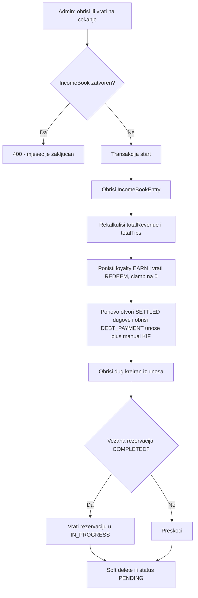

_

## Kontekst i uzrok problema

**Zašto je javna lista transformacija prazna, a slider na pojedinačnom servisu radi**

`findBeforeAfterPairs` dohvati samo `limit + 10` najnovijih COMPLETED unosa, pa tek onda u JavaScriptu filtrira one koji imaju i before i after sliku:

```633:642:backend/src/daily-log/daily-log.service.ts
const entries = await this.prisma.dailyLogEntry.findMany({
  where: { status: 'COMPLETED', ...(serviceId ? { serviceId } : {}) },
  orderBy: { completedAt: 'desc' },
  skip: offset,
  take: limit + 10,
});
```

Većina završenih unosa nema slike, pa u tih ~30 najnovijih redova nema nijednog para. Kad se filtrira po `serviceId`, kandidata je malo i pravi parovi upadnu u prozor - zato slider na `/usluge/:serviceId` radi. Dodatno je i paginacija neispravna: `hasMore: pairs.length >= limit` naspram `nextOffset: offset + entries.length`, pa infinite scroll stane prerano.

Naslovna stranica dodatno maskira problem sa `DEFAULT_BEFORE_AFTER_PAIRS` (5 hardkodiranih Unsplash slika) u [frontend/src/pages/public/PublicHome.tsx](../../frontend/src/pages/public/PublicHome.tsx).

Mobilne ekrane (`SatisfiedClientsScreen`, `HomeScreen`, `ServiceWorkGalleryScreen`, `ServiceSingleDetailScreen`) koriste isti endpoint, pa se popravljaju automatski uz backend fix.

**Stanje dnevne knjige danas**

- `DELETE` endpoint ne postoji.
- `PATCH` prima samo `actualPrice`, `tipAmount`, `notes`, `desiredLoyaltyPercent`, i hard-blokira svaki COMPLETED unos.
- `complete()` piše `IncomeBookEntry` (KIF), rekalkulira `IncomeBook.totalRevenue/totalTips`, dodjeljuje loyalty bodove (`source: daily_log:<id>`) i po potrebi zatvara rezervaciju.
- Otplata duga kreira zasebne `DEBT_PAYMENT` unose + `IncomeBookManualEntry`, ali **bez veze na izvorni unos** - zato je potrebna izmjena šeme.
- Nema `@Roles()` guarda na kontroleru; pristup se rješava kroz `ensureStylistAccess`.

## Potvrđene odluke

- Javna galerija: automatski, bez `isPublic` flaga.
- Admin (web) smije upravljati before/after slikama i na COMPLETED unosu; stilista ne smije.
- Brisanje: **soft delete** (`deletedAt`, `deletedById`, `deleteReason`); razlog obavezan za admina, opcionalan za stilistu.
- Zatvoren KIF mjesec (`IncomeBook.closedAt`) blokira brisanje i izmjenu.
- Puna reverzija: KIF stavka + totali, loyalty bodovi (clamp na 0 uz korekcijsku transakciju), dugovanja, i vraćanje rezervacije iz COMPLETED u IN_PROGRESS.
- Admin vidi obrisane kroz filter, sa opcijom vraćanja (restore).
- Stilista na mobilnoj mijenja datum, servise, klijenta, cijenu, napojnicu i napomenu - ali ne stilistu.
- Dodaju se veze u šemu za reverziju otplata duga; DEBT_PAYMENT unos se smije obrisati i vraća dug u OPEN.

## Dijagram reverzije



## Faza 0 - Šema i migracija

[backend/prisma/schema.prisma](../../backend/prisma/schema.prisma)

`DailyLogEntry` (linija 375):

```prisma
deletedAt     DateTime? @map("deleted_at")
deletedById   String?   @map("deleted_by_id")
deleteReason  String?   @map("delete_reason") @db.Text
sourceEntryId String?   @map("source_entry_id")

deletedBy     User?           @relation("DailyLogDeletedBy", fields: [deletedById], references: [id], onDelete: SetNull)
sourceEntry   DailyLogEntry?  @relation("DailyLogDebtPayments", fields: [sourceEntryId], references: [id], onDelete: SetNull)
debtPaymentEntries DailyLogEntry[] @relation("DailyLogDebtPayments")

@@index([deletedAt])
@@index([status, deletedAt])
```

`IncomeBookManualEntry` (linija 611): `dailyLogEntryId String? @map("daily_log_entry_id")` + relacija `onDelete: SetNull` + `@@index([dailyLogEntryId])`.

`DailyLogImage` (linija 428): `@@index([dailyLogEntryId, isBefore])` i `@@index([dailyLogEntryId, isAfter])` za brzo `some` filtriranje.

Migracija: `npx prisma migrate dev --name daily_log_soft_delete_and_debt_links`.

## Faza 1 - Popravka transformacija (backend + web)

**Backend** - izdvojiti javnu logiku u novi `backend/src/daily-log/daily-log-public.service.ts` (daily-log.service.ts je 686 linija, iznad limita):

```ts
const where: Prisma.DailyLogEntryWhereInput = {
  status: 'COMPLETED',
  deletedAt: null,
  kind: 'SERVICE',
  images: { some: { isBefore: true } },
  AND: [{ images: { some: { isAfter: true } } }],
  ...(serviceId ? { serviceId } : {}),
};
const total = await this.prisma.dailyLogEntry.count({ where });
```

- `take: limit`, `skip: offset`, `hasMore: offset + items.length < total`, `nextOffset: offset + items.length`.
- Novi query param `random=1`: dohvat `id`-eva svih eligible unosa, Fisher-Yates shuffle, pa `findMany` po odabranim ID-evima. Naslovna time dobija stvarni random iz svih završenih radova, a ne samo iz 20 najnovijih.
- Guard: preskoči unos ako `upload` nedostaje (defenzivno, jer je relacija obavezna).

**Frontend** - [frontend/src/pages/public/PublicHome.tsx](../../frontend/src/pages/public/PublicHome.tsx):
- Ukloniti `DEFAULT_BEFORE_AFTER_PAIRS` (linije 32-108) i lokalni shuffle; zvati `/api/daily-log/before-after?random=1&limit=6`.
- Ako je lista prazna i nije loading, ne renderovati cijelu sekciju (i link "Zadovoljni klijenti").
- [frontend/src/pages/public/PublicSatisfiedClients.tsx](../../frontend/src/pages/public/PublicSatisfiedClients.tsx) i [frontend/src/pages/public/PublicServiceDetail.tsx](../../frontend/src/pages/public/PublicServiceDetail.tsx) rade bez izmjena čim backend vrati ispravan `hasMore`/`nextOffset`.

**Provjera podataka**: prije zaključka pokrenuti kontrolni upit koliko unosa ima `status=COMPLETED` uz obje slike - ako je 0, problem je u tome što `addImage` blokira dodavanje slika na COMPLETED unos, pa su slike vezane za PENDING unose (rješava Faza 2).

## Faza 2 - Backend: puna administracija dnevne knjige

Podjela modula radi limita veličine fajla:
- `daily-log.service.ts` - core CRUD
- `daily-log-public.service.ts` - javni before/after (Faza 1)
- `daily-log-reversal.service.ts` - sve nuspojave (KIF, loyalty, dugovi, rezervacija)
- `daily-log-admin.service.ts` - admin izmjena, revert, soft delete, restore

**DTO-i**
- `UpdateDailyLogEntryDto`: dodati `date?`, `stylistProfileId?`, `serviceIds?: string[]`, `clientId?: string | null`, `status?: 'PENDING' | 'COMPLETED'`.
- Novi `delete-daily-log-entry.dto.ts`: `reason?: string`.

**Endpointi** u [backend/src/daily-log/daily-log.controller.ts](../../backend/src/daily-log/daily-log.controller.ts) (svi ispod postojećeg `before-after` da ne kolidiraju s `:id`):
- `PATCH /api/daily-log/:id` - prošireno; polja izvan `price/tip/notes` i promjena statusa dozvoljeni samo `SYSTEM_ADMIN`/`OWNER`.
- `POST /api/daily-log/:id/revert` - COMPLETED u PENDING, admin only.
- `DELETE /api/daily-log/:id` - soft delete; admin bilo koji unos (razlog obavezan), stilista samo vlastiti PENDING.
- `POST /api/daily-log/:id/restore` - admin only.
- `DELETE /api/daily-log/:id/images/:imageId` - novo.
- `addImage`: dopustiti na COMPLETED unosu samo za admina.

**Ključna pravila u servisu**
- Prije svake destruktivne operacije: `getOrCreateForMonth(year, month)` i provjera `closedAt` - ako je zatvoren, `BadRequestException('Mjesec je zaključan u KIF-u.')`. Isto vrijedi ako izmjena datuma prebacuje unos u zatvoren mjesec.
- Validacije iz `create()` (gender match servisa i klijenta, `SERVICE_REQUIRED`) izdvojiti u `daily-log.validators.ts` i reuse u `update()`.
- Izmjena servisa: obrisati i ponovo kreirati `DailyLogEntryServiceItem` te ažurirati `serviceId` (primarni = prvi).
- Izmjena COMPLETED unosa (cijena/napojnica/datum): re-sync pripadajućeg `IncomeBookEntry` i rekalkulacija totala oba pogođena mjeseca.
- `PENDING -> COMPLETED` kroz `PATCH` mora ići kroz postojeći `complete()` da se ne duplira logika.
- Cijela reverzija u `prisma.$transaction`.

**Reverzija loyalty bodova** (`daily-log-reversal.service.ts`, poziva novu metodu u `loyalty.service.ts`): pronaći `LoyaltyTransaction` sa `source = daily_log:<id>`, oduzeti EARN i vratiti REDEEM, saldo clampovan na 0, upisati korekcijsku transakciju `source = daily_log_reversal:<id>`, pa `recalculateTier`.

## Faza 3 - Filtriranje soft-deleted unosa

Dodati `deletedAt: null` na svako produkcijsko čitanje `dailyLogEntry` (8 mjesta):
- [backend/src/analytics/analytics.service.ts](../../backend/src/analytics/analytics.service.ts) linije 254 i 342
- [backend/src/stylists/stylists.service.ts](../../backend/src/stylists/stylists.service.ts) linija 343
- [backend/src/users/users.service.ts](../../backend/src/users/users.service.ts) linije 510 i 718
- [backend/src/finance/income-books.service.ts](../../backend/src/finance/income-books.service.ts) linija 436
- [backend/src/loyalty/loyalty.service.ts](../../backend/src/loyalty/loyalty.service.ts) linija 691
- `daily-log.service.ts` - `findAll` (424), `findOne` (432), javni upit

`findAll` dobija opcioni `includeDeleted` (samo admin) za web filter.

## Faza 4 - Web admin UI

[frontend/src/pages/DailyLog.tsx](../../frontend/src/pages/DailyLog.tsx) ima 910 linija - obavezan split prije dodavanja funkcionalnosti:
- `frontend/src/features/daily-log/use-daily-log.ts` - fetch, filteri, mutacije
- `frontend/src/features/daily-log/entry-table.tsx` - lista + akcije po redu
- `frontend/src/features/daily-log/entry-form-dialog.tsx` - create i edit forma
- `frontend/src/features/daily-log/entry-delete-dialog.tsx` - potvrda + razlog
- `frontend/src/features/daily-log/entry-images-panel.tsx` - upravljanje before/after slikama
- `DailyLog.tsx` ostaje tanka stranica koja slaže komponente

Funkcionalno:
- Edit dialog u edit modu prikazuje sva polja: datum, stilista, servisi (multi-select), klijent, cijena, napojnica, napomena, i **status select** (Na čekanju / Kompletiran).
- Dugme za brisanje sa obaveznim razlogom i upozorenjem da će statistika biti umanjena.
- Switch "Prikaži obrisane"; obrisani redovi sivi/precrtani, tooltip s razlogom i autorom, dugme "Vrati".
- Na mobilnom breakpointu koristiti sheet/drawer umjesto dialoga (globalno pravilo).

## Faza 5 - Mobilna aplikacija

- [mobile/src/screens/stylist/DailyLogNewEntryScreen.tsx](../../mobile/src/screens/stylist/DailyLogNewEntryScreen.tsx) (491 linija) - izdvojiti formu u `mobile/src/features/daily-log/entry-form.tsx` i dodati edit mod preko route parametra `entryId`. Bez polja za stilistu.
- [mobile/src/screens/stylist/DailyLogDetailScreen.tsx](../../mobile/src/screens/stylist/DailyLogDetailScreen.tsx) - dodati "Uredi" i "Obriši" (Alert potvrda) vidljive samo dok je `status !== 'COMPLETED'`. Za COMPLETED prikazati info da izmjenu radi administrator.
- [mobile/src/screens/stylist/DailyLogListScreen.tsx](../../mobile/src/screens/stylist/DailyLogListScreen.tsx) - refresh liste nakon brisanja.
- Transformacije na mobilnoj (`HomeScreen`, `SatisfiedClientsScreen`, `ServiceWorkGalleryScreen`) - samo provjeriti da koriste `hasMore`/`nextOffset` iz odgovora; ukloniti eventualne lokalne fallback slike po istom principu kao na webu.

## Faza 6 - Testovi i dokumentacija

- `daily-log-public.service.spec.ts`: par se vraća samo kad postoje obje slike; unos bez slika se ne pojavljuje; soft-deleted se ne pojavljuje; paginacija i `random`.
- `daily-log-admin.service.spec.ts`: brisanje briše KIF stavku i rekalkulira totale; zatvoren mjesec blokira; loyalty clamp na 0; dug se vraća u OPEN; rezervacija se vraća u IN_PROGRESS; stilista ne može obrisati COMPLETED ni tuđi unos.
- `.cursor/docs/matrices/daily-log/MATRIX.md` + `CHANGELOG.md` - FSM statusa (PENDING, COMPLETED, DELETED), ko šta smije, i tabela nuspojava po prelazu.
- `.cursor/plans/daily-log-transformacije/` sa `00_overview.md`, `01_phase-*.md`, `CHECKLIST.md`, `CHANGELOG.md`, `HANDOFF.md` (plan ima više od 3 faze).

## Redoslijed isporuke

Faza 1 je nezavisna i može ići prva kao brzi popravak vidljiv korisnicima. Faze 0, 2 i 3 idu zajedno jer dijele migraciju. Faze 4 i 5 su UI slojevi nad Fazom 2. Faza 6 se piše paralelno.
