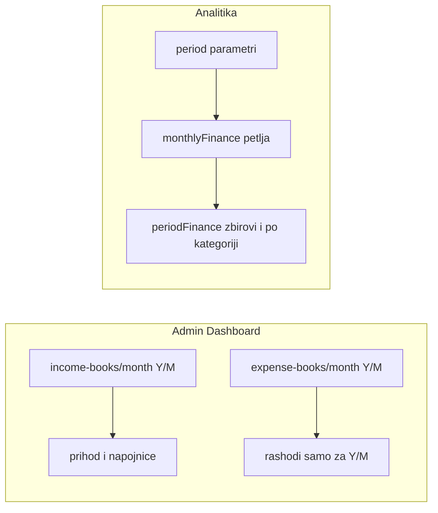

# Plan: Rashodi na Dashboardu i kartice u Analitici

## Uzrok buga (rashodi prikazani kao „ovaj mjesec”)

U [`frontend/src/pages/Dashboard.tsx`](frontend/src/pages/Dashboard.tsx) se za **prihod i napojnice** koristi knjiga za **tekuću godinu/mjesec**:

- `api.get(\`/api/income-books/month/${year}/${month}\`)`

Za **rashode** se poziva `api.get('/api/expense-books')` (rezultat se u kodu ne koristi) i `api.get('/api/expenses')` **bez** `bookId`. Prema [`backend/src/finance/expenses.service.ts`](backend/src/finance/expenses.service.ts), `findAll` bez `bookId` vraća **sve** rashode u sistemu, pa se na kartici „Rashodi (ovaj mjesec)” zapravo prikazuje **životni zbir**, uključujući unos iz 01-2025.

```94:97:frontend/src/pages/Dashboard.tsx
        const monthExpenses = allExpenses.reduce(
          (sum: number, e: any) => sum + Number(e.totalAmount || 0),
          0,
        )
```

## 1. Ispravka Dashboarda (frontend)

- U `Promise.all` **ukloniti** poziv `api.get('/api/expenses')` (i nekorišteni `api.get('/api/expense-books')` ako i dalje nije potreban).
- Dodati poziv istog obrasca kao za prihod:
  `api.get(\`/api/expense-books/month/${year}/${month}\`)`
  ([`backend/src/finance/expense-books.controller.ts`](backend/src/finance/expense-books.controller.ts) – `GET month/:year/:month` vraća knjigu sa `expenses`, vidi [`expense-books.service.ts`](backend/src/finance/expense-books.service.ts)).
- `monthExpenses` izračunati kao zbir `totalAmount` po stavkama **samo** iz te knjige (ili `0` ako nema knjige/stavki).
- Neto na kartici i dalje: `incomeThisMonth - expensesThisMonth` (usklađeno sa istim mjesecima).

## 2. Analitika – zbir za period (backend)

U [`backend/src/analytics/analytics.service.ts`](backend/src/analytics/analytics.service.ts):

- Proširiti tip [`AnalyticsDashboard`](backend/src/analytics/analytics.service.ts) novim poljem, npr. `periodFinance`, sa:
  - **Prihodi:** `servicesRevenue` (suma `totalRevenue` knjiga prihoda po mjesecima u periodu), `tips` (suma `totalTips`), `totalIncome` = zbir (ovo je „sve zajedno” za UI).
  - **Rashodi:** `expensesByCategory`: niz `{ categoryId, categoryName, total }` (grupisano po kategoriji), `totalExpenses` (suma svih rashoda u periodu – istaknuto u UI).
  - **Zarada:** `netProfit` = `totalIncome - totalExpenses`.

Implementacija bez dodatnog upita: u postojećoj petlji po `months` proširiti `include` za `expenseBook` tako da `expenses` uključuju `category` (`id`, `name`), uz `totalAmount`. Tokom petlje:

- akumulirati mape za zbir po `categoryId`;
- zadržati postojeće `monthlyFinance` (graf i tabele ostaju).

Zaokruživanje: konzistentno sa ostatkom servisa (npr. 2 decimale).

Controller ([`analytics.controller.ts`](backend/src/analytics/analytics.controller.ts)) ostaje isti – samo širi odgovor.

## 3. Analitika – UI (frontend)

U [`frontend/src/pages/Analytics.tsx`](frontend/src/pages/Analytics.tsx):

- Proširiti `AnalyticsDashboard` interfejs poljem `periodFinance`.
- Iznad ili odmah ispod kontrole **Period** dodati grid od **tri kartice** (postojeći `StatCard` ili sličan layout):
  1. **Prihodi:** redovi „Servisi (ukupno)”, „Napojnice (ukupno)”, zatim **istaknuto** „Ukupno prihodi” (`totalIncome`).
  2. **Rashodi:** lista po kategorijama (naziv + iznos), zatim **istaknuto** „Ukupno rashodi” (`totalExpenses`).
  3. **Zarada:** jedan istaknut iznos `netProfit` (prihodi − rashodi), uz kratak podnaslov da je za isti period kao graf.

Stil: postojeći Tailwind / `Card`, vizuelno naglasiti zbirne redove (npr. veći font / `font-semibold` / border-top).

## 4. Testovi

- Ažurirati [`backend/src/analytics/analytics.service.spec.ts`](backend/src/analytics/analytics.service.spec.ts): u `mockPrisma.expenseBook.findUnique` po potrebi vratiti `expenses` sa `category` i provjeriti da `periodFinance` ima očekivane zbirove za jedan mjesec.

## Sažetak tokova



Napomena: ovo pokriva **admin web** Dashboard i Analitiku; mobilni `HomeScreen` nema istu finance karticu.
