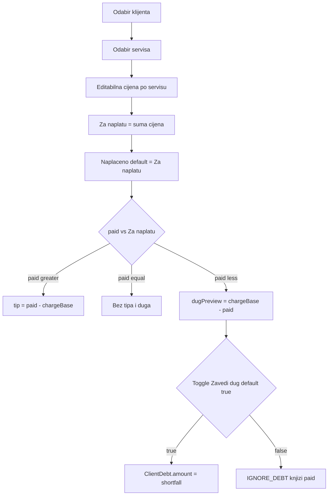

# Dugovanja + dnevna knjiga UX (nova matrica)

## KIF vs KUF

- **KIF** (`IncomeBook` / `IncomeBookEntry` / manual): ostaje jedini finansijski sink dnevne knjige. Konvencija ostaje: `amount = actualPrice − tipAmount` (prihod od servisa), `tipAmount` = napojnica. Nova matrica samo mijenja kako se računaju `actualPrice` / `tipAmount` / `ClientDebt`.
- **KUF** (`ExpenseBook`): **nema izmjena** — dnevna knjiga ne piše u rashode.

## Nova matrica kreiranja unosa (web + mobile)



### Pravila

1. Stilista bira klijenta i servise (postojeće).
2. **Svaki servis ima editabilnu cijenu** — default = katalog `Service.price`. Izmjena vrijedi samo za taj unos (snapshot).
3. **Za naplatu** = suma cijena stavki u unosu (readonly sažetak).
4. **Naplaćeno** default = Za naplatu; stilista može mijenjati.
5. `paid > Za naplatu` → `tipAmount = paid − Za naplatu`; knjiži `actualPrice = paid`.
6. `paid < Za naplatu` → prikaži **dug = Za naplatu − paid**; toggle **Zavedi dug** default `true`:
   - `true` → `CREATE_DEBT` s `debtAmount = shortfall`
   - `false` → `IGNORE_DEBT`, knjiži samo `paid` (svjesno manje, bez duga)
7. Nema dijaloga na 0; nema ručnog polja “Visina duga” — visina = shortfall.

### Primjer

| Korak | Vrijednost |
|-------|------------|
| Šišanje | 10 |
| Farbanje | 30 → stilista mijenja u **40** |
| Za naplatu | **50** |
| Naplaćeno 50 | OK, tip 0 |
| Naplaćeno 60 | servisi 50, tip 10 |
| Naplaćeno 40 | dug preview 10; toggle true → dug 10; false → knjiži 40 bez duga |

### Šema

[`DailyLogEntryServiceItem`](backend/prisma/schema.prisma) danas nema cijenu — dodati:

```prisma
unitPrice Decimal @map("unit_price") @db.Decimal(10, 2)
```

Migracija backfill: `unit_price = services.price` join po `service_id`.

DTO create/update: `items: { serviceId, unitPrice }[]` (ili `serviceIds` + `unitPrices` map). Primary `serviceId` i dalje prvi item.

Loyalty (ako aktivan): `chargeBase = max(0, sum(unitPrices) − loyaltyDiscount)`; tip/shortfall se računa vs taj `chargeBase`.

## Faza 1 — Pretraga klijenata (web)

Web load: `GET /api/users/for-daily-log` umjesto `/api/users?pageSize=500` ([use-daily-log-data.ts](frontend/src/features/daily-log/use-daily-log-data.ts)).

## Faza 2 — UI + backend nove matrice

**Web:** [entry-form-fields.tsx](frontend/src/features/daily-log/entry-form-fields.tsx), [use-daily-log-form.ts](frontend/src/features/daily-log/use-daily-log-form.ts)

- Lista odabranih servisa s number inputom cijene po redu.
- Sažetak Za naplatu; Naplaćeno (sync default kad se mijenjaju cijene/servisi, dok korisnik nije ručno override-ao — flag `paidTouched`).
- Ako shortfall &gt; 0: prikaži iznos duga + Switch “Zavedi dug” (default on).
- Preview napojnice kad paid &gt; chargeBase.
- Ukloniti `DailyLogPartialDialog` / `partialOpen`.

**Mobile:** [DailyLogNewEntryScreen.tsx](mobile/src/screens/stylist/DailyLogNewEntryScreen.tsx) — isti UX.

**Backend:** [daily-log.service.ts](backend/src/daily-log/daily-log.service.ts)

- Snimi `unitPrice` po itemu.
- `chargeBase = sum(unitPrice) − loyalty`.
- `tipAmount = max(0, paid − chargeBase)`.
- `actualPrice = paid`.
- `CREATE_DEBT` → `ClientDebt.amount = chargeBase − paid` (samo ako toggle on i shortfall &gt; 0); zahtijeva `clientId`.
- `IGNORE_DEBT` inače.

**KIF pri complete:** i dalje `amount = getServiceAmount(actualPrice, tipAmount)`, `tipAmount` sa unosa. Za `paid=40`, `chargeBase=50`, IGNORE: tip 0, KIF amount 40. Za CREATE_DEBT isto KIF 40 + OPEN dug 10.

## Faza 3 — Naplata otvorenih dugova u istom obrascu

UI (ne odvojeni wizard):

1. Poruka ako klijent ima OPEN dugove (ukupan iznos + broj).
2. Toggle **Naplati dug** (default off, ili on ako `payDebtsIntent` s rezervacije).
3. Kad je on: checkbox lista dugova; označeni dug ulazi u **listu stavki** kao readonly red: `Naplata dugovanja · #ref · datum · iznos` (nije editabilna cijena).
4. **Za naplatu** = suma editabilnih servisa + suma označenih dugova.
5. **Naplaćeno** default = nova Za naplatu; tip / shortfall / Zavedi dug toggle — ista matrica kao Faza 2 (shortfall stvara **novo** dugovanje, settle starih je odvojeno).

### Backend raspodjela (2 knjiženja, 1 forma)

Da se sačuva audit (`DEBT_PAYMENT`, `debtId`, KIF manual):

1. Validacija: `paid >= sum(selectedDebtAmounts)` (stara dugovanja se zatvaraju u punom iznosu).
2. Za svaki selected debt → postojeći `settleDebtsAndCreateLedgerEntries`: `actualPrice = debt.amount`, `tipAmount = max(0, amount − service.price)` na DEBT_PAYMENT / manual KIF.
3. Ostatak `paidServices = paid − sum(debts)` ide na novi SERVICE unos s `unitPrice` stavkama; tip/shortfall vs `sum(unitPrices)−loyalty` po Fazama 2.
4. `sourceEntryId` povezuje DEBT_PAYMENT → SERVICE unos.

Ako `paid < sum(debts)` → greška “Nedovoljno za naplatu označenih dugova”.

## Faza 4 — Namjera plaćanja duga na rezervaciji

- `Reservation.payDebtsIntent Boolean @default(false)`.
- Klijent pri bookingu: checkbox “Plaćam i dugovanje”.
- Stilista na detailu: badge + default **Naplati dug** on + svi OPEN preselected (može odčekirati).
- Complete/from-reservation koristi Fazu 3 matricu.

## Faza 5 — Klijentski UX (mobile)

- Profil: lista OPEN dugova.
- Početna: banner.
- In-app + push tip `client_debt` pri CREATE_DEBT.
- Rezervacija: Faza 4.

## Faza 6 — Matrica + testovi

- [`.cursor/docs/matrices/client-debts/MATRIX.md`](.cursor/docs/matrices/client-debts/MATRIX.md): unitPrice, Za naplatu/Naplaćeno, tip, shortfall toggle, settle linije, KIF mapping, KUF N/A.
- Update daily-log MATRIX.
- Testovi: edit farbanje 30→40; paid 60 tip 10; paid 40 + debt toggle; settle + services u jednoj formi; KIF amount excludes tip.

## Van obima

- Admin dashboard Početna.
- Izmjena iznosa već kreiranog `ClientDebt.amount`.
- KUF / expense books.
