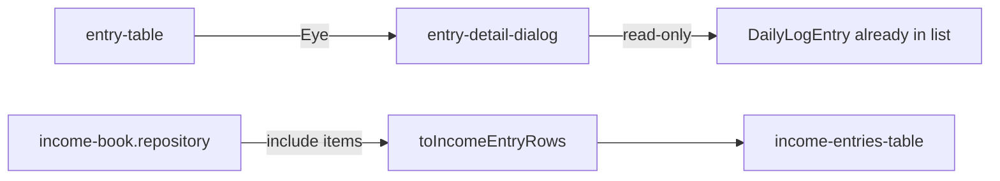

# Detail dialog (dnevna knjiga) + multi-servis u KIF

## Kontekst

- Lista admin dnevne knjige već ima multi-servis label + dugove u tabeli; **nema** detail view (handoff: “opcionalno expand/drawer”).
- Workbook detail (`[workbook-detail-page.tsx](frontend/src/features/stylist-workbook/pages/workbook-detail-page.tsx)`) je referentni sadržaj: lista servisa + cijene, naplata dugova, ukupno.
- KIF detail API trenutno include-a samo `dailyLogEntry.service` (`[income-book.repository.ts](backend/src/finance/repositories/income-book.repository.ts)` L60–72) → frontend mapira jedan naziv (`[income-entries.helpers.ts](frontend/src/features/finance/income/income-entries.helpers.ts)` L27).

**UX odluka:** otvaranje detalja preko **Eye** dugmeta u akcijama (isti pattern kao rashodi). Dialog na desktopu / drawer na mobitelu — isti pristup kao `[entry-form-dialog.tsx](frontend/src/features/daily-log/entry-form-dialog.tsx)`.




---

## 1) Admin dnevna knjiga — detail dialog

**Novi fajl:** `frontend/src/features/daily-log/entry-detail-dialog.tsx` (~100–150 linija)

Sadržaj (read-only, podaci već u listi — bez novog API poziva):

- Naslov: `publicReferenceCode` (fallback datum)
- Meta: datum, stilista, klijent, izvor (Ručno/Rezervacija), status (+ razlog brisanja ako `deletedAt`)
- **Servisi:** lista `items` (ime + `unitPrice`); fallback na legacy `service`
- **Naplata dugovanja:** `debtPaymentEntries` (ime + iznos + datum duga)
- **Iznosi:** servisi / dugovi / napojnica / **Ukupno** (`amounts.ts` helpers)
- Loyalty linija ako postoji; bilješke ako postoje

**Wiring:**

- `[entry-table-actions.tsx](frontend/src/features/daily-log/entry-table-actions.tsx)` — dodati `onView` + Eye dugme (prvo u redu akcija)
- `[entry-table.tsx](frontend/src/features/daily-log/entry-table.tsx)` — prop `onView`
- `[DailyLog.tsx](frontend/src/pages/DailyLog.tsx)` — state `detailEntry`, render dialoga

Ne dirati edit/complete/delete tokove.

---

## 2) Knjiga prihoda — svi servisi u koloni Servis

**Backend** (`[income-book.repository.ts](backend/src/finance/repositories/income-book.repository.ts)` `findDetail`):

```ts
dailyLogEntry: {
  include: {
    service: true,
    items: { include: { service: true }, orderBy: { sortOrder: 'asc' } },
    stylistProfile: { include: { user: true } },
    client: { select: { ... } },
  },
}
```

**Frontend:**

- `[finance.types.ts](frontend/src/features/finance/finance.types.ts)` — `IncomeEntry.dailyLogEntry` proširiti sa `items?: Array<{ service?: { name: string } }>`
- `[income-entries.helpers.ts](frontend/src/features/finance/income/income-entries.helpers.ts)` — helper `resolveIncomeServiceLabel(dailyLogEntry)`: sva imena iz `items`, fallback `service.name`; `serviceName` = full join (`,` ) za sort/search
- `[income-entries-table.tsx](frontend/src/features/finance/income/income-entries-table.tsx)` — u ćeliji Servis prikazati **stacked listu** imena (kao preview u rashodima), ne jedan string; `title` = full label

Ručni unosi ostaju jedan servis (bez promjene).

---

## 3) Matrica / handoff (kratko)

- Ažurirati `[.cursor/docs/matrices/daily-log/CHANGELOG.md](.cursor/docs/matrices/daily-log/CHANGELOG.md)` — admin detail dialog
- Ažurirati HANDOFF next-steps u `[.cursor/plans/debt_ux_daily_log_3e00e5c1/HANDOFF.md](.cursor/plans/debt_ux_daily_log_3e00e5c1/HANDOFF.md)` — označiti ove stavke urađenim

---

## Van obima

- Workbook new-entry usklađivanje s matricom
- KUF / migracije
- Novi API endpoint za detail (nije potreban)
