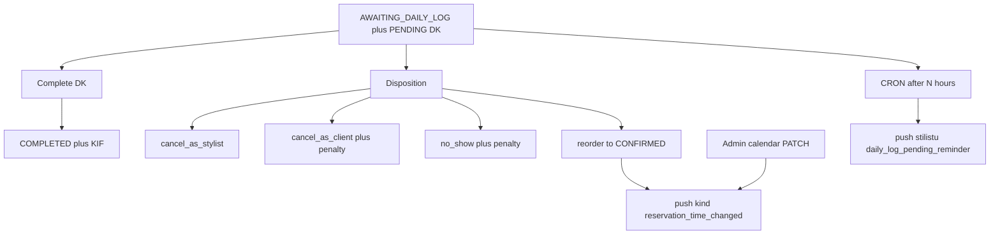

# Direct disposition polish (B + calendar notify)

**ID:** `direct-disposition` (POLICY_BACKLOG #2)
**Odluka (Ask):** opcija B — UX/copy + reminder, **bez** auto-timeouta. Kalendar `PATCH` notify **ulazi**.

Nakon odobrenja: prvo upisati `.cursor/plans/direct-disposition/` (`00_overview.md`, `01_phase-*.md`, `CHECKLIST.md`, `CHANGELOG.md`, `HANDOFF.md`) i u [POLICY_BACKLOG.md](../docs/reservations/POLICY_BACKLOG.md) status `planned` + link. **Bez koda u ovom runu.**

## Scope

Ulazi:
- Copy + hijerarhija complete vs izuzeci; ukloniti `discard` iz UI
- Web reorder + datum (`targetDate`)
- Push klijentu na **disposition reorder** i na **admin calendar PATCH** (isti informational kind)
- Reminder stilistu za stuck PENDING DK (setting, jednokratno, bez zatvaranja)

Ne ulazi:
- Auto-timeout / auto-dispose
- Klijentski prikaz `AWAITING_DAILY_LOG` (mobile i dalje sakriva; raspored → DK ostaje)
- Standardni stylist reorder (već ima propose + push)
- `multi-booking`, `attendance-policy`, slot-hold

## Tok

---

## Phase 1 — UX/copy

Fajlovi:
- [frontend/src/features/stylist-workbook/components/daily-log-disposition-panel.tsx](../../frontend/src/features/stylist-workbook/components/daily-log-disposition-panel.tsx)
- [frontend/src/features/stylist-workbook/api/stylist-workbook.api.ts](../../frontend/src/features/stylist-workbook/api/stylist-workbook.api.ts)
- [mobile/src/screens/stylist/DailyLogDispositionPanel.tsx](../../mobile/src/screens/stylist/DailyLogDispositionPanel.tsx)
- [mobile/src/screens/stylist/disposition-action-menu-modal.tsx](../../mobile/src/screens/stylist/disposition-action-menu-modal.tsx)

Akcije u UI (bez `discard`):
- `cancel_as_stylist` — otkaz salona, bez kazne, klijent dobija push
- `cancel_as_client` — otkaz u ime klijenta, **kazna**; dialog to kaže
- `no_show` — no-show, **kazna**; dialog to kaže
- `reorder` — odmah novi slot, klijent **ne** potvrđuje; dobija informational push

`discard` ostaje u DTO/API kao alias `cancel_as_stylist` (nema breaking change). UI ga ne nudi. Penalty toggle se **ne** dodaje — default ostaje `true` za client cancel / no-show; samo copy.

Panel copy: naplata = postojeće dugme **Završi zapis**; disposition = izuzeci (termin se nije desio / treba drugi slot).

Web reorder: date input + `targetDate` u API (mobile već šalje). Ako panel preraste ~150 linija, izvući labele/copy u `disposition-copy.ts` pored panela.

Status label `Na čekanju (dnevnik)` ostaje za staff/admin; klijentski CTA se ne dodaje.

---

## Phase 2 — Client notify (disposition + calendar)

Shared helper u [backend/src/reservations/reservation-notify.service.ts](../../backend/src/reservations/reservation-notify.service.ts):

`notifyClientTimeChanged` — `type: reservation_reminder`, `data.kind: reservation_time_changed`.

Copy: `Termin je pomjeren na {datum} {start}–{end}. Nije potrebna vaša potvrda.`

**Ne** koristiti `kind: reservation_reorder` (to je propose + accept/decline).

Pozivi:
1. [backend/src/daily-log/daily-log-disposition-apply.ts](../../backend/src/daily-log/daily-log-disposition-apply.ts) — `applyDirectReorder` (web workbook i mobile DK, isti API)
2. [backend/src/reservations/reservation-update.service.ts](../../backend/src/reservations/reservation-update.service.ts) — `updateByAdmin` samo ako se `reservationDate` / `startTime` / `endTime` stvarno promijene. Kalendar: [frontend/src/pages/ReservationsCalendar.tsx](../../frontend/src/pages/ReservationsCalendar.tsx) (`PATCH /api/reservations/:id`). Frontend kalendara se ne mijenja.

Uz push: `emitToUser(clientId, reservation:updated)` u `updateByAdmin` (danas ide samo adminima).

Mobile: [mobile/src/utils/resolve-push-route.ts](../../mobile/src/utils/resolve-push-route.ts) — dodati `reservation_time_changed` u `CLIENT_RESERVATION_KINDS`.

---

## Phase 3 — Reminder (nema auto-timeout)

Setting: `system_reservation_daily_log_reminder_hours` — PRIVATE number, default **12**, min 1, max 168. Registry: [backend/src/settings/settings-registry.ts](../../backend/src/settings/settings-registry.ts). Čitanje pored inbox sati u [backend/src/reservations/reservation-date.service.ts](../../backend/src/reservations/reservation-date.service.ts).

U [frontend/src/pages/Settings.tsx](../../frontend/src/pages/Settings.tsx) grupa `system_reservation_*` (attendance, inbox timeout, ovaj reminder) s opisima.

Prisma: `DailyLogEntry.pendingReminderSentAt` (`pending_reminder_sent_at`) — jednokratni reminder, kao `delayNotifiedAt`. Migracija preko Prisma workflow.

CRON u [backend/src/reservations/reservation-direct-daily-log-cron.service.ts](../../backend/src/reservations/reservation-direct-daily-log-cron.service.ts) (fajl je kratak; nova metoda, ne novi servis dok ne pređe ~150 linija):

Uvjeti: DK `PENDING`, `deletedAt` null, `pendingReminderSentAt` null, `createdAt <= now − N h`, rezervacija `AWAITING_DAILY_LOG`.

Akcija: push **potvrđenom stilistu** (`kind: daily_log_pending_reminder`), deep-link `/stylist/daily-log/detail/[entryId]`. Upisati `pendingReminderSentAt`. **Ne** mijenjati status, **ne** dispose, **ne** kazna.

Tick: [backend/src/reservations/reservation-delay.cron.ts](../../backend/src/reservations/reservation-delay.cron.ts) + tanki wrap na facade [backend/src/reservations/reservations.service.ts](../../backend/src/reservations/reservations.service.ts).

---

## Phase 4 — Docs + testovi

- [`.cursor/docs/reservations/RESERVATION_MODULE.md`](../docs/reservations/RESERVATION_MODULE.md) §6.5 / notifikacije / CRON
- [`.cursor/docs/matrices/reservations/MATRIX.md`](../docs/matrices/reservations/MATRIX.md) + `CHANGELOG.md`
- POLICY_BACKLOG → `done` kad implementacija prođe

Testovi:
- `applyDirectReorder` šalje `reservation_time_changed`
- `updateByAdmin` šalje samo kad se vrijeme/datum promijeni
- reminder CRON: jednom, samo AWAITING + PENDING, bez status change

---

## Defaults

- Reminder: 12h od `DailyLogEntry.createdAt`
- Penalty na client-cancel / no-show: i dalje default true (samo copy)
- Klijent ne vidi `AWAITING_DAILY_LOG` na mobileu
