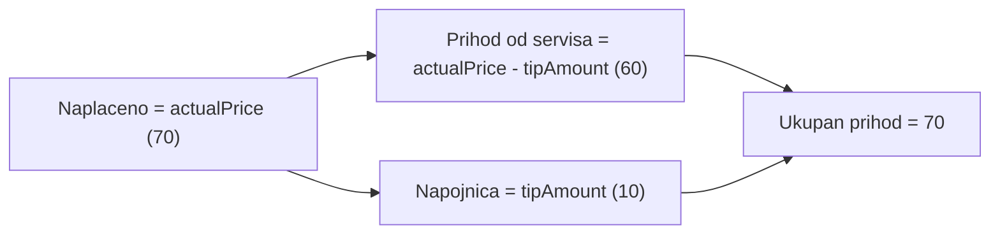

# Dnevna knjiga - provjera i refaktor

## Kljucni nalaz: konvencija za novac

Iz [backend/src/daily-log/daily-log.service.ts](backend/src/daily-log/daily-log.service.ts) i frontend forme, model je:

- `actualPrice` = ukupno naplaceno (napojnica je **ukljucena**)
- `tipAmount` = dio koji je napojnica
- Prihod od servisa = `actualPrice - tipAmount`

Primjer iz zahtjeva: servis 60 KM, klijent platio 70 KM, `actualPrice = 70`, `tipAmount = 10`, prihod od servisa = 60, ukupan prihod = 70.

Tabela sada u koloni "Cijena" prikazuje `actualPrice` (70) pored "Napojnica" `tipAmount` (10), sto vizualno duplo racuna napojnicu. To je bug u prikazu, ne u podacima.



## Bug u KIF-u (isti korijen)

Cijeli finance modul tretira `amount` kao prihod od servisa **bez** napojnice: [frontend/src/features/finance/tabs/income-books-tab.tsx](frontend/src/features/finance/tabs/income-books-tab.tsx) racuna `paidAmount = amount + tipAmount` (linija 226) i ukupno kao `totalRevenue + totalTips` (linije 420, 1051). Rucni KIF unosi to postuju (`amount = min(paidAmount, servicePrice)`).

Ali auto stavke iz dnevne knjige upisuju `amount = actualPrice`, sto vec sadrzi napojnicu:

```467:475:backend/src/finance/income-books.service.ts
    const created = await this.prisma.incomeBookEntry.create({
      data: {
        bookId: book.id,
        dailyLogEntryId,
        amount: entry.actualPrice,
        tipAmount: entry.tipAmount,
        date: entry.date,
      },
    });
```

Isto i u `syncIncomeBookEntry` ([backend/src/daily-log/daily-log-reversal.service.ts](backend/src/daily-log/daily-log-reversal.service.ts), linije 76 i 85). Posljedica: KIF prikazuje 70 + 10 = 80 KM umjesto 70, a `IncomeBook.totalRevenue` je naduvan za sumu svih napojnica.

## Faza 1: Backend - ispravka KIF konvencije

- [backend/src/finance/income-books.service.ts](backend/src/finance/income-books.service.ts) linija 471 - `amount: Number(entry.actualPrice) - Number(entry.tipAmount)`.
- [backend/src/daily-log/daily-log-reversal.service.ts](backend/src/daily-log/daily-log-reversal.service.ts) linije 76 i 85 - isto u create i update granama `syncIncomeBookEntry`.
- Izvuci helper `getServiceAmount(entry)` u [backend/src/daily-log/daily-log.validators.ts](backend/src/daily-log/daily-log.validators.ts) da se pravilo ne duplira na tri mjesta.
- Nova migracija `backend/prisma/migrations/<ts>_fix_income_book_entry_amount_excludes_tip/migration.sql` (samo data-fix, bez promjene seme):

```sql
UPDATE income_book_entries SET amount = amount - tip_amount WHERE tip_amount > 0;

UPDATE income_books b SET
  total_revenue = (SELECT COALESCE(SUM(amount), 0) FROM income_book_entries WHERE book_id = b.id)
                + (SELECT COALESCE(SUM(amount), 0) FROM income_book_manual_entries WHERE book_id = b.id),
  total_tips    = (SELECT COALESCE(SUM(tip_amount), 0) FROM income_book_entries WHERE book_id = b.id)
                + (SELECT COALESCE(SUM(tip_amount), 0) FROM income_book_manual_entries WHERE book_id = b.id);
```

Korekcija ide i na zatvorene knjige (potvrdeno). Migracija je one-shot; guard `tip_amount > 0` sprjecava besmislene update-ove ali NIJE idempotentna pa se ne smije rucno re-run.

## Faza 2: Frontend - novi helperi

- `frontend/src/features/daily-log/amounts.ts` (novo, oko 25 linija) - jedini izvor istine:
  - `getServiceAmount(e)` = `Number(e.actualPrice) - Number(e.tipAmount)` (clamp na 0)
  - `getTipAmount(e)`, `getTotalAmount(e)`
  - `sumEntryTotals(entries)` vraca `{ total, services, tips }`
- `frontend/src/features/daily-log/date-range.ts` (novo, oko 15 linija) - `getCurrentMonthRange()` vraca `{ fromDate: 'YYYY-MM-01', toDate: danas }`, po lokalnom vremenu (ne `toISOString`, da dan ne pobjegne zbog UTC-a).

## Faza 3: Frontend - kartice i inicijalni filter

- `frontend/src/features/daily-log/entry-stats.tsx` (novo) - `StatMini` (premjesten iz `DailyLog.tsx`) + `DailyLogStats` sa 4 kartice: **Ukupan prihod**, **Prihod od servisa**, **Napojnice**, **Kompletirano**. Racuna se preko `sumEntryTotals` nad aktivnim (ne-obrisanim) unosima, ukljucujuci i PENDING i COMPLETED (potvrdeno).
- `frontend/src/features/daily-log/entry-filters.tsx` (novo) - filter bar (od/do datuma, stilista, "Prikazi obrisane", Resetuj), izvucen iz [frontend/src/pages/DailyLog.tsx](frontend/src/pages/DailyLog.tsx) linije 351-398. "Resetuj" vraca na tekuci mjesec, ne na prazno.
- [frontend/src/pages/DailyLog.tsx](frontend/src/pages/DailyLog.tsx) - `fromDate`/`toDate` se inicijalizuju iz `getCurrentMonthRange()` umjesto `''` (linije 61-62).

## Faza 4: Frontend - tabela

[frontend/src/features/daily-log/entry-table.tsx](frontend/src/features/daily-log/entry-table.tsx):

- Desktop: kolona `Cijena` koristi `getServiceAmount(e)`, `Napojnica` ostaje `tipAmount`, dodaje se kolona `Ukupno` sa `actualPrice` (bold), da red sam objasnjava 60 + 10 = 70. `colSpan={9}` postaje `10`.
- Mobile kartica (linija 158): umjesto samo `actualPrice`, prikazati razbijeno `60.00 + 10.00 nap. = 70.00 KM`, napojnicu samo kad je veca od 0.
- [frontend/src/features/daily-log/entry-form-fields.tsx](frontend/src/features/daily-log/entry-form-fields.tsx) linija 230 - ispod "Za naplatu" dodati zivi preview napojnice kad je `paidAmount > chargeAmount` (`Napojnica: X KM`), da admin vidi raspodjelu prije snimanja.

## Faza 5: Refaktor za budzet linija

`DailyLog.tsx` je trenutno 465 linija (limit je 200). Uz izdvajanje iz faza 3-4, dodatno izvuci u `frontend/src/features/daily-log/`:

- `use-daily-log-data.ts` - stanje filtera, `loadData`, lookupi (stilisti/servisi/klijenti)
- `use-loyalty-preview.ts` - loyalty fetch effect (linije 126-149)
- `use-daily-log-form.ts` - form state, open/edit, `paidAmount`, `handleSave` i partial-payment tok
- `use-daily-log-mutations.ts` - `handleComplete` / `handleDelete` / `handleRestore` i stanje delete dijaloga
- `entry-partial-dialog.tsx` - dijalog "Naplacuje se manje..." (linije 440-461)

`DailyLog.tsx` ostaje thin kompozicija (oko 110 linija). Bez promjene ponasanja - ciste ekstrakcije.

## Faza 6: Testovi i dokumentacija

- Unit test za `getServiceAmount` / `sumEntryTotals` (slucaj 60/10/70, napojnica 0, djelimicna naplata s dugom).
- Backend test da `addEntryFromDailyLog` upisuje `amount` bez napojnice i da `recalculateTotals` daje `totalRevenue + totalTips` jednako stvarno naplacenom.
- Update `.cursor/docs/matrices/daily-log/MATRIX.md` (sekcija o novcu: definicije ukupno / servis / napojnica) i upis u `.cursor/docs/matrices/daily-log/CHANGELOG.md`.

## Van obima

Analitika stilista i dashboard sumiraju `actualPrice` kao ukupan prihod, sto ostaje ispravno po novoj konvenciji (ukupno = naplaceno) i ne mijenja se.
