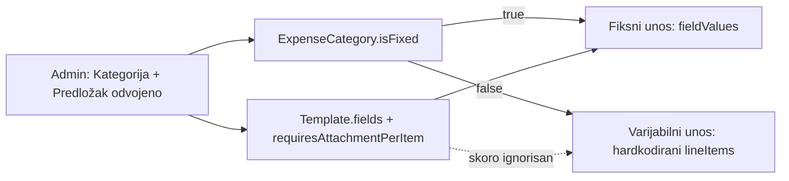

# Modularne kategorije rashoda (KUF)

## Cilj

Administrator može kreirati **bilo koju** kategoriju rashoda i sam definisati:

- **mod**: fiksne stavke (Doprinosi) ili varijabilni redovi (Materijal/Ostalo)
- **template polja/kolone** po želji (npr. naziv+količina+cijena, ili naziv+količina+jedinična cijena)
- **politiku priloga**: po stavci / po liniji / na cijeli rashod

Postojeći rashodi u bazi **ostaju čitljivi i validni** (legacy adapter).

## AS-IS (kratko) — zašto je zbunjujuće

Danas su u UI **dvije odvojene kartice** (`[expense-categories-tab.tsx](frontend/src/features/finance/catalog/expense-categories-tab.tsx)`): Kategorije + Predlošci.

| Entitet                   | Odgovornost                         |
| ------------------------- | ----------------------------------- |
| `ExpenseCategoryTemplate` | polja + `requiresAttachmentPerItem` |
| `ExpenseCategory`         | naziv + `isFixed` + `templateId`    |

Unos rashoda već radi:

- `isFixed=true` → `[FixedFieldsEditor](frontend/src/features/finance/expense/fixed-fields-editor.tsx)` + `fieldValues`
- `isFixed=false` → `[LineItemsEditor](frontend/src/features/finance/expense/line-items-editor.tsx)` sa **hardkodiranim** `{name, qty, price}` u `notes` JSON (`[expense-notes.ts](frontend/src/features/finance/expense/expense-notes.ts)`)

Predložak se za varijabilne kategorije skoro ne koristi — zato admin UX “ne prati” mentalni model.

## Zaključane odluke

1. **Bez brisanja postojećih rashoda** — samo additive schema + legacy read path.
2. **DB zadržava Category ↔ Template** (FK na postojećim `Expense.categoryId`); UX ih tretira kao **jedan koncept** (wizard ispod haube kreira/ažurira oba).
3. **Template fields pokreću oba moda**:
  - fiksni: jedno polje = jedna stavka rashoda (kao sad)
  - varijabilni: polja = **kolone svakog reda**
4. `**lineRole` na polju** (nova kolona) za total:
  - `LABEL` | `QTY` | `UNIT_PRICE` | `AMOUNT` | `NONE`
  - pravilo totala reda: ako postoje `QTY`+`UNIT_PRICE` → `qty×unitPrice`; else ako `AMOUNT` → taj iznos; else suma `CURRENCY` vrijednosti
5. **Skladištenje varijabilnih redova**: versionirani JSON u `Expense.notes` (`v: 2`, values po `fieldId`) + adapter za legacy `v1` `{name,qty,price}`. Relacione tabele za line items **ne** u ovoj iteraciji (manji rizik, brži rollback).
6. **Prilozi**: zadržati filename matching u ovoj iteraciji; u AS-IS dokumentovati kao poznati dug. Jak FK (`fieldId`/`lineItemId`) = follow-up.

## Faze (folder plana)

Plan ide u `[.cursor/plans/expense-categories-modular/](.cursor/plans/expense-categories-modular/)` sa `00_overview.md`, phase fajlovima, `CHECKLIST.md`, `CHANGELOG.md`, `HANDOFF.md`.

### Faza 0 — AS-IS snapshot + rollback tačka

Deliverable (dokumentacija, bez promjene ponašanja):

- `.cursor/docs/matrices/finance/EXPENSE_CATEGORIES_AS_IS.md` — modeli, API, UI tokovi, Doprinosi vs Materijal, gdje žive podaci, poznati dugovi
- Update `[.cursor/docs/matrices/finance/MATRIX.md](.cursor/docs/matrices/finance/MATRIX.md)` + `CHANGELOG.md` (sekcija “snapshot”)
- Rollback checklist: koje tabele ne dirati, kako vratiti FE/BE na prethodni commit, da se ne radi migrate down na produkcijskim rashodima

### Faza 1 — Category-centric admin UX (bez schema)

U `[catalog/](frontend/src/features/finance/catalog/)`:

- Jedna lista **Kategorije** (ne dvije kartice kao primarni UX)
- Wizard/dijalog **Nova/Uredi kategoriju**:
  1. Naziv, opis, aktivna
  2. Mod: Fiksne stavke / Varijabilni redovi (`isFixed`)
  3. Prilozi: po stavci vs na cijeli rashod (`requiresAttachmentPerItem` na templateu)
  4. Polja templatea inline (za fiksni mod: naziv, tip, default, obavezno)
- Ispod haube: create/update `ExpenseCategoryTemplate` + `ExpenseCategory` (postojeći API)
- Pregled kategorije: badge moda, broj polja, politika priloga, lista polja — bez “traži drugi karton Predlošci”
- Predlošci kao odvojen UI ukloniti iz primarnog toka (ili “Napredno” samo ako treba)

### Faza 2 — Schema + backend za modularne kolone

Prisma (`[schema.prisma](backend/prisma/schema.prisma)`):

- `ExpenseTemplateField.lineRole String @default("NONE")` (`LABEL|QTY|UNIT_PRICE|AMOUNT|NONE`)
- Migracija additive only

Backend:

- DTO + templates service: create/update field sa `lineRole`; update postojećeg polja (rename/default/role/required) gdje je bezbedno
- Validacija varijabilnog unosa: `lineItems[].values` moraju odgovarati template field IDs; obavezna polja; total iz `lineRole` pravila
- `[expenses.service.ts](backend/src/finance/expenses.service.ts)`: za `!isFixed` validirati line payload (ne ignorisati template); za `isFixed` zadržati `assertFieldValuesMatchTemplate`
- Helperi: `parseExpenseNotes` / serialize v2 + **legacy v1 → v2 view model** (mapiranje `name/qty/price` preko `lineRole` na trenutnom templateu kategorije)
- Testovi: field-values + notes parse/serialize + create variable expense

### Faza 3 — Dinamički unos u knjizi rashoda

Frontend:

- Zamijeniti hardkodirani `[LineItemsEditor](frontend/src/features/finance/expense/line-items-editor.tsx)` editorom kolona iz `category.template.fields` (sortOrder)
- Total reda/računa iz `lineRole` (isti helper kao backend, shared shape)
- Fiksni editor ostaje; admin može dodavati/mijenjati default vrijednosti kroz kategoriju
- Attachment UX: copy usklađen s politikom templatea (per-item vs bulk)
- Edit postojećeg Materijal rashoda: legacy notes → prikaz u novom editoru bez gubitka

### Faza 4 — Matrica, regresija, seed/bootstrap postojećih kategorija

- Ažurirati finance MATRIX (TO-BE pravila: modovi, lineRole, notes v2, legacy)
- Smoke: kreiraj novu fiksnu kategoriju; novu varijabilnu s drugim kolonama; otvori stari Doprinosi/Materijal rashod
- Opciono: jednokratni admin script/upute da postojeći Materijal template dobije polja sa `lineRole` LABEL/QTY/UNIT_PRICE (bez rewrite-a starih `notes` u DB — read adapter dovoljan)

## Van opsega (explicit follow-up)

- Relacioni `ExpenseLineItem` model
- FK veza priloga na field/line (umjesto filename match)
- Brisanje kategorije/templatea (ostaje soft `isActive`)
- Drag-reorder polja (može kasnije; `sortOrder` već postoji)

## Ključni fajlovi

- FE catalog: `[expense-categories-tab.tsx](frontend/src/features/finance/catalog/expense-categories-tab.tsx)`, `[category-dialog.tsx](frontend/src/features/finance/catalog/category-dialog.tsx)`, `[template-fields-editor.tsx](frontend/src/features/finance/catalog/template-fields-editor.tsx)`
- FE expense: `[line-items-editor.tsx](frontend/src/features/finance/expense/line-items-editor.tsx)`, `[expense-notes.ts](frontend/src/features/finance/expense/expense-notes.ts)`, `[use-expense-form.ts](frontend/src/features/finance/expense/use-expense-form.ts)`
- BE: `[expense-templates.service.ts](backend/src/finance/expense-templates.service.ts)`, `[expenses.service.ts](backend/src/finance/expenses.service.ts)`, `[schema.prisma](backend/prisma/schema.prisma)`
- Matrica: `[.cursor/docs/matrices/finance/](.cursor/docs/matrices/finance/)`
