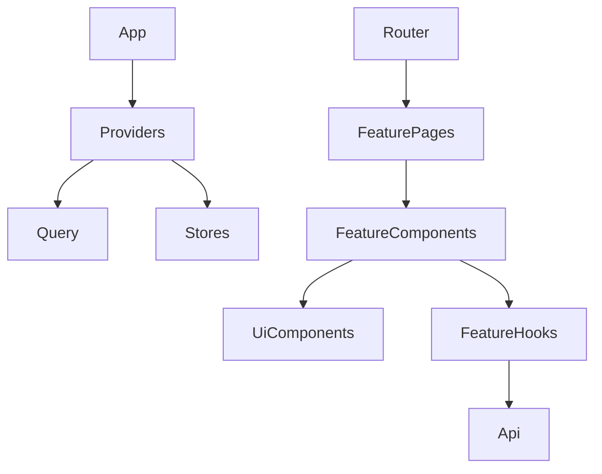

## Cilj
- Potpuno ukloniti Chakra UI iz `frontend/` (bez `@chakra-ui/*`, bez Chakra provider-a, bez Chakra komponenti).
- UI standard: Tailwind + shadcn/ui (Radix primitives, `cn`, CSS vars), i `sonner` za toast.
- Arhitektura: feature-based (`src/features/*`) + TanStack Query za server state + Zustand za auth/settings/theme/locale.
- Ograničenje: **svaki fajl <100 LOC** (razbijanje na `components/*`, `hooks/*`, `api/*`, `types.ts`, `constants.ts`).

---

## Lista planiranih izmjena po fajlovima (high-signal)

### 1) Foundation: Tailwind + shadcn/ui + tokens (bez uklanjanja Chakra još)
- `[frontend/src/index.css](frontend/src/index.css)`
  - Proširiti u `globals.css` sadržaj (Tailwind layers + shadcn CSS vars za light/dark).
  - Uvesti CSS varijable za brand (mapirati postojeće `brand.*` iz Tailwind config).

- `[frontend/tailwind.config.js](frontend/tailwind.config.js)`
  - Standardizovati palette + dodati `darkMode: ['class']`.

- Novi fajlovi:
  - `src/styles/globals.css` (Tailwind + shadcn tokens)
  - `src/lib/cn.ts` (klase merge)
  - `src/components/ui/*` (shadcn komponenta set: `button`, `input`, `textarea`, `select`, `dialog`, `dropdown-menu`, `tabs`, `sheet`, `table`, `badge`, `card`, `separator`, `label`…)

### 2) Toast i error handling (sonner)
- Novi fajlovi:
  - `src/lib/toast/toaster.tsx` (root `<Toaster />`)
  - `src/lib/toast/useAppToast.ts` (wrapper: `success/error/warn`, + `toastApiError(err)` koristi `src/api/error.ts`).

- `[frontend/src/api/error.ts](frontend/src/api/error.ts)`
  - Finalizovati mapping (backend `message` string/array).

### 3) App shell bez Chakra: providers + router
- `[frontend/src/main.tsx](frontend/src/main.tsx)`
  - Uključiti `src/styles/globals.css`.
  - Dodati `QueryClientProvider`, `BrowserRouter`, `Toaster`.

- `[frontend/src/App.tsx](frontend/src/App.tsx)`
  - Ukloniti `ChakraProvider` wrapper i sve Chakra import-e.

- `[frontend/src/app/providers.tsx](frontend/src/app/providers.tsx)`
  - Zamijeniti Chakra provider sa:
    - Query provider
    - i18n provider (wiring)
    - `ThemeProvider` (dark/light class na `html`)
    - `AuthBootstrap` (inicijalni refresh profila)

### 4) Global state i infra migracije
- `[frontend/src/context/AuthContext.tsx](frontend/src/context/AuthContext.tsx)`
  - Deprecate i ukloniti nakon migracije potrošača.

- Novi fajlovi:
  - `src/stores/auth.store.ts` (token/user/isReady + login/logout/refresh)
  - `src/stores/ui.store.ts` (theme, locale)

- `[frontend/src/api/client.ts](frontend/src/api/client.ts)`
  - Token iz store-a, 401 handling: umjesto `window.location.href`, koristiti router navigate helper ili store logout callback.

- `[frontend/src/context/SettingsContext.tsx](frontend/src/context/SettingsContext.tsx)`
  - Migrirati u Query: `src/features/settings/api/settings.api.ts` + `src/features/settings/hooks/usePublicSettingsQuery.ts`.

- `[frontend/src/context/SocketContext.tsx](frontend/src/context/SocketContext.tsx)`
  - Prebaciti u `src/features/realtime/socket.provider.tsx` i vezati na auth store.

### 5) Layout migracija (najveći Chakra footprint)
- `[frontend/src/layouts/PublicLayout.tsx](frontend/src/layouts/PublicLayout.tsx)`
  - Razbiti u `src/features/shell/public/*`:
    - `PublicHeader.tsx`, `PublicNav.tsx`, `PublicFooter.tsx`, `MaintenanceGate.tsx`
  - Zamijeniti Chakra komponente sa shadcn/Tailwind.

- `[frontend/src/layouts/DashboardLayout.tsx](frontend/src/layouts/DashboardLayout.tsx)`
  - Razbiti u `src/features/shell/admin/*`:
    - `AdminLayout.tsx`, `AdminSidebar.tsx`, `AdminNav.tsx`, `AdminHeader.tsx`, `Breadcrumbs.tsx`
  - Zamijeniti Drawer/Collapse/Menu sa shadcn (`Sheet`, `Collapsible`, `DropdownMenu`, `NavigationMenu` ili custom).

### 6) Feature migrations (najveći fajlovi) — page-by-page
Svaki page ide u feature folder i ostaje samo “thin route component”.

- `[frontend/src/pages/Users.tsx](frontend/src/pages/Users.tsx)` → `src/features/users/*`
  - `api/users.api.ts`, `hooks/useUsersQuery.ts`, `components/UsersTable.tsx`, `components/UserEditDialog.tsx`, `types.ts`.
  - Ukloniti lokalni `PaginatedResponse` → `src/lib/pagination/types.ts`.

- `[frontend/src/pages/Finance.tsx](frontend/src/pages/Finance.tsx)` → `src/features/finance/*`
  - Razbiti po pod-domenu: `income/*`, `expense/*`, `manual/*`, `shared/*`.
  - Formatiranje datuma/novca prebaciti u `src/lib/format/date.ts` i `src/lib/format/money.ts`.

- `[frontend/src/pages/EmailSettings.tsx](frontend/src/pages/EmailSettings.tsx)` → `src/features/notifications/email-settings/*`
  - Razbiti na: provider config form, templates editor, test actions.

- `[frontend/src/pages/Settings.tsx](frontend/src/pages/Settings.tsx)` → `src/features/settings/admin/*`
  - UI renderer po `type` (string/boolean/number/json/secret) u sub-komponente.

- `[frontend/src/pages/public/PublicReserve.tsx](frontend/src/pages/public/PublicReserve.tsx)` → `src/features/reservations/public/*`
  - Wizard koraci kao zasebne komponente + query hookovi.

### 7) i18n EN/BS (final cleanup)
- `[frontend/src/i18n/index.ts](frontend/src/i18n/index.ts)`
  - Zadržati wiring + persistence.
- `src/i18n/locales/bs.json` i `src/i18n/locales/en.json`
  - Postepeno prebaciti hardcoded stringove iz layout-a i najvećih admin stranica.
  - Dodati `LanguageSwitcher` (npr. u PublicHeader i AdminHeader).

### 8) Potpuno uklanjanje Chakra
Kad `rg "@chakra-ui" frontend/src` vrati 0:
- `[frontend/package.json](frontend/package.json)`
  - Ukloniti: `@chakra-ui/react`, `@chakra-ui/icons`, `@emotion/*`, `framer-motion` (ako više nije potrebno).
- Obrisati: `[frontend/src/theme/index.ts](frontend/src/theme/index.ts)` ako je neupotrebljiv.
- Ukloniti Chakra specifične util-e/import-e, popraviti preostale stilove.

---

## Kontrolne tačke (build gates)
- Poslije svake faze:
  - `frontend` TypeScript build (`npm run build`) mora proći.
  - “Chakra usage count” treba da pada (pratimo `@chakra-ui` import-e).

---

## Redoslijed implementacije (minimalan rizik)
1. Foundation + sonner toast + format/pagination libs.
2. Migrirati `PublicLayout` i `DashboardLayout` (bez toga Chakra ne može van).
3. Migrirati najveće admin feature-e (Users → Finance → EmailSettings → Settings).
4. Migrirati public reservation flow.
5. i18n cleanup i language switch.
6. Ukloniti Chakra dependency-je iz `package.json` i obrisati theme.

## Mermaid: target layering

