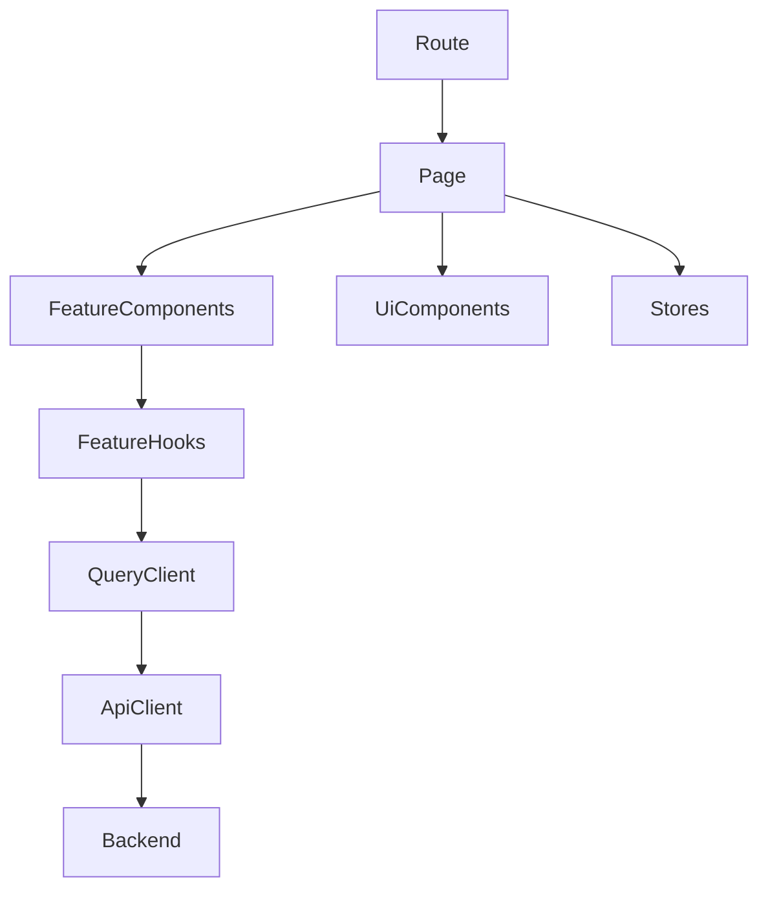

## Lista planiranih izmjena po fajlovima (high-signal)

### App bootstrapping i routing
- `[frontend/src/App.tsx](frontend/src/App.tsx)`
  - Razbiti “mega routes” u manje module (<100 LOC):
    - `src/app/providers.tsx` (svi provider-i na jednom mjestu)
    - `src/app/router.tsx` (React Router konfiguracija i lazy route kompozicija)
    - `src/app/routes/public.routes.tsx` i `src/app/routes/admin.routes.tsx`
  - Uvesti `React.lazy` + `Suspense` za teške admin stranice (Finance/Users/EmailSettings/Settings).

- `[frontend/src/main.tsx](frontend/src/main.tsx)`
  - Dodati root provider kompoziciju: `QueryClientProvider`, `I18nextProvider` (ako nije implicitno), `ThemeProvider` (Tailwind + CSS vars), i `Toaster`/toast sistem.

### Data fetching (TanStack Query) i API layer
- `[frontend/src/api/client.ts](frontend/src/api/client.ts)`
  - Zadržati axios instancu, ali izvući:
    - `src/api/http.ts` (typed wrappers: `get`, `post`, `del`, `patch`)
    - `src/api/error.ts` (`getErrorMessage(err)`)
  - Ujednačiti token injekciju: umjesto direktnog `localStorage` čitanja u interceptoru, koristiti `authStore.getState().token` (Zustand) uz fallback.

- Novi fajlovi:
  - `src/query/client.ts` (QueryClient config: retry, staleTime, onError mapping)
  - `src/query/keys.ts` (centralizovani query keys)
  - `src/query/useApiQuery.ts` / `useApiMutation.ts` (shared wrapper oko axios + error mapping)

### Global state (Zustand) i uklanjanje window event bus-a
- `[frontend/src/context/AuthContext.tsx](frontend/src/context/AuthContext.tsx)`
  - Migrirati u `src/stores/auth.store.ts` (token, user, isReady, login/logout/refreshProfile)
  - Ukloniti `window.dispatchEvent('auth-change')` pattern; umjesto toga koristiti `subscribe` iz store-a.

- `[frontend/src/context/SettingsContext.tsx](frontend/src/context/SettingsContext.tsx)`
  - Migrirati u `src/stores/settings.store.ts` ili Query (`useSettingsPublicQuery`) + selector helper.

- `[frontend/src/context/SocketContext.tsx](frontend/src/context/SocketContext.tsx)`
  - Prebaciti u `src/features/realtime/socket.provider.tsx` i vezati reconnect na auth store.

### i18n (EN/BS) i string standardizacija
- `[frontend/src/i18n/index.ts](frontend/src/i18n/index.ts)`
  - Izvući inline resources u `src/i18n/locales/bs.json` i `src/i18n/locales/en.json`.
  - Dodati language persistence (`localStorage` key npr. `APP_LOCALE`) + `i18n.changeLanguage` helper.
  - Standardizovati key namespace po feature-ima: `common.*`, `auth.*`, `admin.users.*`, `admin.finance.*`, `public.reserve.*`, itd.

- Visok prioritet za hardcoded stringove:
  - `[frontend/src/pages/Settings.tsx](frontend/src/pages/Settings.tsx)` (grupe/labeli/toast poruke)
  - `[frontend/src/layouts/PublicLayout.tsx](frontend/src/layouts/PublicLayout.tsx)`
  - `[frontend/src/layouts/DashboardLayout.tsx](frontend/src/layouts/DashboardLayout.tsx)`

### UI migracija: Chakra → Tailwind + shadcn/ui (postepeno)
- `[frontend/src/theme/index.ts](frontend/src/theme/index.ts)`
  - Deprecate Chakra theme u korist Tailwind tokens (CSS vars) + shadcn theme system.
  - Uvesti `src/styles/globals.css` (Tailwind base + CSS vars) i mapirati postojeće `brand` boje.

- Layouts:
  - `[frontend/src/layouts/DashboardLayout.tsx](frontend/src/layouts/DashboardLayout.tsx)`
    - Razbiti na `src/features/shell/admin/*` komponente: `AdminSidebar`, `AdminHeader`, `Breadcrumbs`, `AdminLayout`.
    - Migrirati na shadcn primitives (Button, Sheet/Drawer, DropdownMenu, Tabs).

  - `[frontend/src/layouts/PublicLayout.tsx](frontend/src/layouts/PublicLayout.tsx)`
    - Razbiti na `src/features/shell/public/*`: `PublicHeader`, `PublicFooter`, `MaintenanceBanner`.

### Feature-based restrukturiranje pages → features
Cilj: svaka velika `src/pages/*.tsx` se razbija u feature module sa:
- `api/` (typed endpoints)
- `components/` (UI)
- `hooks/` (query/mutation hooks)
- `types.ts`
- `index.ts` (public exports)

Prioritet (najveći fajlovi):
- `[frontend/src/pages/Finance.tsx](frontend/src/pages/Finance.tsx)` → `src/features/finance/*`
  - Razbiti po pod-feature-ima: income books, expense books, templates, categories, manual entries.
  - Uvesti shared `Money` i `Date` format util-e (vidi `src/lib/format/*`).

- `[frontend/src/pages/Users.tsx](frontend/src/pages/Users.tsx)` → `src/features/users/*`
  - Centralizovati pagination (shared `Pagination` komponenta + `usePagination` hook).
  - Query hooks: `useUsersQuery`, `useUpdateUserMutation`, `useAssignRoleMutation`.

- `[frontend/src/pages/EmailSettings.tsx](frontend/src/pages/EmailSettings.tsx)` → `src/features/notifications/email-settings/*`
  - Extract: SMTP config form, test connection, templates list/editor.

- `[frontend/src/pages/Settings.tsx](frontend/src/pages/Settings.tsx)` → `src/features/settings/*`
  - Extract registry rendering (key type → input component), secrets handling.

- `[frontend/src/pages/public/PublicReserve.tsx](frontend/src/pages/public/PublicReserve.tsx)` → `src/features/reservations/public/*`
  - Split reservation wizard steps into components and hooks; keep route behavior.

### Shared libs (utils/hooks/components) — centralizacija ponavljanja
- Novi shared:
  - `src/lib/format/date.ts` (formatDate/formatDateTime/toIsoDateInput)
  - `src/lib/format/money.ts` (`Intl.NumberFormat` BAM)
  - `src/lib/pagination/types.ts` (`PaginatedResponse<T>`)
  - `src/lib/pagination/usePagination.ts`
  - `src/lib/toast/useAppToast.ts`
  - `src/components/ui/*` (shadcn components via registry)
  - `src/components/state/LoadingState.tsx`, `EmptyState.tsx`, `ErrorState.tsx`

### Cleanup i naming
- Ukloniti mrtav kod i duplicirane tipove (npr. `PaginatedResponse<T>` definicije u više page fajlova).
- Standardizovati imenovanje i import order.
- Održati <100 LOC po fajlu: kod koji prelazi limit razbiti na:
  - `*.types.ts`, `*.constants.ts`, `*.api.ts`, `*.hooks.ts`, `components/*`.

---

## Redoslijed implementacije (jedan feature po feature)
1. Skeleton: `QueryClient`, `auth.store`, `api/error`, `useAppToast`, minimalna UI baza (shadcn + Tailwind) i routing split.
2. Migrate layouts (Public + Admin shell) na shadcn, uz očuvanje ruta.
3. Migrate najveće admin features: Finance → Users → EmailSettings → Settings.
4. Migrate public reservation flow.
5. i18n externalization + EN resources + language switcher + cleanup hardcoded strings.

## Mermaid: ciljani slojevi

