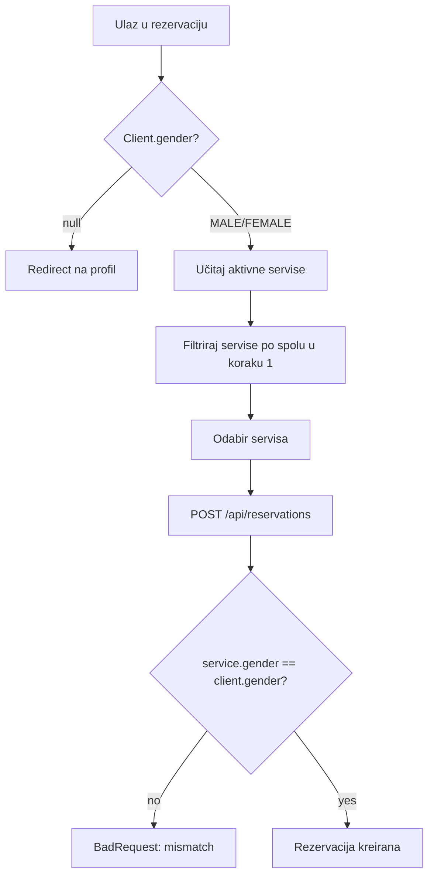

## 1) Model podataka i migracije (Prisma)

- U `backend/prisma/schema.prisma` dodati enum `Gender` = `MALE | FEMALE`
- Dodati `User.gender` (polje `Spol`) i `Service.gender` (za servis: muško/žensko)
- Podaci prije promjene:
  - Postaviti `gender = FEMALE` za postojeće servise
  - Postaviti `gender = FEMALE` za postojeće klijente (korisnici koji imaju rolu `CLIENT`)
  - Admin kasnije može ručno promijeniti na ispravne vrijednosti

## 2) Backend: validacije i API kontrakti

### 2.1 Klijentima obavezan Spol

- U `backend/src/users/users.service.ts`:
  - `getProfile()` mora vraćati i `gender`
  - `create()` i `update()` moraju upisati `gender`
  - Prilikom kreiranja/izmjene korisnika sa rolom `CLIENT`, validirati da `gender` postoji (non-null logika u servisu)
- U `backend/src/users/dto/create-user.dto.ts` i `update-user.dto.ts`:
  - Dodati polje `gender` sa validacijom (`IsIn(['MALE','FEMALE'])`)

### 2.2 Servisi: obavezno označiti spol u admin UI

- U `backend/src/services/dto/create-service.dto.ts` i `update-service.dto.ts`:
  - Dodati obavezno `gender` sa validacijom `IsIn(['MALE','FEMALE'])`
- U `backend/src/services/services.service.ts`:
  - `createService()` mora spremiti `gender`
  - `updateService()` mora ažurirati `gender` kad je poslan

### 2.3 Rezervacije: backend zaštita (gender mismatch)

- U `backend/src/reservations/reservations.service.ts` u `create()`:
  - Učitati `client.gender`
  - Učitati `service.gender`
  - Ako `client.gender` nije postavljen (ili se ne poklapa sa `service.gender`) baciti `BadRequestException` (npr. `GENDER_REQUIRED` / `SERVICE_GENDER_MISMATCH`)

### 2.4 Admin paginacija preko backenda

Dodati opcione query parametre u endpoint-e koji se koriste na admin ekranima:

- `GET /api/users`
- `GET /api/stylists`
- `GET /api/services` (najbitnije za `subcategoryId` + `activeOnly` listu)
- `GET /api/reservations`

Predloženi mehanizam:

- `page` (0-based) i `pageSize`
- odgovor kad je paginacija zatražena: `{ items, total, page, pageSize }`
- kad `page/pageSize` nije poslan: ostaviti postojeći odgovor (array) da se ne “polomi” public/mobile flow

Backend implementacija (ponoviti obrazac na svim navedenim endpoint-ima):

- `skip = page * pageSize`
- `take = pageSize`
- `items = findMany({ skip, take, orderBy, include/select ... })`
- `total = count(...)` sa istim `where` uslovima

## 3) Frontend: Web (React)

### 3.1 Tipovi i auth profil

- U `frontend/src/context/AuthContext.tsx` proširiti `User` na `gender: 'MALE'|'FEMALE'|null`
- U mapiranju iz `/api/users/profile` dodati `gender`

### 3.2 Profil klijenta: unos Spola

- U `frontend/src/pages/Profile.tsx`:
  - Prikazati selector `Spol` samo za korisnike s rolom `CLIENT`
  - Uvesti `FormControl isRequired` za `gender`
  - Sačuvati ga preko postojećeg `PATCH /api/users/:id` ili `PUT /api/users/profile` (uskladiti sa backend DTO)

### 3.3 Rezervacija (public) – filtriranje samo u 1. koraku

- U `frontend/src/pages/public/PublicReserve.tsx`:
  - Uvesti `servicesForGender = services.filter(s => s.gender === user.gender)`
  - U `ServiceAutocomplete` proslijediti `servicesForGender` umjesto `services`
  - Ako je `user.gender` `null`, blokirati odabir servisa i redirect na `'/profil'`
  - Ako postoji `serviceId` u query paramu, validirati da li `service.gender` odgovara `user.gender`; ako ne, resetovati odabir (vratiti na korak 1)

### 3.4 Admin UI: servis gender na kreiranje servisa

- U `frontend/src/pages/Services.tsx` u modal-mode `service`:
  - Dodati obavezni selector `Spol servisa` (muško/žensko)
  - `svcForm` proširiti sa `gender`
  - Kod edit-a popuniti `svcForm.gender`

### 3.5 Admin UI: backend paginacija

Refactor koji je potreban da UI ne “uzima sve odjednom”:

- `frontend/src/pages/Users.tsx`
  - Umjesto `api.get('/api/users')` koristiti paginaciju (`page/pageSize`)
  - Ukloniti frontend-only paginaciju (ako postoji) i prebaciti na server kontrolu
- `frontend/src/pages/ClientAnalytics.tsx`
  - Umjesto učitavanja svih korisnika i slice-a, učitati samo paginirani segment
  - i koristiti server `total` za prikaz page broja
- `frontend/src/pages/Stylists.tsx`
  - Pagirati `api/stylists` listu
  - Za dropdown/checkbox listu servisa (`allServices`) i korisnika (`loadUsers`) uvesti ograničene upite (paginacija ili server-side search po potrebi)
- `frontend/src/pages/DailyLog.tsx`
  - Za dropdown liste `clients`, `services`, `stylists` umjesto “load all” koristiti paginaciju ili barem limitirani server upit
- `frontend/src/pages/Reservations.tsx`
  - Uvesti page controls i slati `page/pageSize` u `/api/reservations`

## 4) Mobile (React Native / Expo)

### 4.1 Tipovi

- U `mobile/src/types/index.ts` proširiti `User` i `Service` na polje `gender`

### 4.2 Profil klijenta: unos Spola

- U `mobile/src/screens/client/ProfileScreen.tsx`:
  - Ako `isClient(user)` i `user.gender` nedostaje, prikazati obavezni selector `Spol`
  - Sačuvati preko `api.put('/api/users/profile', { gender })` (uskladiti sa backend DTO)

### 4.3 Rezervacija (mobile) – filtriranje samo u 1. koraku

- U `mobile/src/screens/client/ReservationScreen.tsx`:
  - U Step 1 renderu prikazati samo servise gdje `service.gender === user.gender`
  - Ako `user.gender` nije postavljen: blokirati step 1 i navigirati na `ProfileTab` (isti guard kao za email/phone)
  - Kod preselect-a `initialServiceId` validirati spol servisa; ako mismatch -> vratiti na Step 1

## 5) Mermaid: tok validacije spola u rezervaciji

