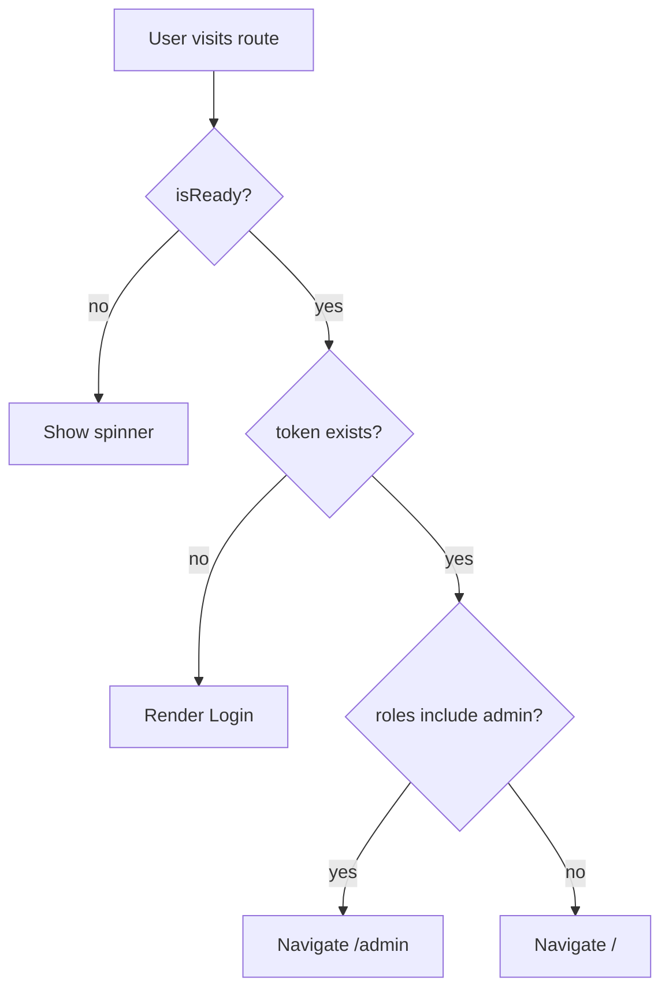

## Problem

- `ProtectedRoute` redirects to `/login` with `state={{ from: location }}` (a Location object), but `Login.tsx` assumes `from` is a string. This can cause inconsistent navigation.
- `/login` is always accessible because there is no guard preventing authenticated users from visiting it.

## Approach

- Add a small route guard component `PublicOnlyRoute` that:
  - waits for `useAuth().isReady`
  - if `token` exists, redirects to `/admin` for admin roles, otherwise `/`
  - otherwise renders children (login/register)
- Update `Login.tsx` to:
  - on mount/effect: if `isReady && token` redirect away from `/login` (same logic as above)
  - correctly resolve `location.state.from` when it is either a string or a Location object.

## Files to change

- `[frontend/src/components/PublicOnlyRoute.tsx](frontend/src/components/PublicOnlyRoute.tsx)` (new)
- `[frontend/src/App.tsx](frontend/src/App.tsx)`
  - Wrap routes `/login` and `/register` with `PublicOnlyRoute`
- `[frontend/src/pages/Login.tsx](frontend/src/pages/Login.tsx)`
  - Fix `from` handling and add effect-based redirect when already authenticated

## Key implementation details

- **Resolve `from`**:
  - If `from` is a string and starts with `/` → navigate there.
  - If `from` is an object with `pathname` → navigate to `pathname + search + hash`.
- **Default redirect**:
  - If roles include `SYSTEM_ADMIN` or `OWNER` → `/admin`
  - Else → `/`

## Test plan

- Open `/login` while logged out → shows login.
- Login succeeds → always redirects (to `from` if present, else `/admin` or `/`).
- While logged in, manually open `/login` → immediately redirects away.
- Try visiting `/admin` while logged out → redirected to `/login`, then after login redirected back to `/admin`.

