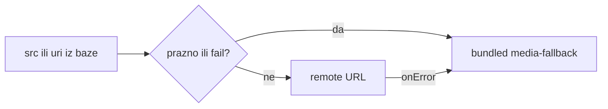

# Globalni fallback za slike (web + mobile)

Implementirani fallback assets u trenutnom checkout-u su JPEG (stariji plan ispod je prvobitno tražio PNG):

- [`frontend/public/brand/media-fallback.jpg`](../../frontend/public/brand/media-fallback.jpg) — javni URL `/brand/media-fallback.jpg` (radi i za CSS `background-image`)
- [`mobile/assets/images/media-fallback.jpg`](../../mobile/assets/images/media-fallback.jpg) — `require()` za Expo

Izvorni image je priložen u ranijem radu; ova putanja dokumentuje implementirano `.jpg` stanje.

## Pristup

Jedna mala komponenta po klijentu + konstanta. Call-siteovi ostaju, samo zamjena `` / `expo-image` / `ImageBackground` i Unsplash defaulta.

**Web** — [`frontend/src/constants/media-fallback.ts`](../../frontend/src/constants/media-fallback.ts) + [`frontend/src/components/media-image.tsx`](../../frontend/src/components/media-image.tsx):

- `MEDIA_FALLBACK_SRC = '/brand/media-fallback.jpg'`
- `cssBackgroundImage(url)` → `url(remote), url(fallback)` kad ima URL; samo fallback kad je prazno (CSS layer fallback za broken remote)
- `MediaImage`: `src` prazan ili `onError` → fallback; reset `failed` kad se `src` promijeni

**Mobile** — [`mobile/src/constants/media-fallback.ts`](../../mobile/src/constants/media-fallback.ts) + [`mobile/src/components/MediaImage.tsx`](../../mobile/src/components/MediaImage.tsx):

- `MEDIA_FALLBACK = require('../../assets/images/media-fallback.jpg')`
- `MediaImage` na `expo-image`: `source={uri ? { uri } : MEDIA_FALLBACK}`, `onError` prebaci na bundled; `contentFit="cover"` default

## Call sites (web)

Zamjena `` → `MediaImage` (uključujući prazan gallery cell koji sada pokazuje „—“):

- Public: [`PublicHome.tsx`](../../frontend/src/pages/public/PublicHome.tsx) (hero/about CSS + img), [`PublicServices.tsx`](../../frontend/src/pages/public/PublicServices.tsx), [`PublicServiceDetail.tsx`](../../frontend/src/pages/public/PublicServiceDetail.tsx), [`PublicReserve.tsx`](../../frontend/src/pages/public/PublicReserve.tsx), [`PublicBlogList.tsx`](../../frontend/src/pages/public/PublicBlogList.tsx), [`PublicBlogPost.tsx`](../../frontend/src/pages/public/PublicBlogPost.tsx), [`PublicGallery.tsx`](../../frontend/src/pages/public/PublicGallery.tsx), [`PublicSatisfiedClients.tsx`](../../frontend/src/pages/public/PublicSatisfiedClients.tsx), [`PublicContact.tsx`](../../frontend/src/pages/public/PublicContact.tsx) ako ima bg
- Admin preview: [`Gallery.tsx`](../../frontend/src/pages/Gallery.tsx), [`Blog.tsx`](../../frontend/src/pages/Blog.tsx), [`Services.tsx`](../../frontend/src/pages/Services.tsx), [`Settings.tsx`](../../frontend/src/pages/Settings.tsx) image previewi
- Slider: [`BeforeAfterSlider.tsx`](../../frontend/src/components/BeforeAfterSlider.tsx)
- Workbook / before-after: [`ServiceWorkGallery.tsx`](../../frontend/src/pages/ServiceWorkGallery.tsx), [`workbook-detail-page.tsx`](../../frontend/src/features/stylist-workbook/pages/workbook-detail-page.tsx)
- Logo upload: [`uploaded-brand-logo.tsx`](../../frontend/src/components/brand/uploaded-brand-logo.tsx) — raster: `MediaImage`; SVG ostaje kao sada, na fetch fail → fallback slika
- Avatari (odabrano: sve slike iz baze): `AvatarImage` `src` = `getUploadUrl(avatar) || MEDIA_FALLBACK_SRC` + `onError` na fallback — [`avatar.tsx`](../../frontend/src/components/ui/avatar.tsx) može wrapovati image, ili call sites: [`admin-layout.tsx`](../../frontend/src/features/shell/admin/admin-layout.tsx), [`admin-chrome.tsx`](../../frontend/src/features/shell/admin/admin-chrome.tsx), [`StylistLayout.tsx`](../../frontend/src/layouts/StylistLayout.tsx), [`public-layout.tsx`](../../frontend/src/features/shell/public/public-layout.tsx), [`Users.tsx`](../../frontend/src/pages/Users.tsx), [`Profile.tsx`](../../frontend/src/pages/Profile.tsx), [`Register.tsx`](../../frontend/src/pages/Register.tsx) (lokalni blob preview ostaje; fail → fallback)

Ne dirati: favicon, PDF/expense linkovi, čisti ikoni.

## Call sites (mobile)

Zamjena `expo-image` / RN `Image` / `ImageBackground` remote URI:

- [`HomeScreen.tsx`](../../mobile/src/screens/client/HomeScreen.tsx) — ukloniti Unsplash `DEFAULT_HERO_IMAGE` / `DEFAULT_BLOG_IMAGE`
- [`LoginScreen.tsx`](../../mobile/src/screens/auth/LoginScreen.tsx) — ukloniti Unsplash `DEFAULT_LOGIN_IMAGE`
- Services / reservation / schedule heroes: [`ServicesScreen.tsx`](../../mobile/src/screens/client/ServicesScreen.tsx), [`ServiceDetailScreen.tsx`](../../mobile/src/screens/client/ServiceDetailScreen.tsx), [`ServiceSingleDetailScreen.tsx`](../../mobile/src/screens/client/ServiceSingleDetailScreen.tsx), [`ReservationScreen.tsx`](../../mobile/src/screens/client/ReservationScreen.tsx), [`StylistScheduleScreen.tsx`](../../mobile/src/screens/stylist/StylistScheduleScreen.tsx)
- Blog: [`BlogListScreen.tsx`](../../mobile/src/screens/client/BlogListScreen.tsx), [`BlogPostScreen.tsx`](../../mobile/src/screens/client/BlogPostScreen.tsx)
- Before/after: [`BeforeAfterSlider.tsx`](../../mobile/src/components/BeforeAfterSlider.tsx), [`SatisfiedClientsScreen.tsx`](../../mobile/src/screens/client/SatisfiedClientsScreen.tsx), [`ServiceWorkGalleryScreen.tsx`](../../mobile/src/screens/client/ServiceWorkGalleryScreen.tsx)
- Daily log slike: [`DailyLogDetailScreen.tsx`](../../mobile/src/screens/stylist/DailyLogDetailScreen.tsx)
- Avatari: [`ProfileScreen.tsx`](../../mobile/src/screens/client/ProfileScreen.tsx), [`EditProfileScreen.tsx`](../../mobile/src/screens/client/EditProfileScreen.tsx) — uvijek prikazati sliku (remote ili fallback), ne samo inicijale

`ImageBackground` sa `uri: null` zamijeniti `MediaImage` + overlay children u `View`.

## Release notes

Ažurirati [`mobile/RELEASE_NOTES.draft.md`](../../mobile/RELEASE_NOTES.draft.md) jednim BS bulletom (npr. da se umjesto praznog/broken prikaza vidi salon slika). Bez bump verzije (nije commit/build).

## Šta nije u opsegu

Backend/Prisma nema promjena. Fallback je samo klijentski bundled asset, ne upload u DB.
