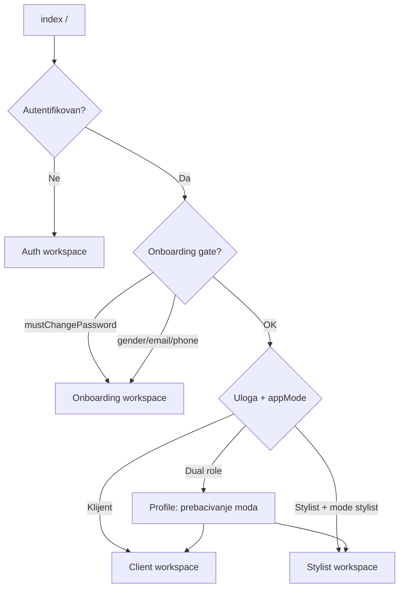
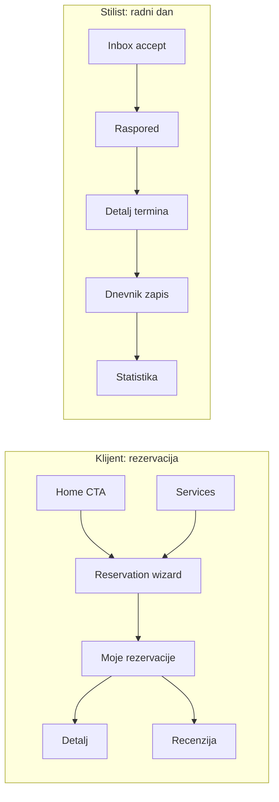

# Mobile UX/UI redizajn — inventar aplikacije

> **Svrha:** Referentni dokument za agenta koji radi vizuelni redizajn mobilne aplikacije Beauty Salon Nejra v2.  
> **Opseg:** samo `mobile/` — bez promjene business logike, API-ja ili backend-a.  
> **Stack:** Expo Router, React Native, TypeScript, Zustand, Socket.IO realtime, i18n (BS default).

---

## 1. Pravila rebrenda i vizuelnog smjera

Ovaj zadatak je **potpuni rebrand mobilne aplikacije**, ne samo polishing postojećeg UI-ja.

Agent ima slobodu da promijeni:

- **kolor šemu**
- **vizuelni identitet**
- **layout ekrana**
- **raspored sekcija**
- **hijerarhiju informacija**
- **UX obrazac toka** (npr. wizard, single-screen flow, cards, tabs, accordion, bottom sheets)

Sve ispod je **obavezno** za redizajn:

| Princip | Opis |
| --- | --- |
| **Potpuni novi identitet** | Dizajn ne mora pratiti postojeći izgled, postojeće boje ni postojeću kompoziciju. Dozvoljen je potpuno novi premium brend izraz. |
| **Smislena paleta** | Ne postoji unaprijed zaključana paleta. Agent smije definisati novu kolor šemu ako je konzistentna, elegantna, čitljiva i semantički ispravna. |
| **Funkcionalna potpunost** | Nijedna postojeća funkcionalnost, informacija ili capability ne smije biti izgubljen. Sve što danas postoji mora ostati dostupno korisniku. |
| **Slobodan raspored** | Ekrani ne moraju ostati u istim koracima, istim sekcijama ni istom redoslijedu ako nova organizacija bolje podržava UX. |
| **HD / HQ** | Slike i mediji u punoj rezoluciji gdje je moguće (`MediaImage`, `expo-image`, thumb/medium/original putanje). Bez mutnih hero i galerijskih prikaza. |
| **Čisto i moderno** | Puno vazduha, jaka hijerarhija, jasan fokus, bez vizuelnog šuma. Finalni rezultat treba djelovati savremeno, samouvjereno i premium. |
| **Profesionalno i ultra premium** | Beauty/salon segment mora djelovati luksuzno, ozbiljno i kvalitetno, bez kiča ili prenatrpanosti. |
| **Animacije samo kad pomažu** | Animacije smiju postojati, ali samo ako poboljšavaju jasnoću, feedback ili osjećaj kvaliteta. Bez dekorativnih i napadnih efekata. |
| **Bolji UX prije vjernosti starom UI-ju** | Ako postojeći koraci, raspored ili struktura nisu idealni, smiju se zamijeniti boljim UX rješenjem, sve dok funkcionalnost ostaje kompletna. |

**Važno:** postojeći design tokeni (`mobile/src/theme/colors.ts`, `spacing.ts`, `typography.ts`, `fonts.ts`) su samo referenca za trenutno stanje, a ne ograničenje za novi identitet.

**Navigacija danas:** custom floating tab bar (`BottomNavMenu`) sa blur pozadinom — 4 taba (klijent) / 5 tabova (stilist). To je informacija za audit, ne obaveza da isti obrazac mora ostati nepromijenjen.

**Ne dirati u redizajnu:** API pozive, Zustand store logiku, FSM rezervacija, validacije, push routing i poslovna pravila.

---

## 2. Workspaces (visoki nivo)

Aplikacija ima **5 workspace-ova**. Korisnik ulazi u odgovarajući prema auth stanju i ulozi.



| Workspace | Ruta | Ko vidi | Ulaz |
| --- | --- | --- | --- |
| **Auth** | `/login`, `/register` | Gosti | Nema sesije |
| **Onboarding** | `/onboarding/*` | Novi klijenti | Obavezni koraci prije klijentskog app-a |
| **Client** | `/(tabs)/*` | Klijenti (+ stilisti u client modu) | `/home` |
| **Stylist** | `/stylist/(tabs)/*` | Stilisti (+ dual role u stylist modu) | `/stylist/inbox` |
| **Global overlay** | root `_layout` | Svi autentifikovani | APK update modal, push, Socket sync |

**Dual role:** Korisnik može biti i klijent i stilist. `appModeStore` (`client` \| `stylist`) + prekidač na Profile ekranima.

---

## 3. Globalni sistemi (van pojedinačnih ekrana)

| Sistem | Lokacija | UX uticaj |
| --- | --- | --- |
| **Tema** | `ThemeContext`, light/dark/system | Boje, header, tab bar, inputi |
| **Auth** | `authStore` | Login/logout, profil, redirect |
| **Notifikacije** | `notificationStore`, push hooks | Badge na Profile tabu, Notifications ekran |
| **Realtime** | `SocketProvider`, `SocketRealtimeSync` | Auto-refresh rezervacija, dostupnosti, public content |
| **APK self-update** | `useApkUpdateCheck`, `ApkForceUpdateModal` | Force/soft update modal na root nivou |
| **i18n** | `react-i18next` | BS primarni copy; EN infrastruktura |
| **Floating tab bar** | `BottomNavMenu` | Donja navigacija, safe area, blur |

**Shared UI komponente za redizajn:**

- `Button`, `Card`, `Input`, `Badge`, `EmptyState`, `LoadingScreen`
- `MediaImage`, `BeforeAfterSlider`
- `OnboardingShell` (onboarding koraci)
- `DateTimeField` (stilist forme)

---

## 4. Auth workspace

### 4.1 Login — `/login`

**Komponenta:** `LoginScreen`

| Aspekt | Detalj |
| --- | --- |
| **Svrha** | Prijava postojećeg korisnika |
| **UI sekcije** | Hero slika (iz public settings), gradient overlay, forma (username/email + lozinka), link na registraciju |
| **Akcije** | Validacija polja → `authStore.login` → redirect na `/` |
| **Podaci** | `GET /api/settings` (hero/branding), login API |
| **Edge cases** | Mrežna greška sa uputstvom za `EXPO_PUBLIC_API_URL`; 401 poruka |

### 4.2 Register — `/register`

**Komponenta:** `RegisterScreen`

| Aspekt | Detalj |
| --- | --- |
| **Svrha** | Registracija novog klijenta |
| **UI sekcije** | Forma: username, email, lozinka, ime, prezime, opcionalno telefon |
| **Akcije** | Validacija → `authStore.register` → automatski login → onboarding flow |
| **Navigacija** | Link nazad na login |

---

## 5. Onboarding workspace

Blokira klijentski app dok se ne ispune obavezni uslovi (`app/index.tsx` redirect logika).

| Korak | Ruta | Ekran | Funkcionalnost |
| --- | --- | --- | --- |
| 1 | `/onboarding/change-password` | `ChangePasswordScreen` u `OnboardingShell` | Obavezna promjena lozinke (`mustChangePassword`) |
| 2 | `/onboarding/gender` | inline route | Izbor spola MALE/FEMALE — obavezan za rezervacije usluga |
| 3 | `/onboarding/email` | inline route | Unos emaila + verifikacioni kod (6 cifara), resend |
| 4 | `/onboarding/phone` | inline route | Unos telefona ili **Preskoči** (SecureStore flag) |

**Napomena za redizajn:** postojeći onboarding je organizovan kao 4 koraka, ali agent **ne mora** zadržati isti step-by-step raspored. Dozvoljeno je spojiti, presložiti ili vizuelno drugačije strukturirati onboarding, sve dok ostanu pokriveni:

- promjena lozinke kada je obavezna
- izbor spola
- email unos i verifikacija
- telefon ili skip logika

---

## 6. Client workspace

**Tab navigacija** (`/(tabs)/_layout.tsx`):

| Tab | Ruta | Ikona |
| --- | --- | --- |
| Početna | `/home` | home |
| Usluge | `/services` | cut |
| Rezervacije | `/reservations` | calendar |
| Profil | `/profile` | person (+ unread badge) |

---

### 6.1 Tab: Početna (`/home`)

#### 6.1.1 Home — `/home`

**Komponenta:** `HomeScreen` — **glavni landing**, bez stack headera.

| Sekcija | Sadržaj | Akcije |
| --- | --- | --- |
| **Hero** | Slika iz settings, gradient, subtitle, CTA | CTA → rezervacija (`/services/reservation`) |
| **Welcome** | „Dobrodošli, {ime}" | — |
| **Dug banner** | Ako klijent ima otvorene dugove | Tap → Profile tab |
| **Kategorije usluga** | Horizontalni scroll po kategorijama (muški/ženski redovi) | Tap usluge → single detail; „Sve" → Services tab |
| **Zadovoljni klijenti** | Before/after slider + featured recenzija | CTA → `/home/satisfied-clients` |
| **Blog** | 2–3 kartice članaka | „Sve" → blog list; tap → blog post |
| **Kontakt teaser** | Adresa/telefon preview | → Profile → Contact |
| **Maintenance mode** | Full-screen poruka | Blokira cijeli home |

**Realtime:** socket refresh public content. **Pull-to-refresh** na cijelom scroll-u.

#### 6.1.2 Blog lista — `/home/blog-list`

**Komponenta:** `BlogListScreen`

- FlatList objavljenih postova (slika, naslov, datum, excerpt)
- Tap → `/home/blog-post/[slug]`

#### 6.1.3 Blog članak — `/home/blog-post/[slug]`

**Komponenta:** `BlogPostScreen`

- Hero slika, naslov, datum, HTML/rendered sadržaj
- Share (ako implementirano u ekranu)

#### 6.1.4 Zadovoljni klijenti — `/home/satisfied-clients`

**Komponenta:** `SatisfiedClientsScreen`

- Paginirana lista before/after transformacija (`BeforeAfterSlider`)
- Infinite scroll (`/api/daily-log/before-after`)

---

### 6.2 Tab: Usluge (`/services`)

#### 6.2.1 Services hub — `/services`

**Komponenta:** `ServicesScreen`

| Sekcija | Sadržaj | Akcije |
| --- | --- | --- |
| **Kategorije** | Muške/ženske kategorije (max 2 chip kartice) | → Service detail po kategoriji |
| **Popularno / featured** | Najpopularnija ili prva usluga | → single detail |
| **Zadnja korištena** | Iz completed rezervacija | → single detail |
| **CTA rezervacija** | Brzi ulaz | → `/services/reservation` |

#### 6.2.2 Kategorija usluga — `/services/service-detail`

**Komponenta:** `ServiceDetailScreen`

- SectionList: podkategorije → liste usluga sa hero slikom
- Gender gate: usluga drugog spola disabled
- Tap usluge → single detail; dugme „Rezerviši" → reservation

#### 6.2.3 Detalj usluge — `/services/service-single-detail`

**Komponenta:** `ServiceSingleDetailScreen`

| Sekcija | Sadržaj |
| --- | --- |
| Hero + opis | Cijena, trajanje, opis |
| Before/after | Do 3 para iz dnevnika |
| Recenzije | Odobrene recenzije |
| Galerija link | → service-work-gallery |
| CTA | Rezerviši ovu uslugu |

#### 6.2.4 Galerija radova — `/services/service-work-gallery`

**Komponenta:** `ServiceWorkGalleryScreen`

- Paginirani before/after slideri filtrirani po `serviceId`

#### 6.2.5 Rezervacija (wizard) — `/services/reservation`

**Komponenta:** `ReservationScreen` — **najkompleksniji klijentski flow**

| Korak | Sadržaj | Akcije |
| --- | --- | --- |
| **1 — Usluge** | Pretraga, multi-select usluga | Gender filter; min 1 usluga |
| **2 — Datum** | Kalendar (`react-native-calendars`), dostupni datumi | Socket refresh dostupnosti |
| **3 — Termin** | Lista slotova za izabrani dan | |
| **4 — Potvrda** | Sažetak, napomena, loyalty popust, plaćanje dugova | Submit → kreira rezervaciju |

**Posebno:** loyalty bodovi, `payDebtsIntent`, open debts total, deep link sa `serviceId` / `startAtStep`.

---

### 6.3 Tab: Rezervacije (`/reservations`)

#### 6.3.1 Moje rezervacije — `/reservations`

**Komponenta:** `MyReservationsScreen`

| Funkcionalnost | Opis |
| --- | --- |
| **Liste** | Sekcije: Nadolazeće / Prošle (SectionList) |
| **Status badge** | Svi reservation statusi (PENDING → COMPLETED, cancelled, NO_SHOW…) |
| **Tap kartice** | → detalj rezervacije |
| **Potvrdi dolazak** | Za CONFIRMED + attendance policy (deadline) |
| **Prihvati/odbij reschedule** | Kad stilist predloži pomak |
| **Otkaži** | Modal sa razlogom |
| **Ocijeni** | → write-review (COMPLETED) |
| **Nova rezervacija** | Empty state CTA → reservation wizard |
| **Realtime** | Socket + auto refresh; layout animacije |

#### 6.3.2 Detalj rezervacije — `/reservations/[reservationId]`

**Komponenta:** `ClientReservationDetailScreen`

- Referentni kod, status, usluge, stilist, datum/vrijeme
- Payment summary (ako postoji)
- Pull-to-refresh

#### 6.3.3 Napiši recenziju — `/reservations/write-review`

**Komponenta:** `ReviewsScreen`

- Star rating usluge (+ opcionalno stilista)
- Komentar, izbor usluge ako nije proslijeđena
- Submit → `POST /api/reviews`

---

### 6.4 Tab: Profil (`/profile`)

#### 6.4.1 Profil — `/profile`

**Komponenta:** `ProfileScreen`

| Sekcija | Funkcionalnost |
| --- | --- |
| **Hero** | Avatar (tap → edit), ime, email (+ verify), telefon |
| **Dugovi** | Lista otvorenih dugova klijenta |
| **Prebaci na Stylist** | Ako `isStylist(user)` → stylist app |
| **Meni** | Edit profil, lozinka, notifikacije, tema (light/dark/system), kontakt, provjeri update, odjava |
| **Email verify modal** | Kod 6 cifara inline |

#### 6.4.2 Uredi profil — `/profile/edit`

**Komponenta:** `EditProfileScreen`

- Avatar upload (gallery picker → `/api/uploads`)
- Ime, prezime, email, telefon, spol
- Email verifikacija modal

#### 6.4.3 Promjena lozinke — `/profile/change-password`

**Komponenta:** `ChangePasswordScreen`

- Stara + nova + potvrda lozinke

#### 6.4.4 Notifikacije — `/profile/notifications`

**Komponenta:** `NotificationsScreen`

- Lista in-app notifikacija (tip: reservation, review, blog, holiday, system)
- Unread vizuelni akcent; tap → mark as read
- Auto refresh + socket

#### 6.4.5 Kontakt — `/profile/contact`

**Komponenta:** `ContactScreen`

- Adresa, telefon, email (tap → dial/mail)
- Radno vrijeme salona
- Mapa / navigacija (lat/lng iz settings)
- Social linkovi (Instagram, Facebook…)
- Realtime refresh settings

---

## 7. Stylist workspace

**Tab navigacija** (`/stylist/(tabs)/_layout.tsx`):

| Tab | Ruta | Label |
| --- | --- | --- |
| Inbox | `/stylist/inbox` | Inbox |
| Dnevnik | `/stylist/daily-log` | Dnevnik |
| Raspored | `/stylist/schedule` | Raspored |
| Statistika | `/stylist/stats` | Statistika |
| Profil | `/stylist/profile` | Profil |

---

### 7.1 Tab: Inbox — `/stylist/inbox`

**Komponenta:** `StylistInboxScreen`

| Funkcionalnost | Opis |
| --- | --- |
| **Lista** | Rezervacije PENDING / STYLIST_REVIEW za stilista |
| **Lock** | Zaključaj pregled (exclusive) |
| **Unlock** | Otključaj |
| **Prihvati** | Accept — provjera dugova klijenta (alert) |
| **Odbij** | Reject sa opcionalnim razlogom |
| **Realtime** | Socket + 30s/120s polling |

---

### 7.2 Tab: Dnevnik (`/stylist/daily-log`)

**Stack:** lista → detail → new-entry → debts → reschedule-preview

#### 7.2.1 Lista — `/stylist/daily-log`

**Komponenta:** `DailyLogListScreen`

- SectionList po sedmicama (zadnjih ~1 mj + 7 dana)
- Kartica: datum, klijent, usluge, iznos, status
- Header actions: **Dužnici** (→ debts), **Novi zapis** (→ new-entry)
- Tap → detail

#### 7.2.2 Detalj zapisa — `/stylist/daily-log/detail/[entryId]`

**Komponenta:** `DailyLogDetailScreen`

| Funkcionalnost | Opis |
| --- | --- |
| **Pregled** | Klijent, usluge, cijene, naplata, napojnica, dugovi |
| **Slike** | Upload before/after (ImagePicker) |
| **Završi zapis** | Complete → knjiga + rezervacija |
| **Dispozicija** | Panel za direct disposition flow |
| **Akcije meni** | Edit, delete (modal + razlog), link na rezervaciju |
| **Transformacije** | Before/after prikaz |

#### 7.2.3 Novi ručni zapis — `/stylist/daily-log/new-entry`

**Komponenta:** `DailyLogNewEntryScreen`

- Datum, klijent (search picker), multi usluge, cijene po stavci
- Plaćeni iznos, kreiranje duga, loyalty popust
- Namirenje postojećih dugova klijenta
- Edit mode ako `entryId` u params

#### 7.2.4 Dužnici — `/stylist/daily-log/debts`

**Komponenta:** `StylistDebtsScreen` (inline u app route)

- Lista otvorenih dugova stilista
- Pretraga po klijentu/usluzi/referenci
- **Naplati** → zatvara dug, upis u dnevnik

#### 7.2.5 Preview pomjeranja — `/stylist/daily-log/reschedule-preview/[reservationId]`

**Komponenta:** `ReschedulePreviewScreen`

- Predlog pomaka termina (overrun / manual / break-only)
- Toggle include breaks, manual minute shift
- Tabela pogođenih termina (staro → novo vrijeme)
- Potvrda → primjenjuje reschedule

---

### 7.3 Tab: Raspored (`/stylist/schedule`)

#### 7.3.1 Raspored — `/stylist/schedule`

**Komponenta:** `StylistScheduleScreen`

| Funkcionalnost | Opis |
| --- | --- |
| **Lista** | Sekcije po danu, 30 dana unaprijed |
| **Filter** | Samo preuzeti termini (`confirmedStylistId`) + IN_PROGRESS |
| **Kartice** | Hero backdrop, usluge, trajanje, status |
| **Akcije** | Detalj termina; CTA za start/complete ovisno o statusu |
| **Header +** | → Direktna rezervacija |

#### 7.3.2 Direktna rezervacija — `/stylist/schedule/direct-booking`

**Komponenta:** `StylistDirectBookingScreen`

- Pretraga klijenta, multi usluge, datum/vrijeme početak/kraj, napomena
- Kreira termin bez attendance potvrde klijenta

#### 7.3.3 Detalj termina — `/stylist/schedule/reservation-detail/[reservationId]`

**Komponenta:** `StylistReservationDetailScreen`

**Sažetak:** `ReservationDetailSummary` + `ReservationDetailActions`

| Akcija | Modal / flow |
| --- | --- |
| Staff confirm attendance | Inline |
| Start termina | API start |
| Overrun / pomak | → Overrun modal → reschedule preview |
| Završi | Complete modal (cijena, napojnica, plaćanje, loyalty) |
| No-show | NoShow modal (penal opcija) |
| Otkaži | Cancel modal (razlog) |
| Reorder usluga | Reorder modal |
| Refresh | Pull-to-refresh |

**Modali:** `CancelReservationModal`, `CompleteReservationModal`, `NoShowReservationModal`, `OverrunReservationModal`, `ReorderReservationModal`

---

### 7.4 Tab: Statistika — `/stylist/stats`

**Komponenta:** `StylistStatsScreen`

- Mjesečni pregled (trenutni mjesec)
- Kartice: završeni termini, nadolazeći, prihod usluga, napojnice, namireni dugovi
- Podaci iz rezervacija + daily-log API

---

### 7.5 Tab: Profil — `/stylist/profile`

**Komponenta:** `StylistProfileScreen`

- Avatar inicijali, ime, uloga „Stilist"
- **Prebaci na Client app** (dual role)
- Provjeri APK update
- Odjava

---

## 8. Mapa ekrana (brza referenca)

| # | Workspace | Ruta | Ekran |
| --- | --- | --- | --- |
| 1 | Auth | `/login` | Login |
| 2 | Auth | `/register` | Register |
| 3 | Onboarding | `/onboarding/change-password` | Promjena lozinke |
| 4 | Onboarding | `/onboarding/gender` | Spol |
| 5 | Onboarding | `/onboarding/email` | Email + verifikacija |
| 6 | Onboarding | `/onboarding/phone` | Telefon |
| 7 | Client | `/home` | Početna |
| 8 | Client | `/home/blog-list` | Blog lista |
| 9 | Client | `/home/blog-post/[slug]` | Blog članak |
| 10 | Client | `/home/satisfied-clients` | Transformacije |
| 11 | Client | `/services` | Usluge hub |
| 12 | Client | `/services/service-detail` | Kategorija |
| 13 | Client | `/services/service-single-detail` | Detalj usluge |
| 14 | Client | `/services/service-work-gallery` | Galerija radova |
| 15 | Client | `/services/reservation` | Rezervacija wizard |
| 16 | Client | `/reservations` | Moje rezervacije |
| 17 | Client | `/reservations/[id]` | Detalj rezervacije |
| 18 | Client | `/reservations/write-review` | Recenzija |
| 19 | Client | `/profile` | Profil |
| 20 | Client | `/profile/edit` | Uredi profil |
| 21 | Client | `/profile/change-password` | Lozinka |
| 22 | Client | `/profile/notifications` | Notifikacije |
| 23 | Client | `/profile/contact` | Kontakt |
| 24 | Stylist | `/stylist/inbox` | Inbox |
| 25 | Stylist | `/stylist/daily-log` | Dnevnik lista |
| 26 | Stylist | `/stylist/daily-log/detail/[id]` | Dnevnik detalj |
| 27 | Stylist | `/stylist/daily-log/new-entry` | Novi zapis |
| 28 | Stylist | `/stylist/daily-log/debts` | Dužnici |
| 29 | Stylist | `/stylist/daily-log/reschedule-preview/[id]` | Reschedule preview |
| 30 | Stylist | `/stylist/schedule` | Raspored |
| 31 | Stylist | `/stylist/schedule/direct-booking` | Direktna rezervacija |
| 32 | Stylist | `/stylist/schedule/reservation-detail/[id]` | Detalj termina |
| 33 | Stylist | `/stylist/stats` | Statistika |
| 34 | Stylist | `/stylist/profile` | Stilist profil |

**Ukupno: 34 ekrana/ruta** (+ globalni modali: APK update, cancel/complete/no-show/overrun/reorder, email verify, delete daily log).

---

## 9. Korisnički tokovi (za redizajn)



Ovi tokovi služe kao **funkcionalna mapa**, ne kao obavezna UX struktura. Agent smije promijeniti način kako korisnik prolazi kroz ove tokove, ali ne smije ukloniti nijednu ključnu radnju, informaciju ili mogućnost.

---

## 10. Backup protokol prije implementacije

Prije prve implementacije redizajna obavezan je **maksimalno siguran backup trenutnog mobilnog dizajna**.

Ovaj korak nije opcionalan i mora biti završen **prije bilo kakvih UI izmjena** na redesign branchu.

### Obavezni koraci

1. Uraditi pregled trenutnog stanja preko `git status` i `git diff`.
2. Napraviti jedan jasan commit koji predstavlja **posljednju stabilnu verziju postojećeg mobilnog dizajna prije rebranda**.
3. Pushati taj commit na remote.
4. Napraviti i pushati **backup referencu** za povrat:
   - obavezno: **backup tag**
   - preporučeno dodatno: **backup branch**
5. U ovom planu zabilježiti tačnu backup verziju:
   - commit SHA
   - naziv backup taga
   - naziv backup brancha ako postoji
   - datum kreiranja
   - kratki opis šta ta verzija predstavlja
6. Tek nakon toga početi implementaciju novog dizajna.

### Svrha ovog pravila

- da trenutni dizajn ne bude izgubljen
- da postoji jasan i udaljeni backup na remote-u
- da se repo u bilo kojem trenutku može vratiti na stabilnu pre-redesign verziju
- da se po potrebi mogu raditi parcijalni ili potpuni rollback scenariji

### Preporučena konvencija

- Backup tag: `mobile-pre-rebrand-v1` ili `backup-mobile-ui-YYYY-MM-DD`
- Backup branch: `backup/mobile-pre-rebrand-YYYY-MM-DD`

### Obavezni zapis u planu nakon backup-a

```md
- Backup commit SHA: `<upisati>`
- Backup tag: `<upisati>`
- Backup branch: `<upisati ako postoji>`
- Datum: `<upisati>`
- Opis: Posljednja stabilna verzija mobilnog UI-ja prije potpunog rebranda.
```

### Pravilo za rollback

Ako redesign uvede velike probleme, regresije ili nezadovoljavajući rezultat, backup verzija iz ovog koraka se tretira kao **sigurna povratna tačka** za:

- poređenje promjena
- selektivni povrat fajlova ili commitova
- potpuni rollback na pre-redesign stanje

---

## 11. Prioriteti redizajna (predlog agentu)

1. **Novi brand sistem** — definisati novu paletu, tipografski pravac, shape language, elevation, ikonografiju i tone of UI
2. **Novi design system** — Button, Card, Input, Badge, list items, tabs, sheets, empty states, feedback states
3. **Client landing** — Home kao novi identitetski ekran i prvi dojam aplikacije
4. **Booking UX** — rezervacije su najvažniji conversion flow i smiju biti potpuno reorganizovane ako UX postane bolji
5. **My Reservations** — statusi, akcije, čitljivost i pregled toka nakon rezervacije
6. **Stylist core flow** — Inbox, Schedule, Reservation detail kao radni alat stilista
7. **Daily log** — finansijski zapis, transformacije, disposition i ručni unos
8. **Auth + Onboarding** — prvi kontakt i ulazni flow, bez obaveze da ostane identičan po koracima
9. **Profil + Contact + Notifications** — sekundarni ali važni ekrani za povjerenje i account management

---

## 12. Handoff uputstvo za redesign agenta

1. Pročitaj ovaj dokument prije bilo koje UI izmjene.
2. Prije prve implementacije obavezno ispoštuj `Backup protokol prije implementacije` iz ovog dokumenta.
3. Tretiraj zadatak kao **potpuni rebrand**, ne kao vizuelno dotjerivanje postojećeg interfejsa.
4. Slobodno definiši **novu paletu**, novi vizuelni jezik, nove kompozicije i nove UX obrasce ako to vodi boljem rezultatu.
5. Nisi vezan za postojeći raspored ekrana, postojeće sekcije ni postojeći step-by-step model, osim gdje backend logika eksplicitno traži određeni uslov ili redoslijed.
6. **Obavezno sačuvaj svu funkcionalnost**: ništa ne smije nestati, biti zaboravljeno ili ostati bez jasnog pristupa.
7. Ako reorganizuješ flow, provjeri da su sve postojeće akcije i sva bitna stanja i dalje pokriveni.
8. **Ne mijenjaj** business logiku — dozvoljene su izmjene u JSX strukturi, vizuelnoj hijerarhiji, komponentama, stilovima, spacingu, tipografiji i animacijama.
9. Testiraj **light + dark** i **Android 3-button + gesture** safe area, osim ako novi brand pravac traži svjesno drugačiju temu strategiju koja i dalje mora ostati konzistentna i čitljiva.
10. Slike: uvijek `MediaImage` / upload URL helperi — ne hardcodiraj dimenzije koje kvare aspect ratio.
11. Animacije: koristi ih selektivno; cilj je kvalitet i jasnoća, ne vizuelni spektakl.
12. Referenca prethodnog tehničkog audita: `.cursor/plans/mobile_ui_redesign_audit_24155cab.plan.md` (tehnički setup NativeWind, edge-to-edge).

---

*Generisano: inventar mobilne aplikacije za UX/UI redizajn — Beauty Salon Nejra v2.*
