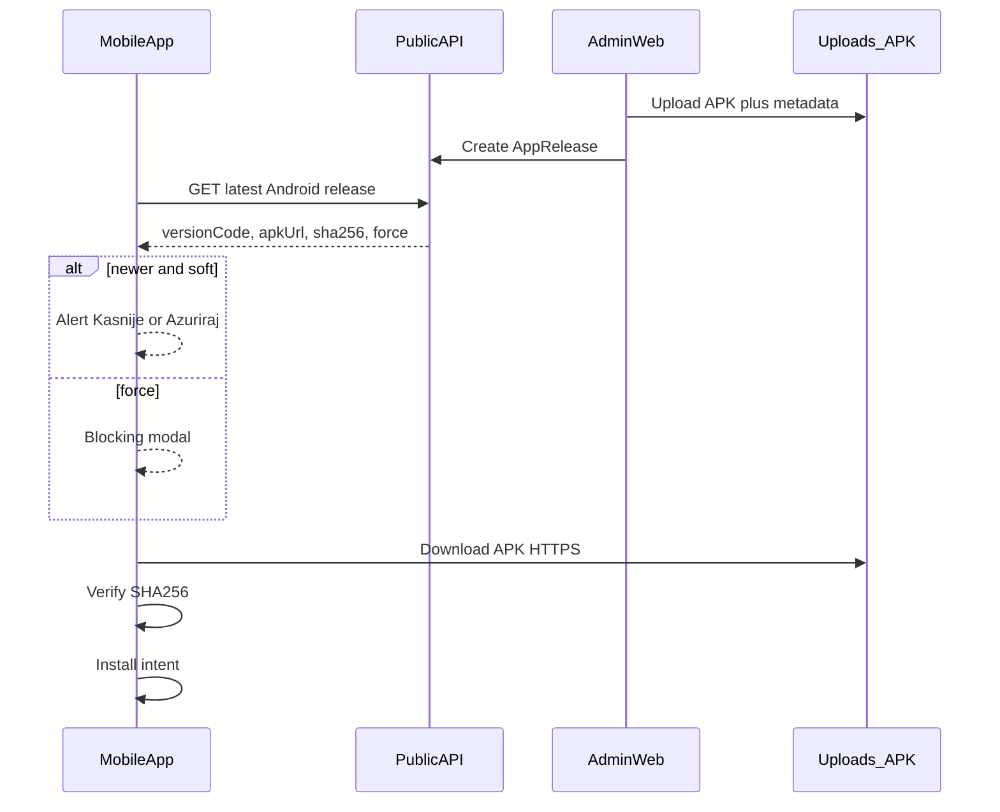

# Mobile APK Self-Update

## Odluke (zaključano)

- **Platforma u ovom planu:** samo Android (APK). iOS van opsega.
- **Politika:** soft update po defaultu; **force** samo ako `forceUpdate=true` **ili** `localVersionCode < minSupportedVersionCode`.
- **Admin:** pun web UI (upload + metadata), ne samo ručni API.
- **Storage model:** novi Prisma `AppRelease` (historija release-ova), ne flat `AppSetting` JSON.
- **OTA (`expo-updates`):** van opsega u ovoj fazi.

## Tok (high level)




## Matrica (source of truth)

Implementacija piše i održava:

- `[.cursor/docs/matrices/mobile-apk-update/MATRIX.md](.cursor/docs/matrices/mobile-apk-update/MATRIX.md)`
- `[.cursor/docs/matrices/mobile-apk-update/CHANGELOG.md](.cursor/docs/matrices/mobile-apk-update/CHANGELOG.md)`

### Statusi release-a


| Status      | Značenje                                                            |
| ----------- | ------------------------------------------------------------------- |
| `DRAFT`     | Upload/metadata postoji; nije vidljiv mobilnom clientu              |
| `PUBLISHED` | Aktivan kandidat za `latest` (najveći `versionCode` među PUBLISHED) |
| `RETIRED`   | Zamijenjen; više nije `latest`, fajl može ostati                    |


Pravilo: jedan platform `ANDROID` može imati više PUBLISHED historijski, ali `**latest` = max(`versionCode`) gdje `status=PUBLISHED**`. Objava novog release-a automatski prethodni PUBLISHED → RETIRED (ili ostavi historiju PUBLISHED samo ako želimo rollback preko “re-publish”; default: prethodni → RETIRED).

### Polja i usporedba


| Polje                     | Tip                      | Pravilo                             |
| ------------------------- | ------------------------ | ----------------------------------- |
| `platform`                | enum `ANDROID`           | samo Android u v1                   |
| `version`                 | semver string            | prikaz u UI (`1.0.1`)               |
| `versionCode`             | int, unique per platform | **jedini** kriterij “novije”        |
| `minSupportedVersionCode` | int                      | ako `local < min` → force           |
| `forceUpdate`             | bool                     | ako true → force bez obzira na soft |
| `apkPath`                 | relative upload path     | servira se kao `/uploads/...`       |
| `apkSha256`               | hex string               | obavezna verifikacija prije install |
| `apkSizeBytes`            | int                      | progress / sanity check             |
| `releaseNotes`            | text                     | prikaz u dijalogu                   |
| `status`                  | DRAFT/PUBLISHED/RETIRED  | vidi gore                           |


### Client odluke (matrica ponašanja)


| Uvjet                                        | Soft dijalog                | Force wall | Download           | Install      |
| -------------------------------------------- | --------------------------- | ---------- | ------------------ | ------------ |
| `remote.versionCode <= local`                | Ne                          | Ne         | Ne                 | Ne           |
| `remote > local` i `!force` i `local >= min` | Da (Kasnije / Ažuriraj)     | Ne         | Na Ažuriraj        | Nakon verify |
| `forceUpdate=true`                           | Ne                          | Da         | Da (jedini CTA)    | Nakon verify |
| `local < minSupportedVersionCode`            | Ne                          | Da         | Da                 | Nakon verify |
| SHA-256 mismatch                             | —                           | —          | Obriši fajl, error | **Nikad**    |
| Download fail / offline                      | Soft: dismiss; Force: retry | Retry      | —                  | —            |
| iOS / web                                    | Nema checka                 | —          | —                  | —            |


### Auth / uloge


| Endpoint / akcija                             | Auth                                                                  |
| --------------------------------------------- | --------------------------------------------------------------------- |
| `GET /api/public/app-releases/android/latest` | `@Public()`                                                           |
| Admin CRUD + upload APK                       | JWT + `SYSTEM_ADMIN`                                                  |
| Download APK fajla                            | Javni static `/uploads/app-releases/...` (HTTPS); integrity = SHA-256 |


### Sigurnosna pravila

- Samo HTTPS u produkciji (`EXPO_PUBLIC_API_URL` / files URL).
- APK MIME only: `application/vnd.android.package-archive` (+ opcioni `application/octet-stream` uz `.apk` ekstenziju).
- Dedicated upload limit **100 MB** (postojeći generic upload ostaje **10 MB** — ne dirati).
- Isti Android signing keystore na svim APK-ovima (operativno pravilo; nije kod).
- Soft prompt: max 1× po kalendarskom danu (AsyncStorage), osim ručnog “Provjeri ažuriranja”.
- Force: na svakom cold startu dok se ne ažurira.

---

## Faza 1 — Schema + backend modul + matrica

**Prisma** (`backend/prisma/schema.prisma`): model `AppRelease`:

- `id`, `platform` (`ANDROID`), `version`, `versionCode`, `minSupportedVersionCode`, `forceUpdate`, `apkPath`, `apkSha256`, `apkSizeBytes`, `releaseNotes`, `status`, `publishedAt`, `createdById`, timestamps
- `@@unique([platform, versionCode])`, index na `[platform, status, versionCode]`

**Modul:** `backend/src/app-releases/`

- `POST /api/app-releases/upload` — multer APK, folder `app-releases/{yyyy}/{mm}/`, vraća path + size; server računa SHA-256
- `POST /api/app-releases` — kreira DRAFT ili odmah PUBLISHED
- `PATCH /api/app-releases/:id` — notes, force, minSupported, publish/retire
- `GET /api/app-releases` — admin lista
- `GET /api/public/app-releases/android/latest` — `@Public()`, 204/404 ako nema PUBLISHED

Public DTO response:

```ts
{
  version: string
  versionCode: number
  minSupportedVersionCode: number
  forceUpdate: boolean
  apkUrl: string          // absolute or path joined with files base
  apkSha256: string
  apkSizeBytes: number
  releaseNotes: string | null
  publishedAt: string
}
```

Ne širiti postojeći `[uploads.controller.ts](backend/src/uploads/uploads.controller.ts)` MIME/limit — zaseban upload u app-releases modulu.

Testovi: latest selection, force flags, auth na admin, reject non-APK, publish retires previous.

Matrica + CHANGELOG kreirati u ovoj fazi.

---

## Faza 2 — Admin web UI

- Nav: `[frontend/src/features/shell/admin/admin-nav.ts](frontend/src/features/shell/admin/admin-nav.ts)` → System: `/admin/app-releases`
- Stranica: lista release-ova + forma “Novi release” (file, version, versionCode, minSupported, force, notes, Publish)
- Prikaži computed SHA-256/size s backend responsea (read-only)
- i18n BS (+ EN keys infrastruktura)

---

## Faza 3 — Mobile client

**Config** `[mobile/app.config.js](mobile/app.config.js)`:

- `android.versionCode: 1` (bump na svaki native release)
- `permissions`: `REQUEST_INSTALL_PACKAGES` (cache download — bez legacy storage)

**Deps:** `expo-application`, `expo-file-system`, `expo-intent-launcher` (via `npx expo install`)

**Kod:**

- `mobile/src/features/app-update/apk-update.ts` — fetch latest, compare, download, hash verify, install intent
- `mobile/src/features/app-update/use-apk-update-check.ts` — mount check (Android only), soft throttle, force modal state
- Wire u `[mobile/app/_layout.tsx](mobile/app/_layout.tsx)` `AppContent`
- UI: soft `Alert.alert`; force = blocking `Modal` (nema dismiss)
- Progress download u modalu
- Ručni check: Profile (client + stylist) “Provjeri ažuriranja”
- i18n ključevi

**Install:** download u `cacheDirectory` → SHA-256 → `FileSystem.getContentUriAsync` → `IntentLauncher` `ACTION_VIEW` + APK MIME.

**API:** javni GET bez obaveznog JWT (axios instance ili plain fetch na `EXPO_PUBLIC_API_URL`).

---

## Faza 4 — Plan folder + release runbook + testovi

Pošto ima **>3 faze**, plan artefakti:

- `.cursor/plans/mobile-apk-self-update/00_overview.md`
- `01_phase-backend.md`, `02_phase-admin-ui.md`, `03_phase-mobile.md`
- `CHECKLIST.md`, `CHANGELOG.md`, `HANDOFF.md`

Runbook (u overview/checklist): bump version+versionCode → EAS APK → upload u admin → Publish → verify na uređaju.

---

## Ključni fajlovi


| Sloj   | Fajlovi                                                                          |
| ------ | -------------------------------------------------------------------------------- |
| DB     | `backend/prisma/schema.prisma` + migracija                                       |
| API    | `backend/src/app-releases/*`                                                     |
| Admin  | `frontend/src/features/.../app-releases/*`, `admin-nav.ts`                       |
| Mobile | `app.config.js`, `app/_layout.tsx`, `src/features/app-update/*`, profile screens |
| Matrix | `.cursor/docs/matrices/mobile-apk-update/{MATRIX,CHANGELOG}.md`                  |


## Van opsega

- iOS IPA / TestFlight
- `expo-updates` OTA
- Play/App Store in-app updates
- Automatski CI upload APK-a na server (ručni/admin upload u v1)
