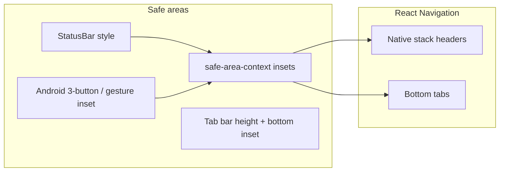

# Plan: vizuelni redizajn mobilne aplikacije (Faza 1 – audit i plan)

## 1. Sažetak audit-a repozitorija

| Oblast              | Stanje                                                                                                                                                                                                                                                                                  |
| ------------------- | --------------------------------------------------------------------------------------------------------------------------------------------------------------------------------------------------------------------------------------------------------------------------------------- |
| Lokacija aplikacije | `[mobile/](../../mobile)` — samostalan Expo projekat                                                                                                                                                                                        |
| Navigacija          | **React Navigation v7** (`@react-navigation/native-stack`, `bottom-tabs`), ulaz u `[App.tsx](../../mobile/App.tsx)`, root u ``src/navigation/index.tsx`` |
| Stil                | **Theme tokeni** (`[src/theme/colors.ts](../../mobile/src/theme/colors.ts)`, spacing, typography, fonts) + `**StyleSheet`**; **nema** `nativewind`, `tailwind`, `className`                                                                 |
| Animacije           | `react-native-reanimated` već korišten npr. na `[HomeScreen.tsx](../../mobile/src/screens/client/HomeScreen.tsx)` (`FadeIn`*); `GestureHandlerRootView` u `App.tsx`                                                                         |
| Metro               | **Nema** prilagođenog `metro.config.js` (default Expo) — potreban za NativeWind prema skill-u                                                                                                                                                                                           |
| Babel               | `[babel.config.js](../../mobile/babel.config.js)`: `babel-preset-expo` + `module-resolver` (`@` → `./src`); nema eksplicitnog `react-native-reanimated/plugin` (Expo preset obično pokriva; provjeriti nakon upgrade-a)                     |

---

## 2. Zavisnosti (upgrading-expo skill)

- **Expo SDK**: u `[package.json](../../mobile/package.json)` je `expo@^55.0.6` sa `react-native@0.83.2` i `react@19.2.0` — u skladu je sa trenutnim **SDK 55** stabilnim linijama opisanim u upgrading-expo vodiču. Prije implementacije: pokrenuti `npx expo install expo@latest` + `npx expo install --fix` i `npx expo-doctor` da se potvrdi da nema novijih patch verzija unutar SDK 55.
- **react-native-reanimated**: `4.2.1` + `**react-native-worklets@0.7.2`** — ispunjava preporuku iz skill-a za Reanimated na novijim SDK-ima.
- **NativeWind**: **nije instaliran**; nema verzije za usporedbu. Skill `expo-tailwind-setup` (izvorni skill je bio lokalna, ne-versionirana datoteka) cilja **Tailwind CSS v4 + NativeWind v5 (preview) + react-native-css**, ne „NativeWind v4“ kao zaseban stack — to treba eksplicitno usvojiti u implementacionoj fazi.

**Napomena o building-native-ui skill-u**: generički tekst kaže da Tailwind nije podržan i preporučuje inline stilove; to je u kontradikciji sa vašim ciljem NativeWind/Tailwind setup-a. U praksi: **usvojiti expo-tailwind-setup za novi UI sloj**, a postojeće ekrane migrirati postepeno (ili hibrid: tokeni + `className` na novim djelovima).

---

## 3. Tehnički setup (expo-tailwind-setup – šta uraditi u Fazi 2, ne sada)

Kada odobrite modifikacije koda, redoslijed usklađen sa skill-om:

1. **Dependencies**: `tailwindcss@^4`, `nativewind@5.x` (preview prema skill-u), `react-native-css`, `@tailwindcss/postcss`, `tailwind-merge`, `clsx`; po potrebi `resolutions` za `lightningcss` (vidi skill).
2. `**metro.config.js`**: `getDefaultConfig` + `withNativewind` sa `inlineVariables: false`, `globalClassNamePolyfill: false`.
3. `**postcss.config.mjs`**: samo `@tailwindcss/postcss`.
4. `**global.css`**: `@import` theme/preflight/utilities + platform `@media` za font varijable.
5. **Ulaz aplikacije**: import `global.css` u `[App.tsx](../../mobile/App.tsx)` (ili jedan bootstrap fajl).
6. **Wrapper komponente** (`src/tw/`): `View`, `Text`, `ScrollView`, `Pressable`, `Image` preko `useCssElement` — **bez mijenjanja** poziva API-ja u ekranima na početku; postepeno zamijeniti `View`/`Text` importe gdje se uvodi Tailwind.
7. **Babel**: skill kaže da **nije** potreban NativeWind babel preset za v5; zadržati `babel-preset-expo`.

**Alternativa manjeg opsega**: samo unaprijediti postojeći dizajn sistem (`colors`, `Card`, `Button`) i Reanimated, **bez** NativeWind-a — manje rizično za „samo UI“, ali ne ispunjava eksplicitni zahtjev za Tailwind klasama.

---

## 4. Dizajn strategija (vizuelni pravac)

- **Clean UI**: više „vazduha“ (veći ritam sekcija), konzistentan **8pt grid** (već imate `[spacing](../../mobile/src/theme/spacing.ts)`), jasna hijerarhija: Playfair za naslove, Inter za body (već u projektu).
- **Kvalitet**: zamijeniti legacy RN `shadow`* / `elevation` na karticama modernijim `**boxShadow`** stilom gdje je podržano (preporuka iz building-native-ui); `borderCurve: 'continuous'` na iOS za zaobljene kontejnere.
- **Reanimated**: ulazne/izlazne animacije liste (`FadeInDown` / `FadeInUp`), **layout animacije** (`LinearTransition`) za promjene liste termina/notifikacija, blagi **press** feedback na kartice (opciono `react-native-gesture-handler` + `Animated.View`).
- **Pristupačnost**: kontrast teksta u odnosu na `gold` na svijetloj pozadini; zadržati `selectable` na važnim tekstovima (reviews, greške) prema building-native-ui.

---

## 5. Gesture i navigacija + edge-to-edge

- **Android 3-button vs gesture bar**: koristiti `**useSafeAreaInsets()`** za donji padding scroll sadržaja gdje tab bar ne pokriva cijelu širinu ili gdje je potrebno dodatno mjesto iznad sistemskog nav bara; uskladiti `contentContainerStyle` na `ScrollView`/`FlatList` umjesto paddinga na samom scroll view-u (building-native-ui).
- **Edge-to-edge**: u implementacionoj fazi dodati provjeru Expo SDK 55 + Android dokumentacije: `**expo-system-ui`** / navigation bar appearance i eventualno `**react-native-edge-to-edge`** ili odgovarajući config plugin ako želite puni draw-behind status/nav bar uz ispravne insete. Trenutno `[app.config.js](../../mobile/app.config.js)` nema eksplicitne edge-to-edge postavke — to je predviđeno kao zaseban korak uz vizuelne testove na uređaju.
- **Tab bar**: modernizovati visinu, `paddingBottom` prema `insets.bottom`, aktivna stanja (npr. blaga pill pozadina) — isključivo stilovi u ``MainNavigator.tsx`` / ``StylistNavigator.tsx``.

---

## 6. Inventar ekrana i UI komponenti

**Ekrani (`src/screens/`)**

| Grupa   | Fajl                                                                                                                                                                                                                                                                                                                                      |
| ------- | ----------------------------------------------------------------------------------------------------------------------------------------------------------------------------------------------------------------------------------------------------------------------------------------------------------------------------------------- |
| Auth    | `auth/LoginScreen.tsx`, `auth/RegisterScreen.tsx`                                                                                                                                                                                                                                                                                         |
| Klijent | `client/HomeScreen.tsx`, `BlogListScreen.tsx`, `BlogPostScreen.tsx`, `SatisfiedClientsScreen.tsx`, `ServicesScreen.tsx`, `ServiceDetailScreen.tsx`, `ServiceSingleDetailScreen.tsx`, `ReservationScreen.tsx`, `MyReservationsScreen.tsx`, `ReviewsScreen.tsx`, `ProfileScreen.tsx`, `ChangePasswordScreen.tsx`, `NotificationsScreen.tsx` |
| Stilist | `stylist/StylistInboxScreen.tsx`, `DailyLogListScreen.tsx`, `DailyLogDetailScreen.tsx`, `DailyLogNewEntryScreen.tsx`, `ReschedulePreviewScreen.tsx`, `StylistScheduleScreen.tsx`, `StylistReservationDetailScreen.tsx`, `StylistStatsScreen.tsx`, `StylistProfileScreen.tsx`                                                              |

**Komponente (`src/components/`)**

| Komponenta                                                                                                               | Uloga                               |
| ------------------------------------------------------------------------------------------------------------------------ | ----------------------------------- |
| `[ui/Button.tsx](../../mobile/src/components/ui/Button.tsx)`                 | Primarni CTA, varijante             |
| `[ui/Card.tsx](../../mobile/src/components/ui/Card.tsx)`                     | Kontejner liste/detalja             |
| `[ui/Input.tsx](../../mobile/src/components/ui/Input.tsx)`                   | Form polja                          |
| `[ui/Badge.tsx](../../mobile/src/components/ui/Badge.tsx)`                   | Statusi                             |
| `[ui/EmptyState.tsx](../../mobile/src/components/ui/EmptyState.tsx)`         | Prazne liste                        |
| `[ui/LoadingScreen.tsx](../../mobile/src/components/ui/LoadingScreen.tsx)`   | Splash dok se fontovi/auth učitaju  |
| `[BeforeAfterSlider.tsx](../../mobile/src/components/BeforeAfterSlider.tsx)` | Before/after slike (home + dnevnik) |

---

## 7. Tabela plana rada (ekran po ekran)

| Ekran                              | Vizuelna unapređenja (samo UI sloj)                                                                                                                                                                              |
| ---------------------------------- | ---------------------------------------------------------------------------------------------------------------------------------------------------------------------------------------------------------------- |
| **LoginScreen**                    | Hero/layout: jači vertikalni ritam, kartica forme sa `boxShadow` / continuous corners; animiran ulaz polja; zadržati `SafeAreaView` edges usklađene sa edge-to-edge odlukom.                                     |
| **RegisterScreen**                 | Isti jezik komponenti kao Login; sekcije forme vizuelno grupisane; skrol regija sa `paddingBottom` = `insets.bottom`.                                                                                            |
| **HomeScreen**                     | Refiniran hero (gradient overlay, tipografija); sekcije (kategorije, blog, review) sa konzistentnim spacingom; proširiti Reanimated na liste kartica; `Dimensions` → `useWindowDimensions` gdje utiče na layout. |
| **BlogListScreen**                 | Lista kao kartice sa jedinstvenim `Card` stilom; skeleton/empty preko `EmptyState`; blagi stagger ulaz.                                                                                                          |
| **BlogPostScreen**                 | Tipografija članka (line height, margine); slike `expo-image` sa zaobljenim uglovima; čitljivost u dark modu.                                                                                                    |
| **SatisfiedClientsScreen**         | Grid/list harmonija sa `HomeScreen` karticama; placeholder slike.                                                                                                                                                |
| **ServicesScreen**                 | Kategorije / usluge: jasnija hijerarhija naslova; animacija pri expand/filter ako postoji UI lista.                                                                                                              |
| **ServiceDetailScreen**            | Galerija i opis: vertikalni tok, sticky CTA zona (vizuelno, bez promjene navigacije logike).                                                                                                                     |
| **ServiceSingleDetailScreen**      | Uskladiti sa ServiceDetail (jedan izvor stilova gdje je moguće).                                                                                                                                                 |
| **ReservationScreen**              | Kalendar (`react-native-calendars`) tematizovati bojama iz `colors`; form polja kroz `Input`; jasni step/sekcije vizuelno.                                                                                       |
| **MyReservationsScreen**           | Lista kartica sa status badge-ima; layout animacija pri promjeni filtera; pull-to-refresh vizuelno usklađen.                                                                                                     |
| **ReviewsScreen**                  | Forma ocjene (zvezde) i tekstualno polje: fokus stanja, spacing, `selectable` na porukama.                                                                                                                       |
| **ProfileScreen**                  | Avatar sekcija, lista stavki (settings-like); separatori i touch feedback.                                                                                                                                       |
| **ChangePasswordScreen**           | Tri polja + CTA: ista širina i validacioni vizuelni prostor kao ostale forme.                                                                                                                                    |
| **NotificationsScreen**            | Lista notifikacija: unread vizuelni akcent; swipe opcija kasnije samo ako ostane čisto UI (gesture).                                                                                                             |
| **StylistInboxScreen**             | Inbox kartice: prioritet vizuelne hijerarhije (datum, status); prazan inbox — `EmptyState`.                                                                                                                      |
| **DailyLogListScreen**             | Lista zapisa: kartice, sličan ritam kao rezervacije.                                                                                                                                                             |
| **DailyLogDetailScreen**           | Slike + tekst: full-width slike, tipografija; `BeforeAfterSlider` stil usklađen sa home.                                                                                                                         |
| **DailyLogNewEntryScreen**         | Forma + picker slike: jasni koraci vizuelno (bez promjene submit logike).                                                                                                                                        |
| **ReschedulePreviewScreen**        | Preview promjena: tabele/liste čitljive, naglašene promjene bojom (semantički, iz theme tokena).                                                                                                                 |
| **StylistScheduleScreen**          | Kalendar/raspored: teme i boje konzistentne sa klijentskim kalendarom.                                                                                                                                           |
| **StylistReservationDetailScreen** | Detalji termina u sekcijama (Card); akcije kao `Button` varijante.                                                                                                                                               |
| **StylistStatsScreen**             | Brojke sa `tabular-nums`; jednostavni „stat“ blokovi umjesto gustog teksta.                                                                                                                                      |
| **StylistProfileScreen**           | Profil stil kao klijent ali sa stilist poljima; edit mode vizuelno odvojen.                                                                                                                                      |

**Zajednički UI zadaci (paralelno sa ekranima)**

| Komponenta                      | Unapređenje                                                                                        |
| ------------------------------- | -------------------------------------------------------------------------------------------------- |
| **Button**                      | Opcioni `layout` animacija / press scale; disabled stanje kontrastnije.                            |
| **Card**                        | `boxShadow` umjesto shadow/elevation gdje je moguće; opciono `Pressable` + Reanimated za feedback. |
| **Input**                       | Fokus border/ring iz theme-a; visina i padding usklađeni.                                          |
| **Badge**                       | Veličine za listu vs detalj.                                                                       |
| **EmptyState**                  | Ilustracija ili ikona, tipografija, jedan CTA stil.                                                |
| **LoadingScreen**               | Blagi branded animacija (Reanimated) umjesto čistog spinnera.                                      |
| **BeforeAfterSlider**           | Ručke i linija: touch target veći; vizuelno usklađeno sa novim Card stilom.                        |
| **Navigacija (Main + Stylist)** | Tab bar safe area, ikone (outline/filled za active), badge pozicija.                               |

---

## 8. Rizici i ograničenja

- **NativeWind v5 je preview**: zakucati verzije i testirati nakon svakog `npm install`; alternativa je ostati na token + StyleSheet dok preview ne stabilizuje tim.
- **Ne dirati**: potpise funkcija komponenti, `useState` / `useEffect` tokove, `api.`* pozive, Zustand store logiku — samo JSX struktura može ostati ista uz promjenu stilova/wrappera.
- **react-native-calendars**: teming je uglavnom props/CSS-like objekti; pažljivo da se ne pokvari selekcija datuma.

---

## 9. Predloženi redoslijed implementacije (Faza 2+, nakon odobrenja)

1. Odluka: **pun NativeWind setup** vs **token-only redesign**.
2. Ako NativeWind: dependency + metro + postcss + `global.css` + minimalni `src/tw/` + jedan pilot ekran (npr. `LoginScreen`).
3. Dizajn sistem: `Card`, `Button`, `Input`, navigacija tab bar.
4. Klijentski flow: Home → Services → Reservation → MyReservations.
5. Profil + auth.
6. Stilist flow: Inbox → Schedule → Daily log.
7. Edge-to-edge i finalni test na Android (3-button + gesture).
