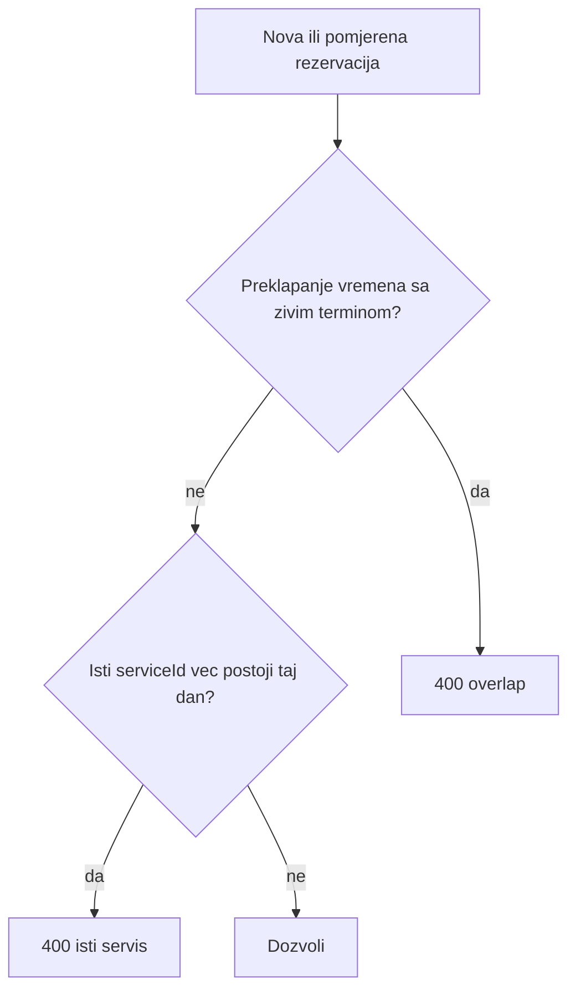

# Multi-booking (M2 + unique servis/dan)

**ID:** `multi-booking` (POLICY_BACKLOG #3)
**Odluka (Ask):** M2 — neograničen broj rezervacija isti dan, uz dva guarda. Više servisa u **jednoj** rezervaciji ostaje.

Nakon odobrenja (prije koda): upisati `.cursor/plans/multi-booking/` + `POLICY_BACKLOG` → `planned`.

## Pravilo

- **Overlap:** `start < other.end && end > other.start` (`intervalsOverlap` u [time-slot.utils.ts](backend/src/reservations/utils/time-slot.utils.ts)). Statusi: `PENDING`, `STYLIST_REVIEW`, `CONFIRMED`, `ATTENDANCE_CONFIRMED`, `IN_PROGRESS`. Pauza između klijentovih termina nije obavezna.
- **Isti servis:** presjek `serviceId` iz `ReservationServiceItem` (fallback `Reservation.serviceId` ako nema items). Statusi: živi + `AWAITING_DAILY_LOG` + `COMPLETED`. Cancel / `NO_SHOW` ne broje se.
- **Isto** za klijentski create, admin STANDARD create, staff direct.
- **Isti assert** na admin PATCH, stylist reorder request, klijent accept reschedule, overrun commit (predložena vremena), disposition reorder (`targetDate` + vrijeme).
- Nema novog settinga, nema Prisma migracije.

## Shared helper

Novi fajl [backend/src/reservations/utils/assert-client-day-booking.ts](backend/src/reservations/utils/assert-client-day-booking.ts) (isti stil kao [assert-admin-working-hours.ts](backend/src/reservations/utils/assert-admin-working-hours.ts)):

`assertClientDayBookingAllowed({ prisma, clientId, reservationDate, startTime, endTime, serviceIds, excludeReservationId })`

- Dan preko UTC midnight (`parseDateOnly` / `YYYY-MM-DD`), ne `setHours` lokalno (današnji create) niti miješati s `setUTCHours` iz direct-create.
- Jedan `findMany` ostalih rezervacija klijenta tog dana + `items`.
- Poruke (BS): overlap s postojećim `HH:mm–HH:mm`; dupli servis s imenom servisa.
- Konstante u [constants.ts](backend/src/reservations/constants.ts): `CLIENT_LIVE_STATUSES`, `CLIENT_SERVICE_DAY_STATUSES`.

## Call sites (zamjena 1/dan guarda)

- [reservation-create.service.ts](backend/src/reservations/reservation-create.service.ts) linije 74–99 — ukloniti `existingSameDay` / `activeStatuses`.
- [reservation-direct-create.service.ts](backend/src/reservations/reservation-direct-create.service.ts) linije 125–147 — ukloniti `sameDay` 1/dan (stylist slot conflict ostaje).
- [reservation-update.service.ts](backend/src/reservations/reservation-update.service.ts) `updateByAdmin` — poslije working-hours, prije/uz postojeći stilist overlap; učitati `items`.
- [reservation-reorder.service.ts](backend/src/reservations/reservation-reorder.service.ts) `requestReorder`.
- [reservation-reschedule-client.service.ts](backend/src/reservations/reservation-reschedule-client.service.ts) `acceptReschedule` (predloženo vrijeme).
- [reservation-reschedule-commit.service.ts](backend/src/reservations/reservation-reschedule-commit.service.ts) — po `proposal.items` prije zapisa PENDING predloga (da klijent ne dobije predlog koji ne može prihvatiti).
- [daily-log-disposition.service.ts](backend/src/daily-log/daily-log-disposition.service.ts) — uz `assertReorderSlotFree` kad je `action === 'reorder'`.

## Testovi

- [assert-client-day-booking.spec.ts](backend/src/reservations/utils/assert-client-day-booking.spec.ts): OK različiti servisi bez overlap; blok overlap; blok isti `serviceId` (uključujući `COMPLETED`); cancel ne blokira; `excludeReservationId` ignoriše self.
- Create happy-path u [reservations.service.spec.ts](backend/src/reservations/reservations.service.spec.ts) već mocka `findFirst(null)` — prilagoditi mock na `findMany([])` ako helper koristi `findMany`.
- Jedan PATCH slučaj u [reservation-update.service.spec.ts](backend/src/reservations/reservation-update.service.spec.ts) ako mock ostane kompatibilan.

## Docs (logika se mijenja)

- [MATRIX.md](.cursor/docs/matrices/reservations/MATRIX.md) + [CHANGELOG.md](.cursor/docs/matrices/reservations/CHANGELOG.md) — sekcija client-day.
- [RESERVATION_MODULE.md](.cursor/docs/reservations/RESERVATION_MODULE.md) §6.1 (max 1/dan).
- [POLICY_BACKLOG.md](.cursor/docs/reservations/POLICY_BACKLOG.md) → `done` tek na zatvaranju implementacije.

## Out of scope

- Availability / date-picker filtriranje već bookanih servisa (400 na submit je dovoljno; postojeći UI već pokazuje API poruku).
- Slot-hold, attendance-policy, disposition UX/notify/reminder.
- Novi settings key / M1 max N.
