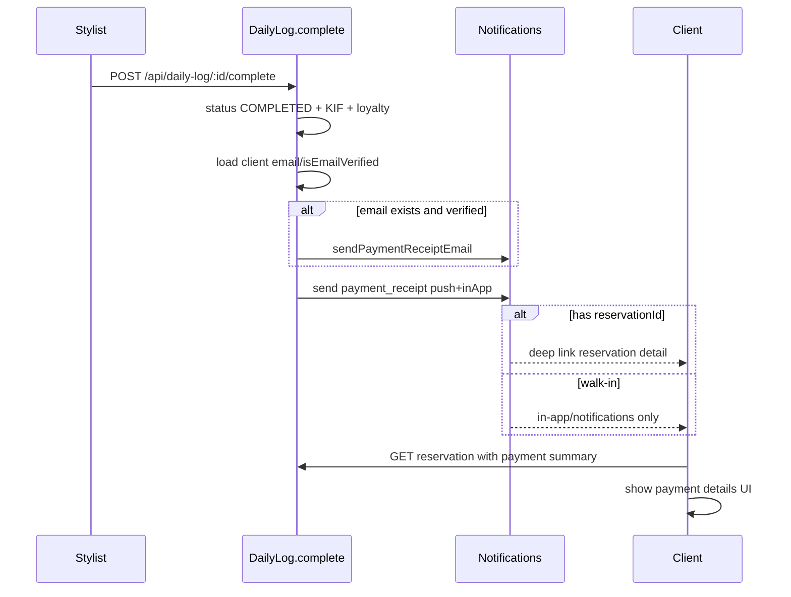

# Payment receipt na complete dnevne knjige

## Odluke (zaključano)

- **Email + push**: na `PENDING → COMPLETED` za `kind=SERVICE` ako postoji `clientId` — uvijek pokušaj push/in-app; email samo ako klijent ima email i `isEmailVerified === true` (inače skip email).
- **Deep link / detalj uplate**: samo kad postoji `reservationId`. Walk-in (`clientId` bez rezervacije) dobija email/push bez deep linka na rezervaciju.
- **UI**: i **mobile** i **web** — tap na rezervaciju otvara detalj s uplatom iz proknjiženog zapisa.

## Tok

## Faza 1 — Backend: notifikacija + email račun

**Hook** na kraju `[DailyLogService.complete](backend/src/daily-log/daily-log.service.ts)` (nakon KIF/loyalty), fire-and-forget `.catch` da ne ruši complete:

- Novi helper modul (da `daily-log.service.ts` ne raste): npr. `[backend/src/daily-log/daily-log-receipt.service.ts](backend/src/daily-log/daily-log-receipt.service.ts)`
  - Učitaj klijenta (`email`, `isEmailVerified`, `firstName`)
  - Učitaj entry sa `items`, stilistom, `publicReferenceCode`, `actualPrice`, `tipAmount`, settled debts ako su u include
  - `notifications.send({ type: 'payment_receipt', channel: 'BOTH'|'PUSH', data: { kind: 'payment_receipt', reservationId?, dailyLogEntryId, publicReferenceCode } })`
  - Ako `email && isEmailVerified`: poseban `sendPaymentReceiptEmail(...)` koji koristi postojeći `buildDefaultEmailTemplate` stil (isti gradient layout kao verification/ostali mailovi) — **business receipt, ne zavisi od email preference** (kao verification); push/in-app i dalje kroz `send()` + preference.

**Notifications** (`[notifications.service.ts](backend/src/notifications/notifications.service.ts)`):

- Dodati `payment_receipt` u `NotificationType`
- CTA/plainText mape + registry key `system_email_template_payment_receipt` u `[settings-registry.ts](backend/src/settings/settings-registry.ts)`
- Receipt HTML body: lista usluga (naziv + unitPrice), naplaćeno (`actualPrice`), napojnica (`tipAmount`), referenca `DK-…`, zahvalnica; CTA na web `/moje-rezervacije` ako ima `reservationId`, inače app URL

**Skip**: `kind !== 'SERVICE'`, nema `clientId`, već COMPLETED (ranije return).

## Faza 2 — Backend: client payment summary na rezervaciji

Proširiti `[reservation-queries.service.ts` `findOne](backend/src/reservations/reservation-queries.service.ts)` (ili mali mapper poslije queryja):

- Include completed `DailyLogEntry` gdje `reservationId = id`, `kind=SERVICE`, `deletedAt=null`, `status=COMPLETED` (najnoviji ako ih više bude)
- Client-safe payload (bez admin polja), npr. `paymentSummary: { publicReferenceCode, actualPrice, tipAmount, serviceAmount, completedAt, items: [{ name, unitPrice }], loyaltyDiscountAmount? } | null`
- Alternativa ako želimo tanki findOne: `GET /api/reservations/:id/payment` — **preferirati proširenje findOne** da mobile/web jednim pozivom dobiju sve (client već smije `GET /api/reservations/:id`).

Guard ostaje: samo vlasnik rezervacije / stilist / admin.

## Faza 3 — Mobile UI + deep link

- Novi ekran `ClientReservationDetailScreen` + Expo route `[mobile/app/(tabs)/reservations/[reservationId].tsx](mobile/app/(tabs)`/reservations/) (type `ReservationDetail` već postoji u `[types.ts](mobile/src/navigation/types.ts)`)
- Prikaz: usluge, termin, stilist, status; ako `paymentSummary` — blok “Uplata” (stavke, naplaćeno, tip, referenca)
- `[MyReservationsScreen](mobile/src/screens/client/MyReservationsScreen.tsx)`: tap na karticu → `navigate('ReservationDetail', { reservationId })` (action dugmad stopPropagation / ne navigiraju)
- `[resolve-push-route.ts](mobile/src/utils/resolve-push-route.ts)`: `payment_receipt` + `reservationId` → `/reservations/[reservationId]`; bez `reservationId` → `/profile/notifications`
- i18n BS/EN ključevi za receipt copy

## Faza 4 — Web UI

- Nova ruta/stranica ili sheet: npr. `/moje-rezervacije/:id` ili drawer na tap u `[MyReservations.tsx](frontend/src/pages/public/MyReservations.tsx)` + `[my-reservation-card.tsx](frontend/src/features/client-reservations/my-reservation-card.tsx)`
- Preferirati **detail page** konzistentno s deep linkom iz email CTA; na mobile breakpointu sheet/drawer OK po global UX pravilu
- Isti `paymentSummary` prikaz kao na mobile

## Faza 5 — Matrica + testovi

- Update `[.cursor/docs/matrices/daily-log/MATRIX.md](.cursor/docs/matrices/daily-log/MATRIX.md)` + `CHANGELOG.md`: PENDING→COMPLETED nuspojave = email receipt (conditional) + push `payment_receipt`
- Unit testovi: receipt service (skip bez email/unverifikovan; send kad verified; push data s/bez reservationId); `complete` zove receipt; findOne vraća paymentSummary samo za COMPLETED entry
- Plan folder (jer >3 faze): `.cursor/plans/payment-receipt-on-complete/` (`00_overview.md`, phase fajlovi, `CHECKLIST.md`, `CHANGELOG.md`, `HANDOFF.md`)

## Van scopea

- PDF račun / fiskalni račun
- Prikaz uplate za walk-in bez rezervacije u klijentskom UI (nema rezervacije za tap)
- Promjena KIF/loyalty logike
