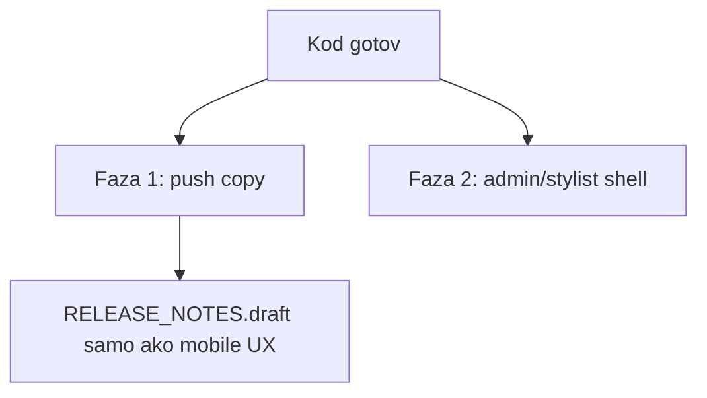

# Push copy + admin/stylist web layout

Dva odvojena posla u ovom planu. Javni web (`frontend/src/features/shell/public`, `pages/public`) se **ne** dira.

## Faza 1 — Push / in-app sadržaj

Kanal je već [`NotificationsService.send`](backend/src/notifications/notifications.service.ts): isti `title`/`body` idu u DB, socket i Expo. UX se popravlja na **mjestu slanja**, ne u FCM payload strukturi.

**Helper** (novi fajl, ~80–120 linija), npr. [`backend/src/notifications/utils/reservation-push-copy.ts`](backend/src/notifications/utils/reservation-push-copy.ts):

- Ulaz: `ref` (`publicReferenceCode`), lista usluga, datum, `start`/`end`, opciono `attendanceRequired`, opciono `confirmWithinMinutes`, `reason`.
- Datum `DD.MM.YYYY`, vrijeme `HH:mm`.
- Usluge: imena iz `items.service.name` (fallback `service.name`); ako ih ima >3: `Usluga1, Usluga2, Usluga3 i još N`.
- Body cap ~220 znakova (Android/iOS preview) — skratiti listu usluga prije rečenice o potvrdi.
- Predlošci (BS, profesionalno, bez jargona):

| Kind | Naslov | Tijelo (smisao) |
| --- | --- | --- |
| Pomjereno, bez klijentske potvrde termina (`reservation_time_changed`) | Termin pomjeren | `Termin za rezervaciju {ref}, koja sadrži: {usluge}, pomjeren je na {datum} u {start} do {end}.` + `Molimo da potvrdite dolazak.` **ili** `Potvrda dolaska nije potrebna.` prema `attendancePolicy === CLIENT_REQUIRED` |
| Prijedlog pomjeranja / reorder (klijent mora odgovoriti) | Prijedlog novog termina | Ista baza + `Potvrdite u narednih {N} min.` |
| Reschedule zbog kašnjenja | Promjena termina | Ref + usluge + novo vrijeme + rok potvrde |
| Potvrđena (stilist accept) | Rezervacija potvrđena | Ref + usluge + datum/vrijeme + dolazak da/ne |
| Otkaz (timeout dolaska, inbox, admin, klijent→stilist, no-show) | kontekstualni naslov | Ref + usluge + kratak razlog |
| DK reminder stilisti | Dnevna knjiga | Ref + da čeka naplatu/odluku |
| Uplata / dug | ostaje iznos + ref | dodati ref/usluge gdje su već u ruci |
| Delay warning | Moguće kašnjenje | Ref + da obavijestimo o tačnom vremenu |

**Load konteksta:** mali `loadReservationPushContext(id)` (ref, date, times, item names, `attendancePolicy`) da senderi ne šalju polu-prazan DTO. [`notifyClientTimeChanged`](backend/src/reservations/reservation-notify.service.ts) proširiti ili interno učitati kontekst umjesto samo date/time (trenutno: *„Termin je pomjeren… Nije potrebna vaša potvrda.“* uvijek).

**Call sites** (samo copy, isti `type`/`kind`/`data` za deep link):

- [`reservation-notify.service.ts`](backend/src/reservations/reservation-notify.service.ts)
- [`reservation-update.service.ts`](backend/src/reservations/reservation-update.service.ts) (već zove time-changed)
- [`reservation-reorder.service.ts`](backend/src/reservations/reservation-reorder.service.ts)
- [`reservation-reschedule-commit.service.ts`](backend/src/reservations/reservation-reschedule-commit.service.ts)
- [`reservation-stylist-accept.service.ts`](backend/src/reservations/reservation-stylist-accept.service.ts)
- cancel/no-show: [`reservation-attendance-cron.service.ts`](backend/src/reservations/reservation-attendance-cron.service.ts), [`reservation-inbox-cron.service.ts`](backend/src/reservations/reservation-inbox-cron.service.ts), [`reservation-runtime-cancel.service.ts`](backend/src/reservations/reservation-runtime-cancel.service.ts), [`reservation-client-actions.service.ts`](backend/src/reservations/reservation-client-actions.service.ts), [`daily-log-disposition-apply.ts`](backend/src/daily-log/daily-log-disposition-apply.ts)
- stilist DK: `notifyStylistPendingDailyLog`
- receipt/debt: lagano obogatiti refom

Holiday / blog / generic ostaju.

**Testovi:** unit na helper (format datuma, 1 vs 4 usluge, attendance da/ne, cap). Ažurirati postojeće expecte `body` u `reservation-notify.service.spec.ts` i srodnim specovima.

In-app lista na mobilnom već prikazuje `title`/`body` iz API-ja — nema obaveznog mobile UI rada. Draft napomena **samo ako** se vidi drugačiji tekst na lock screenu (vidi se) → jedna linija u [`mobile/RELEASE_NOTES.draft.md`](mobile/RELEASE_NOTES.draft.md) po pravilu (bez bump-a dok ne ide APK).

## Faza 2 — Admin + stylist web: širina i kompaktnost

**Uzrok stiska na 24":** shell je [`max-w-7xl`](frontend/src/features/shell/admin/admin-layout.tsx) (~1280px) na 1920px monitoru; tabele imaju `overflow-x-auto` pa scroll unutar uskog stupca.

**Shell (javni layout ne dirati):**

- [`admin-layout.tsx`](frontend/src/features/shell/admin/admin-layout.tsx): `max-w-7xl` → `max-w-[1600px]` (header + grid); `lg:grid-cols-[220px_1fr]`; `py-6` → `py-4`; `min-w-0` na `main` ostaje.
- [`StylistLayout.tsx`](frontend/src/layouts/StylistLayout.tsx): `max-w-6xl` → isti `max-w-[1600px]`, kompaktniji `py`.
- Unutrašnji dupli cap: [`Settings.tsx`](frontend/src/pages/Settings.tsx) `max-w-6xl` unutar admin shella ukloniti ili uskladiti.

**Tabele (bez rewrite svake stranice):** u [`frontend/src/index.css`](frontend/src/index.css) (ili mali `admin-surface.css` importovan iz admin+stylist layouta) klase:

- `.app-table-wrap`: `w-full min-w-0 overflow-x-auto xl:overflow-x-visible`
- `table.app-table`: `w-full table-fixed` + `text-sm`; `th/td`: `px-2 py-1.5`, `truncate` na tekst kolone

Primijeniti wrap klasu na postojeće `overflow-x-auto` tabele u admin/stylist (rezervacije, korisnici, DK, finance, analytics, salon, loyalty, blog, notifications, reviews) — zamjena wrappera, ne nova tabela biblioteka.

Cilj: 24" bez lažnog horizontalnog scrolla kad kolone stanu; 15.6" (~1366–1600) gustiji padding, scroll samo ako je stvarno previše kolona.

**Out of scope:** novi kalendar, public one-pager, promjena push kanala/FCM data contract osim `title`/`body`.
