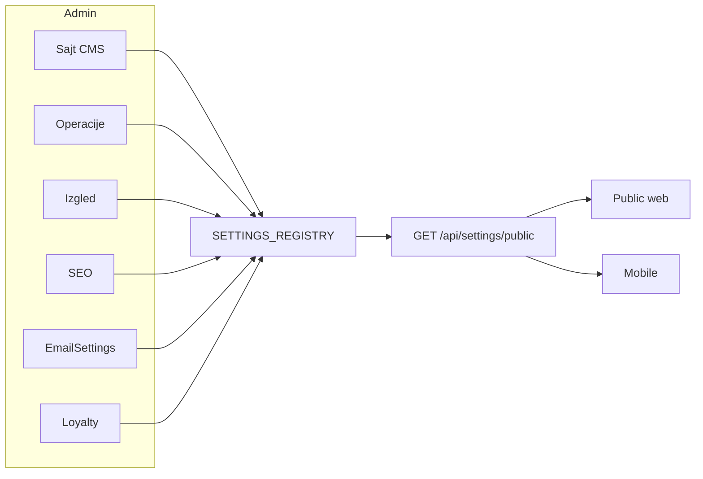

# Settings: moduli, cleanup i stvarni efekat

Plan folder (više od 3 faze): `.cursor/plans/settings-modules-cleanup/` (`00_overview.md`, `01_phase-*.md`, `CHECKLIST.md`, `CHANGELOG.md`, `HANDOFF.md`).

Odluke iz reviewa su fiksirane. Izvor kontrakta ostaje [backend/src/settings/settings-registry.ts](backend/src/settings/settings-registry.ts). Admin UI danas je monolit [frontend/src/pages/Settings.tsx](frontend/src/pages/Settings.tsx) (~1000 linija) — mora se rascijepiti (limit ~200 linija po fajlu).

## Faza 1 — Registry cleanup + novi ključevi

**Ukloniti iz registryja i UI (E):**
`public_hero_cta_link`, cijeli peek (`public_services_peek_*`, `public_service_{1,2,3}_*`), `public_footer_copyright`, `app_logo_icon`, `app_logo_text`, `system_app_version`, `system_email_provider`, `system_reservation_lock_minutes`, `system_reservation_auto_cancel`, `public_contact_working_hours_text`.

Stari redovi u `app_settings` ostaju kao Legacy dok ih admin ne obriše; nema Prisma migracije za KV.

**Zadržati / dodati:**

- `public_hero_cta_text` — opis: **samo mobilni** hero CTA. Web ne čita ovaj ključ.
- `public_hero_cta_text_web` — novi PUBLIC string; default = trenutni hardkod: `Rezervišite termin` (isto kao `t('public.nav.reserve')` na BS).
- `public_cta_title` / `public_cta_subtitle` — u registry + UI; defaulti iz [PublicHome.tsx](frontend/src/pages/public/PublicHome.tsx): `Spremni za novu frizuru?` / `Rezervišite termin online u par klikova.`
- `salon.timezone` — ostaje PRIVATE; dobija UI.
- Feature flagovi PUBLIC boolean (default `true`): `public_feature_blog`, `public_feature_gallery`, `public_feature_reviews`.
- Izgled PUBLIC: `theme_primary` (`#632238`), `theme_accent` (`#D4A843`) — mapiraju se na CSS varijable, ne na 100 Tailwind klasa.
- SEO PUBLIC: `seo_default_title`, `seo_default_description`, `seo_og_image`; po ruti `seo_page_{home,services,blog,gallery,contact,reserve}_title` + `_description`. Canonical/base URL: postojeći `public_site_base_url` (bez trećeg URL ključa).
- Push PRIVATE: `system_push_enabled` (default `true`) — globalni AND preko user `pushEnabled` u `NotificationsService.send`.
- `system_notif_reminder_hours` ostaje; dobija cron.

Ažurirati `[.cursor/docs/app-settings.md](.cursor/docs/app-settings.md)`.

## Faza 2 — Admin IA: odvojeni moduli

Rute (sve pod `/admin`, ista role guard):

- `/admin/settings` — Sajt (CMS grupe: održavanje, hero, o nama, highlights, kontakt, social, share, footer, rezervacija stranica, usluge/galerija/blog hero, auth vizuali, feature flagovi).
- `/admin/settings/operations` — timezone, rezervacijski rokovi (`attendance` / `inbox` / `daily_log_reminder`), `system_notif_reminder_hours`, `system_push_enabled`. Lock minuta ostaje na [Salon.tsx](frontend/src/pages/Salon.tsx).
- `/admin/settings/appearance` — `app_title`, `app_logo`, logo boje/animacija, `theme_primary`, `theme_accent`.
- `/admin/settings/seo` — SEO ključevi.

Nav: pod **Sistem** stavke umjesto jednog “Postavke”, ili jedan “Postavke” s unutrašnjim tabovima/sidebarom (preferirati unutrašnji sidebar na `/admin/settings/`* da se nav ne raspline).

**Ukloniti iz Postavki:** loyalty grupa; `system_notif_email_from/name` i `system_public_app_url` (ostaju [EmailSettings.tsx](frontend/src/pages/EmailSettings.tsx)).

Ekstrakcija: `frontend/src/features/settings/` — shared `SettingEditor`, group panel, API load/save. Svaki modul < 200 linija.

## Faza 3 — Konzumenti (web / mobile / backend)

**Hero web CTA:** [PublicHome.tsx](frontend/src/pages/public/PublicHome.tsx) hero dugme čita `public_hero_cta_text_web` (link i dalje `/rezervacija`). Mobile i dalje `public_hero_cta_text`. Hero naslov na mobile **ne** dirati (odluka 24).

**Pozadine (isti pattern kao `public_services_bg`):**
`public_contact_bg` na [PublicContact.tsx](frontend/src/pages/public/PublicContact.tsx); `public_gallery_bg` / `public_blog_bg` na Gallery/BlogList.

**Radno vrijeme:** Contact web + [ContactScreen.tsx](mobile/src/screens/client/ContactScreen.tsx) formatiraju `workingHours` iz javnog `GET /api/salon` (već include). Ukloniti setting ključ.

**Feature flagovi:** filter `publicNav` u [public-layout.tsx](frontend/src/features/shell/public/public-layout.tsx); guard rute ili redirect; sakriti home sekciju recenzija / link na `/zadovoljni-klijenti`; mobile Home blog blok + blog-list stack ako je flag off.

**Boje:** `SettingsContext` postavlja `--brand-primary` i `--brand-accent` na `document.documentElement`. Tailwind `brand.gold` / champagne-adjacent koristiti `var(--brand-accent)` gdje je to jedan config edit u [tailwind.config.js](frontend/tailwind.config.js). Logo boje ostaju zasebno.

**Timezone UI:** select (npr. `Europe/Sarajevo`, `Europe/Zagreb`, `Europe/Belgrade`, `UTC`) na Operacije.

**Podsjetnik N sati prije termina:** danas **ne postoji** cron. Dodati `reminderSentAt` na `Reservation` (Prisma migracija) + `processAppointmentReminders()` u tick [reservation-delay.cron.ts](backend/src/reservations/reservation-delay.cron.ts): statusi `CONFIRMED` | `ATTENDANCE_CONFIRMED`, start u prozoru oko `system_notif_reminder_hours`, kanal `BOTH`, `kind: 'appointment_reminder'`, idempotentno preko `reminderSentAt`. Unit test.

**Push master:** u [notifications.service.ts](backend/src/notifications/notifications.service.ts) `sendPush` / `doPush` samo ako `system_push_enabled` nije false.

## Faza 4 — Loyalty samo na Loyalty stranici

[Loyalty.tsx](frontend/src/pages/Loyalty.tsx) trenutno ima samo `loyalty_enabled`. Proširiti formom preko `GET /api/loyalty/settings`:

- number/switch polja (points, tip, min amount, redeem, rate, min points, max %)
- excluded services: multi-select iz `/api/services` (ne JSON textarea)
- tiers: lista redova (id, name, minPoints) → JSON na save

Ključevi ostaju u registryju; samo UI lokacija se mijenja.

## Faza 5 — SEO

[site.ts](frontend/src/seo/site.ts) ostaje fallback. [Seo.tsx](frontend/src/seo/Seo.tsx) / [SeoRouteDefaults.tsx](frontend/src/seo/SeoRouteDefaults.tsx) čitaju public settings: title/description/og image, `public_site_base_url` za canonical umjesto hardkodiranog `site.baseUrl` kad je postavljen. Per-page override iz `seo_page_*`.

## Testovi i mobile draft

- Registry: unknown keys rejected; novi ključevi imaju default.
- Reminder cron: šalje jednom, poštuje sati.
- Notifications: `system_push_enabled=false` ne zove Expo.
- Ako mobile UX (flagovi, radno vrijeme): [mobile/RELEASE_NOTES.draft.md](mobile/RELEASE_NOTES.draft.md).

## Van opsega

- Lock minuta / pause: Salon.
- SMTP detalji: EmailSettings.
- Mobile hero title.
- Push per-type admin (user prefs već postoje na Notifications).
