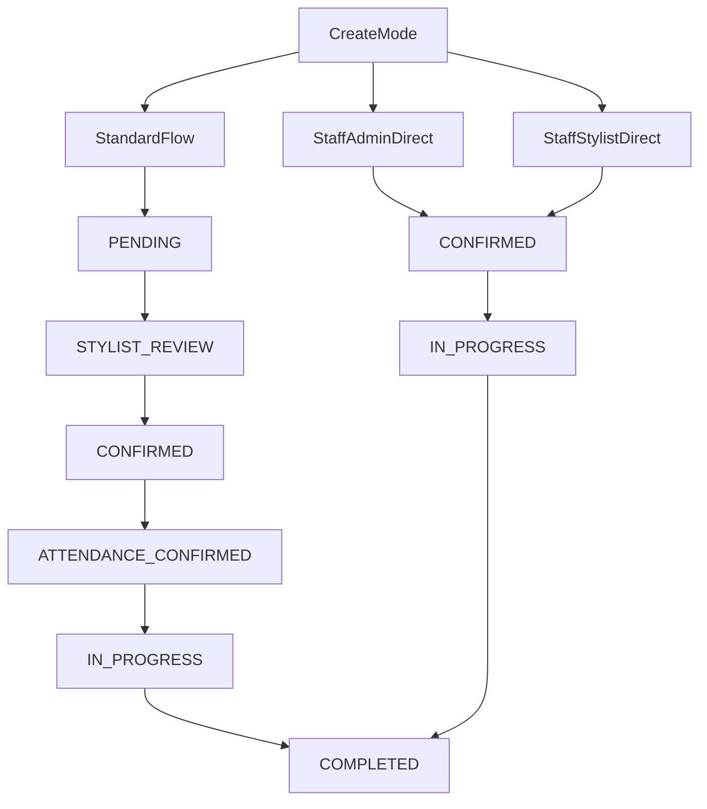

# Staff Direct Booking Plan

## Goal

Uvesti tri eksplicitna create moda za rezervacije:

- `CLIENT_SELF_SERVICE` / standardni tok s punom matricom
- `STAFF_ADMIN_DIRECT` / admin direktno dodjeljuje klijenta i stilistu
- `STAFF_STYLIST_DIRECT` / stilist kreira dogovoreni termin za svog klijenta

Pri tome zadržati postojeći rezervacijski engine, ali razdvojiti:

- porijeklo termina
- način dodjele stiliste
- attendance pravilo

## Locked Decisions

- Auto-start za standardni flow radi samo za `ATTENDANCE_CONFIRMED`.
- Admin create nema default mode; admin svaki put eksplicitno bira tok.
- Standard admin create ostaje podržan i prolazi punu postojeću matricu.
- Direktni staff tok ne koristi lažni `ATTENDANCE_CONFIRMED`, nego policy-aware `CONFIRMED`.

## Current Code Anchors

- Facade i ulazne tačke rezervacija su u [backend/src/reservations/reservations.service.ts](backend/src/reservations/reservations.service.ts).
- Admin create danas samo delegira na standardni create u [backend/src/reservations/reservation-create.service.ts](backend/src/reservations/reservation-create.service.ts).
- Runtime start guard trenutno striktno traži `ATTENDANCE_CONFIRMED` u [backend/src/reservations/reservation-runtime.service.ts](backend/src/reservations/reservation-runtime.service.ts).
- Attendance CRON i timeout logika su u [backend/src/reservations/reservation-attendance-cron.service.ts](backend/src/reservations/reservation-attendance-cron.service.ts).
- Source-of-truth matrica je u [.cursor/docs/matrices/reservations/MATRIX.md](.cursor/docs/matrices/reservations/MATRIX.md).
- Trenutna dokumentacija toka je u [.cursor/docs/reservations/RESERVATION_MODULE.md](.cursor/docs/reservations/RESERVATION_MODULE.md).

## Proposed Domain Model

Dodati policy sloj na `Reservation` model:

- `bookingOrigin`: `CLIENT_SELF_SERVICE | STAFF_ADMIN | STAFF_STYLIST`
- `acceptanceMode`: `INBOX | DIRECT_ASSIGN`
- `attendancePolicy`: `CLIENT_REQUIRED | STAFF_WAIVED`
- `createdByUserId` za audit staff kreiranja
- opcionalno `attendanceWaivedAt` i `attendanceWaivedByUserId`

Time status ostaje istinit, a pravila prelaza i runtime ponašanje se računaju iz kombinacije `status + policy`.

## Target Flows

### Standard flow

`PENDING -> STYLIST_REVIEW -> CONFIRMED -> ATTENDANCE_CONFIRMED -> IN_PROGRESS -> COMPLETED`

### Staff direct flow

`CONFIRMED (DIRECT_ASSIGN + STAFF_WAIVED) -> IN_PROGRESS -> COMPLETED`

### High-level decision graph

## Implementation Phases

## Phase 1: Schema and policy foundation

Update [backend/prisma/schema.prisma](backend/prisma/schema.prisma) to add the new policy and audit fields.

Also update reservation constants/helpers in [backend/src/reservations/constants.ts](backend/src/reservations/constants.ts) and introduce central helpers such as:

- `canConfirmAttendance()`
- `canStartReservation()`
- `shouldRunAttendanceCron()`
- `isDirectAssignedReservation()`

Acceptance criteria:

- Existing reservations get safe defaults via migration/backfill.
- No existing standard flow behavior changes yet.
- Helper layer becomes the single policy source of truth.

## Phase 2: Create path split

Refactor [backend/src/reservations/reservation-create.service.ts](backend/src/reservations/reservation-create.service.ts) so that admin create no longer blindly delegates to the standard create path.

Introduce explicit create modes:

- standard admin create: current inbox flow
- admin direct create: direct stylist assignment, no stylist responses
- stylist direct create: stylist self-assigns the slot

DTO work likely belongs in:

- [backend/src/reservations/dto/admin-create-reservation.dto.ts](backend/src/reservations/dto/admin-create-reservation.dto.ts)
- new stylist direct DTO under `backend/src/reservations/dto/`

Acceptance criteria:

- Standard admin create still produces `PENDING` + stylist responses.
- Direct admin/stylist create produces `CONFIRMED` + `confirmedStylistId` + no inbox rows.
- Slot and working-hours validation still run for all create modes.

## Phase 3: Runtime and CRON policy enforcement

Update runtime guards in [backend/src/reservations/reservation-runtime.service.ts](backend/src/reservations/reservation-runtime.service.ts), attendance actions in [backend/src/reservations/reservation-client-actions.service.ts](backend/src/reservations/reservation-client-actions.service.ts), and attendance timeout logic in [backend/src/reservations/reservation-attendance-cron.service.ts](backend/src/reservations/reservation-attendance-cron.service.ts).

Key rules:

- `confirmAttendance` only for `CLIENT_REQUIRED`.
- `stylistStart` allowed for:
  - `ATTENDANCE_CONFIRMED`, or
  - `CONFIRMED + STAFF_WAIVED + confirmedStylistId`
- attendance CRON skips `STAFF_WAIVED`
- auto-start for standard flow limited to `ATTENDANCE_CONFIRMED`

Acceptance criteria:

- Standard client flow remains intact.
- Staff direct flow can start from `CONFIRMED` without fake attendance.
- Attendance timeout never touches direct staff bookings.

## Phase 4: API surface and query shape

Extend controllers/queries so clients can distinguish the new modes.

Primary files:

- [backend/src/reservations/reservations.controller.ts](backend/src/reservations/reservations.controller.ts)
- [backend/src/reservations/reservation-queries.service.ts](backend/src/reservations/reservation-queries.service.ts)
- [backend/src/reservations/dto/query-reservations.dto.ts](backend/src/reservations/dto/query-reservations.dto.ts)

Acceptance criteria:

- Reservation payloads include origin/policy fields needed by web/mobile.
- New direct stylist endpoint is exposed cleanly.
- No ambiguity remains between standard and direct reservations in API responses.

## Phase 5: Web admin UX

Update admin calendar reservation create UX to require explicit mode selection every time.

Likely files:

- [frontend/src/features/reservations/components/ReservationScheduler.tsx](frontend/src/features/reservations/components/ReservationScheduler.tsx)
- [frontend/src/pages/Reservations.tsx](frontend/src/pages/Reservations.tsx)
- shared reservation status helpers in [frontend/src/features/reservations/status.ts](frontend/src/features/reservations/status.ts)

Planned UX:

- explicit mode picker
- mode-specific fields
- direct modes require stylist selection/assignment
- standard mode keeps existing flow semantics

Acceptance criteria:

- Admin cannot accidentally create the wrong type of reservation.
- UI copy clearly explains inbox flow vs direct booking.
- Existing standard create remains available.

## Phase 6: Stylist web/mobile direct booking UX

Add a focused “dogovoreni termin” / “brzi termin” entry point for stylist-created direct bookings.

Relevant anchors:

- web stylist area under [frontend/src/features/stylist-portal/](frontend/src/features/stylist-portal/)
- mobile stylist schedule/detail flow under [mobile/src/screens/stylist/](mobile/src/screens/stylist/)

Acceptance criteria:

- Stylist can create direct bookings only for self.
- Direct bookings appear immediately in schedule, not inbox.
- Client-facing attendance CTA is hidden for waived bookings.

## Phase 7: Notifications and client UX

Adjust notification semantics so direct staff bookings do not reuse attendance/reminder expectations.

Relevant backend touchpoints:

- reservation notifications in reservation services
- event types in [backend/src/events/socket-events.ts](backend/src/events/socket-events.ts)

Acceptance criteria:

- Standard bookings keep current reminder and attendance behavior.
- Direct bookings send informational confirmation only.
- No attendance timeout/reminder messaging for direct bookings.

## Phase 8: Tests, docs, matrices

Update test coverage and documentation.

Tests to add/update:

- direct admin create
- direct stylist create
- attendance blocked on direct bookings
- start allowed on `CONFIRMED + STAFF_WAIVED`
- attendance CRON skip
- slot blocking on direct create
- standard regression suite

Docs to update:

- [.cursor/docs/matrices/reservations/MATRIX.md](.cursor/docs/matrices/reservations/MATRIX.md)
- [.cursor/docs/matrices/reservations/CHANGELOG.md](.cursor/docs/matrices/reservations/CHANGELOG.md)
- [.cursor/docs/reservations/RESERVATION_MODULE.md](.cursor/docs/reservations/RESERVATION_MODULE.md)
- future handoff notes if implementation spans sessions

## Risks and compatibility checks

- `ATTENDANCE_CONFIRMED` is used widely today; implementation must move business meaning into policy helpers before changing runtime behavior.
- Existing auto-start from `CONFIRMED` can silently bypass the new intended semantics if not tightened.
- Query consumers on web/mobile may currently infer behavior from status alone; they will need policy-aware labels and actions.
- Reporting and analytics should distinguish direct/trusted bookings from self-service bookings.

## Suggested rollout order

1. Backend schema + helper layer
2. Create path split
3. Runtime/CRON guards
4. Query/API exposure
5. Admin web UX
6. Stylist UX (web then mobile)
7. Notifications
8. Tests/docs

## Definition of done

- Three explicit booking modes exist and are selectable as planned.
- Standard flow keeps full existing matrix.
- Staff direct flow skips inbox and client attendance without falsifying status.
- Start/cancel/no-show/DK complete all behave consistently across both flows.
- Docs, matrix, and tests are updated to match the new policy model.
