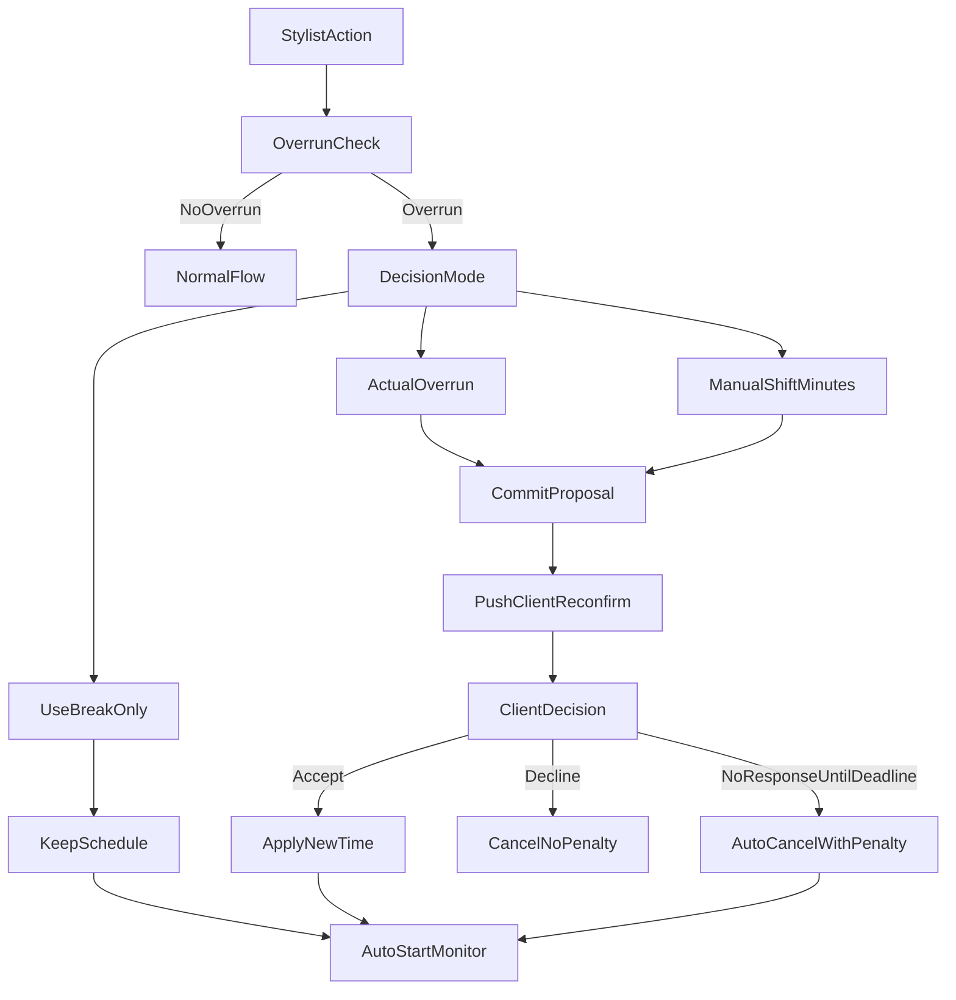

# Stylist Matrica Upgrade (Full Scope)

## Cilj

Uvesti pouzdan dnevni orkestrator termina za stilistu: kontrolu kašnjenja, rekalkulaciju budućih termina, ponovno potvrđivanje klijenata kroz push notifikacije, reorder slobodnih slotova i auto-start logiku, uz jasne statuse, testove i dokumentaciju.

## Poslovna pravila (zaključana)

- Potvrda klijenta nakon promjene termina koristi dinamički rok:
  - `deadline = min(30 min, floor(0.5 * minutesUntilTerm))`
  - ako klijent ne potvrdi do deadline-a: auto-otkaz + kazneni bodovi
- Ako klijent aktivno odbije novi termin: rezervacija se otkazuje bez kaznenih bodova.
- Stilista bira nakon probijanja:
  - rekalkulacija za stvarni overrun
  - rekalkulacija za ručno unesene minute
  - bez rekalkulacije (skraćivanje pauze)
- U ovoj iteraciji ide full scope: overrun + rekalkulacija + reorder + auto-start + testovi + dokumentacija.

## Implementacione cjeline

### 1) Stabilizacija trenutnog bug-a u rasporedu (kasni start bez upozorenja)

- Uvesti guard koji razlikuje:
  - termin je u prošlosti i nije startovan
  - termin je aktivan za start
  - termin je probijen (overrun scenario) i traži odluku stiliste
- Ažurirati akcije u stylist detail/schedule da više ne nude “slijepo” start/cancel bez konteksta.
- Primarni fajlovi:
  - [backend/src/reservations/reservations.service.ts](../../backend/src/reservations/reservations.service.ts)
  - [mobile/src/screens/stylist/StylistReservationDetailScreen.tsx](../../mobile/src/screens/stylist/StylistReservationDetailScreen.tsx)
  - [mobile/src/screens/stylist/StylistScheduleScreen.tsx](../../mobile/src/screens/stylist/StylistScheduleScreen.tsx)

### 2) Overrun odluka i rekalkulacija lanca termina

- Proširiti postojeći reschedule flow (`propose/commit/accept/decline`) da podrži tri moda odluke stiliste.
- Dodati eksplicitan payload mode:
  - `actual_overrun`
  - `manual_minutes`
  - `use_break_only`
- U `commit` upisivati metadata promjene (koji mode, koliko minuta, timestamp, initiator).
- Primarni fajlovi:
  - [backend/src/reservations/reservations.controller.ts](../../backend/src/reservations/reservations.controller.ts)
  - [backend/src/reservations/reservations.service.ts](../../backend/src/reservations/reservations.service.ts)
  - [mobile/src/screens/stylist/ReschedulePreviewScreen.tsx](../../mobile/src/screens/stylist/ReschedulePreviewScreen.tsx)
  - [mobile/src/screens/stylist/DailyLogDetailScreen.tsx](../../mobile/src/screens/stylist/DailyLogDetailScreen.tsx)

### 3) Klijentsko ponovno potvrđivanje sa dinamičkim deadline-om

- Pri `commit` generisati confirmation deadline po formuli i čuvati ga per rezervacija.
- Push poruka klijentu sadrži:
  - novi termin
  - krajnji rok za odgovor
  - akcije Accept/Decline
- Uvesti cron/worker za istek pending potvrda:
  - expired + no response => auto-cancel + penalizacija
- Primarni fajlovi:
  - [backend/src/reservations/reservations.service.ts](../../backend/src/reservations/reservations.service.ts)
  - [backend/src/reservations/reservation-delay.cron.ts](../../backend/src/reservations/reservation-delay.cron.ts)
  - [backend/src/notifications/notifications.service.ts](../../backend/src/notifications/notifications.service.ts)
  - [mobile/src/screens/client/MyReservationsScreen.tsx](../../mobile/src/screens/client/MyReservationsScreen.tsx)
  - [mobile/src/hooks/usePushNotifications.real.ts](../../mobile/src/hooks/usePushNotifications.real.ts)

### 4) Reorder termina (slobodan slot -> push ponuda klijentu)

- Dodati endpoint za stylist reorder ponudu za tačno kompatibilan termin (isti service duration constraint).
- Klijent prihvati:
  - rezervacija prelazi u novi slot
  - stari slot se oslobađa
- Klijent odbije:
  - zadržava originalni potvrđeni termin
  - bez penalizacije
- Dodati status/trag zahtjeva radi audit-a i prikaza u rasporedu.
- Primarni fajlovi:
  - [backend/src/reservations/reservations.controller.ts](../../backend/src/reservations/reservations.controller.ts)
  - [backend/src/reservations/reservations.service.ts](../../backend/src/reservations/reservations.service.ts)
  - [mobile/src/screens/stylist/StylistScheduleScreen.tsx](../../mobile/src/screens/stylist/StylistScheduleScreen.tsx)
  - [mobile/src/screens/stylist/StylistReservationDetailScreen.tsx](../../mobile/src/screens/stylist/StylistReservationDetailScreen.tsx)
  - [mobile/src/screens/client/MyReservationsScreen.tsx](../../mobile/src/screens/client/MyReservationsScreen.tsx)

### 5) Auto-start nadolazećeg termina (kad prethodni nije pokrenut)

- Uvesti pravilo za “first upcoming” termin koji treba auto-prelazak u `IN_PROGRESS` kada vrijeme starta dođe, uz zaštite da ne starta pogrešan termin.
- Logika mora poštovati konflikt sa postojećim `IN_PROGRESS` terminom.
- Primarni fajlovi:
  - [backend/src/reservations/reservation-delay.cron.ts](../../backend/src/reservations/reservation-delay.cron.ts)
  - [backend/src/reservations/reservations.service.ts](../../backend/src/reservations/reservations.service.ts)
  - [mobile/src/screens/stylist/StylistScheduleScreen.tsx](../../mobile/src/screens/stylist/StylistScheduleScreen.tsx)

### 6) Statusi, prikaz i notifikacije u stylist rasporedu

- Prikazati jasne badge/stanja:
  - pending response
  - auto-cancelled (no response)
  - declined by client
  - reordered
- Uskladiti wording i filtere na scheduler listi i detailu.
- Primarni fajlovi:
  - [mobile/src/screens/stylist/StylistScheduleScreen.tsx](../../mobile/src/screens/stylist/StylistReservationDetailScreen.tsx)
  - [mobile/src/screens/stylist/StylistReservationDetailScreen.tsx](../../mobile/src/screens/stylist/StylistReservationDetailScreen.tsx)
  - [mobile/src/i18n/bs.ts](../../mobile/src/i18n/bs.ts)

### 7) Testovi (obavezno prije produkcije)

- Backend unit/integration:
  - overrun modes
  - dynamic deadline calc
  - auto-cancel by timeout + penalty
  - decline without penalty
  - reorder accept/decline
  - auto-start guard cases
- Mobile behavior tests/smoke:
  - stylist modal odluke
  - client acceptance flow from push/in-app
  - schedule status rendering
- Primarni fajlovi:
  - [backend/src/reservations/reservations.service.spec.ts](../../backend/src/reservations/reservations.service.spec.ts)
  - [backend/src/reservations/availability.service.spec.ts](../../backend/src/reservations/availability.service.spec.ts)
  - [backend/src/daily-log/daily-log.service.spec.ts](../../backend/src/daily-log/daily-log.service.spec.ts)

### 8) Dokumentacija matrice

- Dodati detaljan docs fajl sa:
  - FSM + status transitions
  - overrun decision tree
  - deadline formula i primjeri
  - reorder scenario i ograničenja
  - notifikacije i penalizacija
  - test matrix + rollback notes
- Predloženi fajl:
  - [stylist-reservation-matrix.md](../docs/stylist-reservation-matrix.md)

## Operativni tok (visok nivo)

## Release kriteriji

- Svi novi i postojeći testovi prolaze.
- Nema regresije na trenutni reservation FSM.
- Push notifikacije verified za oba smjera (stylist -> client i client response).
- Dokumentacija završena i usklađena s implementacijom.
