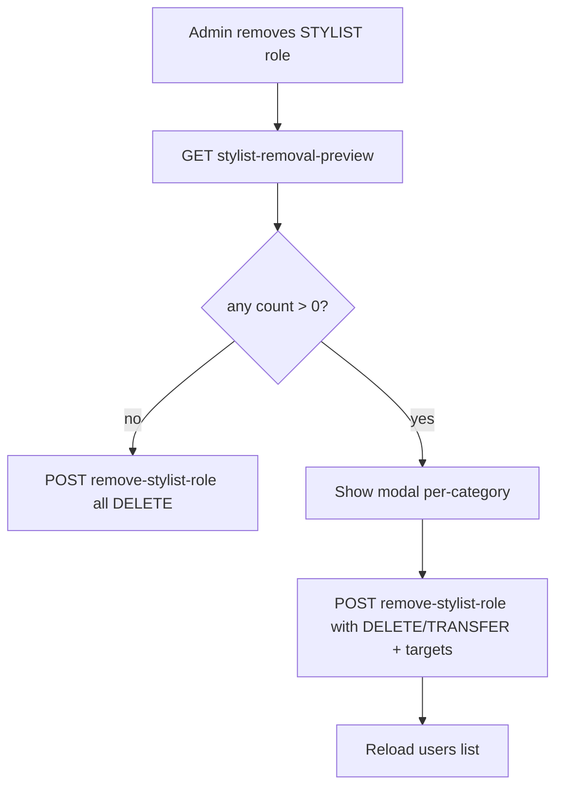

## Goals

- UI: Replace the current single table/sections on `[frontend/src/pages/Users.tsx](frontend/src/pages/Users.tsx)` with **three separate cards**:
  - **ADMINISTRATORI**: users with `SYSTEM_ADMIN`
  - **STILISTI**: users with `STYLIST` but **not** `SYSTEM_ADMIN`
  - **KLIJENTI**: users with **only** `CLIENT` (strict: no other roles)
- Backend + UI: Allow removing `STYLIST` role from Users page.
  - This must **remove stylist profile** + **delete stylist settings**.
  - If stylist has linked data (reservations/daily logs/reviews/etc), admin is prompted to **transfer** or **delete** per category.

## Current state (relevant)

- Users page already computes `groupedUsers` but renders in one container.
- Backend currently blocks removing `STYLIST` in `UsersService.removeRole`.
- DB constraints:
  - `DailyLogEntry.stylistProfileId` is required → cannot delete stylistProfile unless daily logs are deleted or transferred.
  - `Reservation.confirmedStylistId` is nullable (`SetNull` on delete) → can be deleted, but you want admin-controlled transfer/delete.
  - `Review.stylistProfileId` is nullable (`SetNull` on delete) → admin-controlled transfer/delete.

## Backend changes

### 1) Add “stylist removal preview” endpoint

- **New route** in `[backend/src/users/users.controller.ts](backend/src/users/users.controller.ts)`:
  - `GET /api/users/:id/stylist-removal-preview`
- **New service method** in `[backend/src/users/users.service.ts](backend/src/users/users.service.ts)`:
  - Find user’s `stylistProfile` (by `userId`). If none → 404.
  - Compute counts that would block deletion/need action:
    - `dailyLogEntriesCount`
    - `confirmedReservationsCount`
    - `reservationResponsesCount`
    - `reviewsCount`
  - Return `{ stylistProfileId, counts }`.

### 2) Add “execute stylist removal” endpoint (delete or transfer)

- **New route**:
  - `POST /api/users/:id/remove-stylist-role`
- **DTO** (new file) e.g. `[backend/src/users/dto/remove-stylist-role.dto.ts](backend/src/users/dto/remove-stylist-role.dto.ts)`:
  - Per-category action:
    - `dailyLogs`: `{ mode: 'DELETE' | 'TRANSFER', targetStylistProfileId?: string }`
    - `confirmedReservations`: same
    - `reservationResponses`: same
    - `reviews`: same
- **Implementation** in `UsersService` using a single `prisma.$transaction`:
  - Resolve `stylistProfileId` for that user.
  - For each category:
    - If mode `DELETE` → delete rows (or rely on cascade by deleting stylistProfile where safe).
    - If mode `TRANSFER` → update FK to `targetStylistProfileId`.
  - Always delete stylist “settings”:
    - delete working hours + stylist services (via cascade by deleting stylistProfile).
  - Delete the `stylistProfile`.
  - Remove `STYLIST` from `user_roles`.
- Validation:
  - If mode is `TRANSFER`, require `targetStylistProfileId` and disallow transferring to same stylistProfileId.
  - Ensure target stylist exists.

## Frontend changes

### 1) Users page: three cards

- Update `[frontend/src/pages/Users.tsx](frontend/src/pages/Users.tsx)` rendering:
  - Replace the big “users list” container with 3 Chakra `Box` cards (white bg, shadow, heading + count) each containing either:
    - Desktop: a small table
    - Mobile: the existing stacked card list
  - Filtering rules:
    - **Administratori**: `roles.includes('SYSTEM_ADMIN')`
    - **Stilisti**: `roles.includes('STYLIST') && !roles.includes('SYSTEM_ADMIN')`
    - **Klijenti (strict)**: `roles.length === 1 && roles[0] === 'CLIENT'`

### 2) Remove STYLIST role flow

- In Users UI, when clicking close/remove on `STYLIST` tag:
  - Call preview endpoint `GET /api/users/:id/stylist-removal-preview`.
  - If all counts are 0 → call execute endpoint with all modes `DELETE` (simple removal).
  - If any counts > 0 → open a modal:
    - For each category with count>0, show:
      - count
      - radio: **Delete** vs **Transfer**
      - if Transfer: stylist dropdown (load from `/api/stylists` list; exclude current stylist)
    - Confirm button calls `POST /api/users/:id/remove-stylist-role`.
  - After success: refresh users list.

## Test plan

- UI grouping:
  - SYSTEM_ADMIN user shows only in Administratori card.
  - STYLIST user shows only in Stilisti card.
  - Strict CLIENT-only user shows in Klijenti card; users with CLIENT+OWNER do not.
- Role removal:
  - If stylist has daily logs → modal appears; choosing Transfer requires selecting a target.
  - Delete path removes stylist profile + daily logs + responses + reviews per selection.
  - Transfer path reassigns rows to chosen stylist, then removes stylist profile and role.

