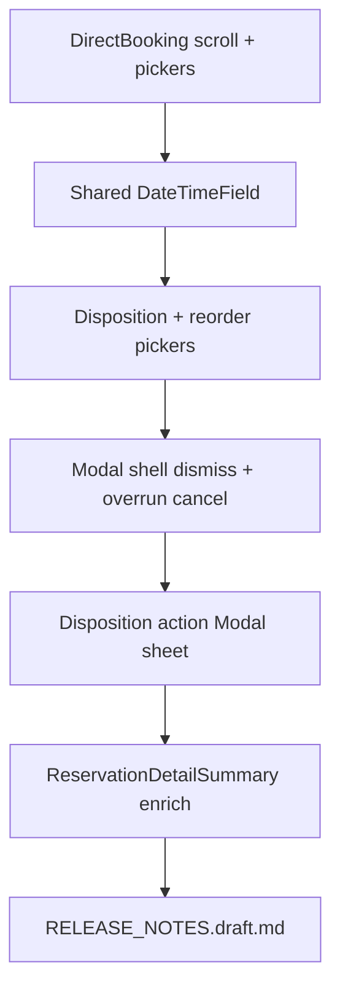

# Stylist mobile UX fixes

## Scope (zaključano)

Četiri povezana fixa na stilista mobilnoj app. Jezik UI: BS. Ažurirati i `[mobile/RELEASE_NOTES.draft.md](mobile/RELEASE_NOTES.draft.md)` po pravilu `mobile-release-notes.mdc`.

---

## 1. Scroll / dugmad ispod glossy tab bara

**Uzrok:** `[StylistDirectBookingScreen.tsx](mobile/src/screens/stylist/StylistDirectBookingScreen.tsx)` nema `useFloatingTabBarTotalHeight`; `contentContainerStyle` je samo `padding: spacing.md` — CTA ispod „Napomena“ završava ispod floating menija.

**Fix:**

- Dodati `tabBarBottom = useFloatingTabBarTotalHeight()`
- `paddingBottom: spacing.xxl + tabBarBottom` na ScrollView
- `KeyboardAvoidingView` oko forme (iOS padding / Android undefined) da tipkanje napomene ne gura CTA ispod

**Audit (ostalo stilista):**

- Već OK: schedule, inbox, daily-log list/detail/new, reservation detail, profile, stats, reschedule preview
- Jedini jasni miss: **Direct booking** (gore)
- Modali (disposition / reservation-detail shell) nisu tab-scroll problem, ali disposition modal treba dovoljan bottom padding kad je tastatura otvorena

---

## 2. Date / time pickeri umjesto plain TextInput

Nema `@react-native-community/datetimepicker` u projektu; client booking koristi `react-native-calendars` samo za datum.

**Pristup:** instalirati `npx expo install @react-native-community/datetimepicker` i napraviti mali shared kontrol:

- `[mobile/src/components/ui/DateTimeField.tsx](mobile/src/components/ui/DateTimeField.tsx)` — `mode: 'date' | 'time'`, label, value string (`YYYY-MM-DD` / `HH:mm`), onChange; tap otvara native picker; display vrijednost formatirana

**Zamijeniti plain inpute na:**

| Lokacija                                                                                                       | Polja                                 |
| -------------------------------------------------------------------------------------------------------------- | ------------------------------------- |
| `[StylistDirectBookingScreen.tsx](mobile/src/screens/stylist/StylistDirectBookingScreen.tsx)`                  | Datum, Početak, Kraj                  |
| `[DailyLogDispositionPanel.tsx](mobile/src/screens/stylist/DailyLogDispositionPanel.tsx)`                      | Novi datum / početak / kraj (reorder) |
| `[reorder-reservation-modal.tsx](mobile/src/screens/stylist/reservation-detail/reorder-reservation-modal.tsx)` | Novi početak / kraj                   |
| `[DailyLogEntryPricingBlock.tsx](mobile/src/screens/stylist/DailyLogEntryPricingBlock.tsx)`                    | Datum unosa                           |

Payload ostaje isti string format (`DD-MM-YYYY`, `HH:mm`) — bez API promjena.

---

## 3. Dijalozi bez pouzdanog izlaza

### A) Disposition action menu (direktna rezervacija u zapisu)

`[DailyLogDispositionPanel.tsx](mobile/src/screens/stylist/DailyLogDispositionPanel.tsx)` `openMenu` koristi `Alert.alert` s mnogo akcija. Na Androidu s glossy/native sheetom cancel je često nejasan.

**Fix:** zamijeniti `Alert.alert` action sheetom u `Modal`:

- lista akcija (reorder / cancel client / cancel stylist / no_show / discard)
- **Odustani** + tap na overlay zatvara
- `onRequestClose` (Android back)

Follow-up form modal (razlog + date/time za reorder) već ima Odustani — dodati overlay dismiss + `onRequestClose`.

### B) Shared reservation detail modals

`[reservation-detail-modal-shell.tsx](mobile/src/screens/stylist/reservation-detail/reservation-detail-modal-shell.tsx)`:

- `onRequestClose={onClose}`
- Pressable overlay → `onClose`
- Proslijediti `onClose` iz svih child modala

`[overrun-reservation-modal.tsx](mobile/src/screens/stylist/reservation-detail/overrun-reservation-modal.tsx)`:

- Dodati eksplicitno **Odustani** (trenutno nema zatvaranja bez izbora akcije)

Ostali (cancel / no-show / reorder / complete) već imaju cancel button — nasljeđuju backdrop iz shell-a.

---

## 4. Detalj termina — bogatiji prikaz

Proširiti `[reservation-detail-summary.tsx](mobile/src/screens/stylist/reservation-detail/reservation-detail-summary.tsx)` (pattern kao klijent `[MyReservationsScreen](mobile/src/screens/client/MyReservationsScreen.tsx)`):

**Naslov:** `publicReferenceCode` (fallback: prvi servis / „Rezervacija“)

**Ispod naslova:**

- Lista servisa (ime + cijena po stavci + trajanje ako postoji)
- **Procjenjena naplata** = suma `service.price` (minus loyalty iznos ako > 0, prikazati i bruto i popust)
- Datum · vrijeme · ukupno min (već postoji)
- Status badge (postoji)
- Klijent (postoji)
- Porijeklo: mapirati `bookingOrigin` / `acceptanceMode` (npr. „Direktna (stilista)“, „Inbox“, „Klijent“)
- Napomena, payDebtsIntent, reschedule warning (postoji)
- Ako postoji: `cancelReason`, predloženo pomjeranje (`rescheduleProposed*`)

Helper: dodati `getReservationEstimatedTotal` u `[reservationServices.ts](mobile/src/utils/reservationServices.ts)` (suma price iz `getReservationServices`).

Header navigation title može ostati generic; **ref ide u summary card** kao hero naslov (jasnije na scrollu).

---

## Tok

## Van opsega

- Backend API / schema
- Client ReservationScreen calendar redesign
- Novi native EAS build osim što datetimepicker zahtijeva rebuild prije prod testiranja
