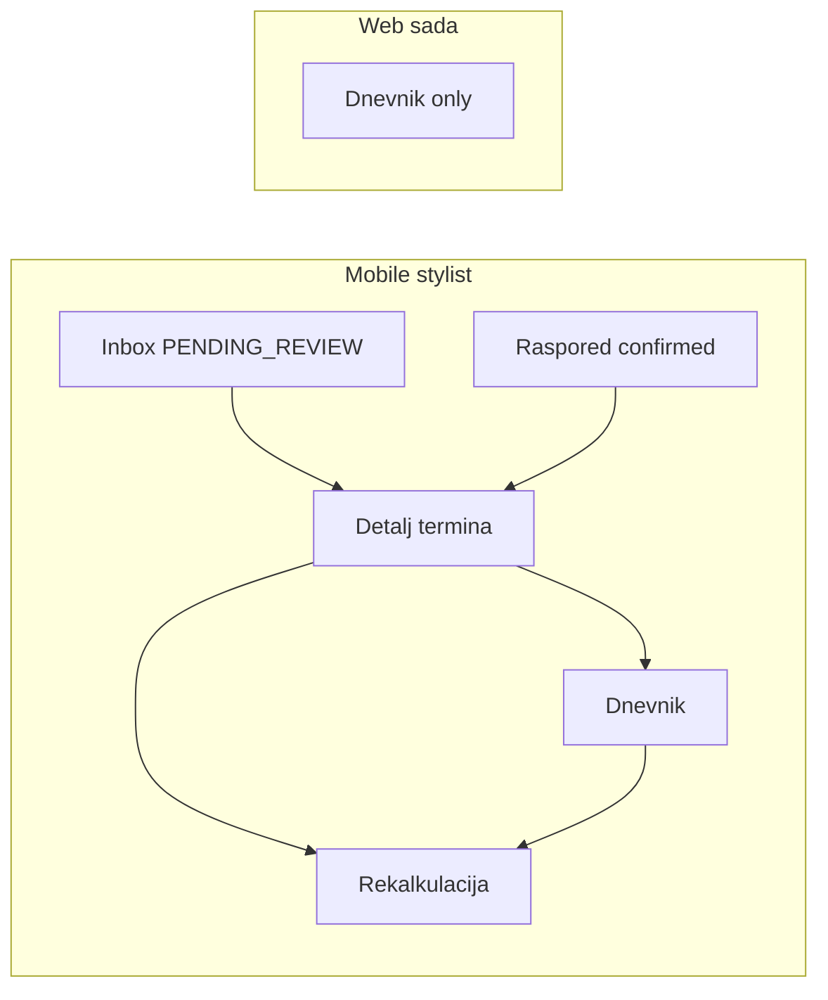

# Web stilist: paritet s mobilnom aplikacijom

## Kontekst i uzrok problema

- **Mobilni** stilist ima pet tabova definisanih u [`mobile/app/stylist/(tabs)/_layout.tsx`](mobile/app/stylist/(tabs)/_layout.tsx): Inbox → Dnevnik → Raspored → Statistika → Profil.
- **Neuhvaćene buduće rezervacije** (npr. status `PENDING`, niko nije `confirmedStylist`) pojavljuju se u **Inboxu** ([`mobile/src/screens/stylist/StylistInboxScreen.tsx`](mobile/src/screens/stylist/StylistInboxScreen.tsx)): `GET /api/reservations?asStylist=true`, zatim **Zaključaj** → **Prihvati** / **Odbij** (`/lock`, `/accept`, `/reject`).
- **Raspored** prikazuje samo termine koje je stilist zaista preuzeo ([`mobile/src/screens/stylist/StylistScheduleScreen.tsx`](mobile/src/screens/stylist/StylistScheduleScreen.tsx) – filter `confirmedStylistId === profileId` ili `IN_PROGRESS`), sa odlaskom na detalj.
- **Detalj termina** ([`mobile/src/screens/stylist/StylistReservationDetailScreen.tsx`](mobile/src/screens/stylist/StylistReservationDetailScreen.tsx)) pokriva cijeli životni ciklus: start (sa blokadom ranijeg termina), završetak preko `POST /api/daily-log/from-reservation/:id`, dugovanja + `PATCH .../settle`, otkaz/no-show/reorder, navigacija na rekalkulaciju, periodično osvježavanje i overrun popup.

- **Web** trenutno ima samo [`frontend/src/layouts/StylistLayout.tsx`](frontend/src/layouts/StylistLayout.tsx) s jednom stavkom i rute isključivo pod `workbook` u [`frontend/src/app/router.tsx`](frontend/src/app/router.tsx) – nema Inbox/Raspored/Detalj, pa stilist ne vidi zahtjeve koje treba zaključati/prihvatiti.

## Cilj

Isporuka **istih pet područja** na webu, s istim backend pozivima i redoslijedom koraka gdje je moguće, uz minimalne web prilagodbe (npr. Profil bez Expo „prebaci na client app“ ako na webu nema istog moda).

## Arhitektura na frontendu

- **Navigacija**: proširiti [`frontend/src/layouts/StylistLayout.tsx`](frontend/src/layouts/StylistLayout.tsx) s pet linkova (isti red kao mobile: Inbox, Dnevnik, Raspored, Statistika, Profil). Aktivno stanje: `pathname.startsWith` po prefiksu rute.
- **Rute** u [`frontend/src/app/router.tsx`](frontend/src/app/router.tsx) (unutar postojećeg `StylistRoute` + `StylistLayout`):
  - `/stylist` → `Navigate` na **`/stylist/inbox`** (prvi tab kao na mobile).
  - `/stylist/inbox` – lista + akcije.
  - `/stylist/schedule` – sekcijski prikaz kao na RN.
  - `/stylist/schedule/:reservationId` – detalj termina.
  - Postojeće: `/stylist/workbook`, `.../new`, `.../:entryId`, `.../reschedule-preview/:reservationId` (bez premještanja URL-ova da se ne lome bookmarki; labela „Dnevnik“ u navu).
  - `/stylist/stats` – statistika.
  - `/stylist/profile` – profil.
- **Modul foldera**: novi feature npr. [`frontend/src/features/stylist-portal/`](frontend/src/features/stylist-portal/) (ili `stylist-schedule`) sa `pages/`, `api/`, `hooks/`, `types.ts` – da ne razvodnimo logiku kroz `pages/` root. Postojeći [`frontend/src/features/stylist-workbook/`](frontend/src/features/stylist-workbook/) ostaje; portal ga samo linkuje.

## API i hookovi (paritet s mobile)

Centralizovati pozive koji već postoje u RN ekranima:

| Akcija | Endpoint (kao na mobile) |
|--------|--------------------------|
| Lista (inbox) | `GET /api/reservations?asStylist=true` |
| Raspored | `GET /api/reservations?asStylist=true&fromDate&toDate` + isti client-side filter |
| Detalj | `GET /api/reservations/:id` |
| Lock / Accept / Reject | `POST .../stylist/:profileId/lock|accept|reject` |
| Dugovanja | `GET /api/client-debts?clientId=` |
| Start | `POST .../stylist-start` |
| Otkaz | `POST .../stylist-cancel` |
| No-show | `POST .../stylist-no-show` |
| Reorder | `POST .../reorder/request` |
| Završetak → dnevnik | `POST /api/daily-log/from-reservation/:id` zatim `PATCH /api/client-debts/:id/settle` po odabiru |
| Rekalkulacija | već u [`stylist-workbook.api.ts`](frontend/src/features/stylist-workbook/api/stylist-workbook.api.ts) |

**TanStack Query**: liste i detalj sa `queryKey` po `profileId` + parametrima; mutacije sa `invalidateQueries` za inbox + schedule + detalj.

## Stranice (ponašanje kao RN)

1. **Inbox** – port logike iz [`StylistInboxScreen.tsx`](mobile/src/screens/stylist/StylistInboxScreen.tsx): filter `PENDING` \| `STYLIST_REVIEW`, badgeovi za klijenta (CXL/PENAL), upozorenje za dugovanje prije accept-a (isti tekstovi), dijalog za odbij (opciono `rejectionReason`).
2. **Raspored** – port sekcija i sortiranja iz [`StylistScheduleScreen.tsx`](mobile/src/screens/stylist/StylistScheduleScreen.tsx) (danas, budući datumi, aktivna kartica / countdown gdje ima smisla na webu).
3. **Detalj termina** – port iz [`StylistReservationDetailScreen.tsx`](mobile/src/screens/stylist/StylistReservationDetailScreen.tsx):
   - Isti uslovi za `canStart`, `startBlockedReason` (upit `asStylist` za isti dan kao na RN).
   - Modali: otkaz, no-show, završetak (cijena, dugovanja, napomena), overrun (tri načina), reorder.
   - Nakon uspješnog `from-reservation`: **`navigate(\`/stylist/workbook/${entry.id}\`)`** (ekvivalent RN navigacije na DailyLogDetail).
   - Rekalkulacija: **`navigate(\`/stylist/workbook/reschedule-preview/${id}?mode=...&manualShiftMinutes=...&includeBreaks=...\`)`**.
4. **Rekalkulacija (postojeća stranica)** – u [`workbook-reschedule-preview-page.tsx`](frontend/src/features/stylist-workbook/pages/workbook-reschedule-preview-page.tsx) **pročitati `mode` i `manualShiftMinutes` iz `useSearchParams`** pri mountu (trenutno se `mode` inicijalizuje fiksno na `actual_overrun`), da deep link iz detalja termina bude paritetan s mobile.
5. **Statistika** – port [`StylistStatsScreen.tsx`](mobile/src/screens/stylist/StylistStatsScreen.tsx): isti mjesecni opseg, agregati iz rezervacija + daily-log.
6. **Profil** – port [`StylistProfileScreen.tsx`](mobile/src/screens/stylist/StylistProfileScreen.tsx): prikaz korisnika, odjava; **„Prebaci na client“** samo ako web auth/model podržava dvostruku ulogu (npr. provjera `roles` kao `isClient` na RN) – inače sakriti tu akciju.

## Ostalo ponašanje aplikacije

- **[`getPostAuthRedirectPath`](frontend/src/utils/clientOnboarding.ts)** – nakon prijave za `STYLIST` usmjeriti na **`/stylist/inbox`** (ili `/stylist` koji redirectuje), da odmah vidi nepreuzete zahtjeve.
- **i18n**: gdje već postoje ključevi (`stylist.schedule.*`, `nav.*`), koristiti ih; ostatak BS stringova uskladiti s mobile gdje je copy isti.

## Test plan (ručno)

- Prijava kao stilist → otvara Inbox; vidljiva buduća `PENDING` rezervacija → Zaključaj → Prihvati (i provjera alerta za dugovanje ako postoji test podatak).
- Raspored: preuzeti termin se pojavljuje; klik na detalj.
- Detalj: redoslijed blokada starta; Start; Završi → otvaranje workbook detalja; Complete zapis + opciona rekalkulacija.
- Otkaz / no-show / reorder – uspjeh i poruke.
- Statistika i Profil se učitavaju; odjava radi.
