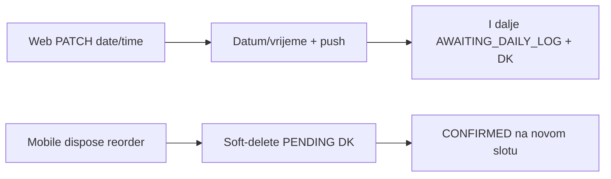

# Web kalendar/DK tok, statusi, DK meni

## 1. Bug: kalendar ne izlazi iz dnevne knjige

**Uzrok:** web kalendar i edit forma zovu `PATCH /api/reservations/:id` ([ReservationsCalendar.tsx](frontend/src/pages/ReservationsCalendar.tsx) `handleMove` / `handleResize`). [reservation-update.service.ts](backend/src/reservations/reservation-update.service.ts) mijenja samo `reservationDate` / `startTime` / `endTime` i šalje `reservation_time_changed`. Status ostaje `AWAITING_DAILY_LOG`, PENDING DK ostaje.

Mobilni „pomjeri“ ide `POST /api/daily-log/:id/dispose` `action=reorder` → soft-delete DK + `applyDirectReorder` → status `CONFIRMED`.

**Backend (jedan put, svi kanali):** u `updateByAdmin`, ako je `existing.status === AWAITING_DAILY_LOG` i `scheduleChanged`:

- nađi PENDING DK (`reservationId`, `deletedAt` null)
- isti ishod kao [applyDirectReorder](backend/src/daily-log/daily-log-disposition-apply.ts): `CONFIRMED`, novo vrijeme, očisti reschedule polja
- soft-delete PENDING DK (isti admin soft-delete kao disposition, razlog npr. `Pomjereno sa kalendara` — kalendar ne traži obrazac)
- postojeći push `reservation_time_changed` ostaje

Drag/resize/edit forma na kalendaru i bilo koji drugi admin PATCH tada rade isto. Toast na webu: „Termin je izašao iz dnevne knjige i vraćen u raspored.“

Test: PATCH `AWAITING_DAILY_LOG` + nova vremena → `CONFIRMED`, DK `deletedAt` set, push. PATCH bez promjene vremena → bez DK close. Standardni `CONFIRMED` PATCH → bez DK close.

Docs: [RESERVATION_MODULE.md](.cursor/docs/reservations/RESERVATION_MODULE.md) §6.4 + MATRIX/CHANGELOG.

## 2. Web kalendar + lista — staff/admin UX (scoped)

Kalendar je fallback kad mobilna ne radi. Nije vizuelni rewrite `react-big-calendar`.

**Kalendar** ([ReservationScheduler.tsx](frontend/src/features/reservations/components/ReservationScheduler.tsx)):

- Boje/eventi: `AWAITING_DAILY_LOG` jasno označen (npr. „Dnevnik“)
- Drawer/event: preveden status; akcije po FSM: otkaz, potvrda dolaska (`CLIENT_REQUIRED`), link na DK ako postoji PENDING unos, copy kad je u DK da pomjeranje vraća termin u raspored
- Tablet: drawer umjesto malog dialoga gdje već nije

**Lista** ([Reservations.tsx](frontend/src/pages/Reservations.tsx)):

- Iste akcije u detailu (ne samo cancel + staff confirm)
- Badge već koristi `getReservationStatusLabel` — ostaje
- Ako je `AWAITING_DAILY_LOG`: CTA „Otvori dnevnu knjigu“ + napomena da pomjeranje na kalendaru zatvara DK

Stylist web raspored ([stylist-schedule-page.tsx](frontend/src/features/stylist-portal/pages/stylist-schedule-page.tsx)) i detail summary: isti labeli (vidi §4).

## 3. Bug: DK meni se ne zatvara (mobile)

[DailyLogDetailScreen.tsx](mobile/src/screens/stylist/DailyLogDetailScreen.tsx) `openActionsMenu` koristi `Alert.alert` sa 5 dugmadi. Na Androidu `Alert.alert` podržava max 3 — „Odustani“ često nestane.

Zamjena: isti pattern kao [disposition-action-menu-modal.tsx](mobile/src/screens/stylist/disposition-action-menu-modal.tsx) — Modal + backdrop tap + dugme Odustani. Stavke: Uredi, slika prije, slika poslije, Obriši.

`RELEASE_NOTES.draft.md`: zatvaranje menija na zapisu dnevnika.

## 4. Raw status umjesto prevoda

Nije i18n rupa u `bs.ts` (`IN_PROGRESS` / `AWAITING_DAILY_LOG` već postoje). UI ispisuje enum.

Zamijeniti sa `getReservationStatusLabel` (web) / `t('myReservations.status.*')` (mobile):

- [reservation-detail-summary.tsx](frontend/src/features/stylist-portal/components/reservation-detail-summary.tsx) `{reservation.status}`
- [stylist-schedule-page.tsx](frontend/src/features/stylist-portal/pages/stylist-schedule-page.tsx) Badge `{r.status}`
- [recent-reservations.tsx](frontend/src/features/dashboard/recent-reservations.tsx)
- [DailyLogDetailScreen.tsx](mobile/src/screens/stylist/DailyLogDetailScreen.tsx) `reservationStatusLabel` (trenutno raw `entry.reservation.status`)
- ostali Badge/Text koji renderuju `status` string bez mape (ne AppReleases)

## Out of scope

- Promjena auto-seed DK / auto-start
- Novi kalendar library
- Disposition razlog-obrazac na drag (kalendar ostaje tih PATCH + auto-razlog)
