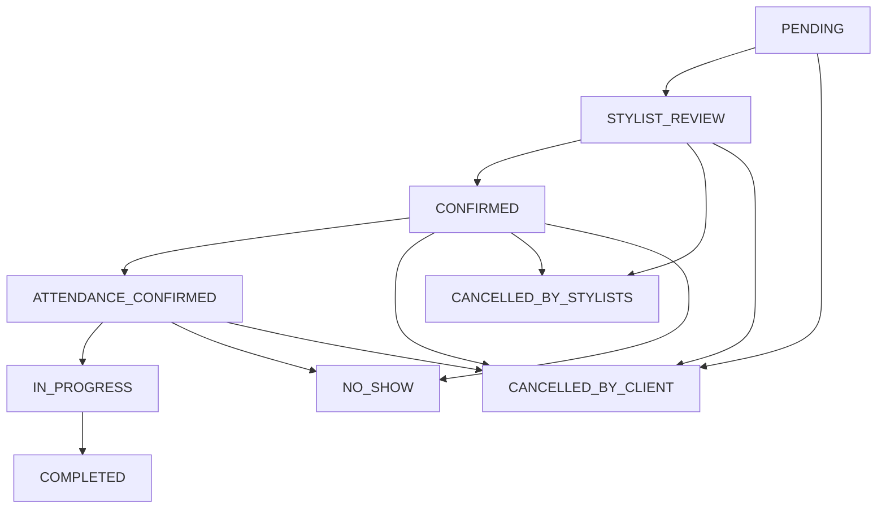

# Backend prezentacija (NestJS + Prisma) — workflow rezervacije

Ovaj dokument je walkthrough za prezentaciju, ne test report ni formalni API ugovor. Implementacija u trenutnom kodu i statički audit imaju prednost nad sažetim opisom ispod. Cron, integrations, security i runtime ponašanje nisu produkcijski testirani.

- Referenca (mapa koda): [docs/codebase-map/BACKEND.md](../codebase-map/BACKEND.md)
- Aktuelni sažetak: [SOURCE_OF_TRUTH.md](../../SOURCE_OF_TRUTH.md)
- Arhitektura i evidence: [docs/audit/ARCHITECTURE.md](../audit/ARCHITECTURE.md), [docs/audit/FINDINGS.md](../audit/FINDINGS.md)
- PostgreSQL migration caveats: [backend/POSTGRES_MIGRATION.md](../../backend/POSTGRES_MIGRATION.md)

## 1) Kontekst sistema (backend u sredini)

```mermaid
flowchart LR
  webPublic[WebPublic(Frontend)] -->|REST| api[BackendAPI(NestJS)]
  webAdmin[WebAdmin(Frontend)] -->|REST+Socket| api
  mobileClient[MobileClient(Expo)] -->|REST+Push| api
  mobileStylist[MobileStylist(Expo)] -->|REST+Push| api

  api -->|PrismaPg| db[(PostgreSQL)]
  api -->|Socket.IO| ws[RealtimeGateway]
  api -->|FS| uploads[(UploadsFS)]
  api -->|ExpoPushAPI| expo[ExpoPush]
```

## 2) Moduli relevantni za workflow rezervacije

- **Auth**: JWT auth + globalni guard, `@Public()` escape hatch
- **Reservations**: kreiranje, dostupnost, FSM, stylist response, attendance, start/complete/no-show, reschedule/reorder
- **Events**: Socket.IO gateway + sobe + standardizirani eventi
- **Notifications**: in-app notifikacije, Expo push i Nodemailer/SMTP email transport (isporuka zavisi od runtime konfiguracije)
- **Daily log**: zapis izvršene usluge (manual ili iz rezervacije) + zaključavanje zapisa
- **Finance**: KIF (IncomeBook) i KUF (ExpenseBook) + ručni prihodi i dugovanja
- **Uploads**: univerzalni upload servis (slike + derivati, dokumenti)
- **Loyalty**: redeem/earn vezan na rezervaciju i daily log

## 3) API površina (ključni endpointi za ovaj workflow)

Kontroler: `backend/src/reservations/reservations.controller.ts` (prefix `api/reservations`).

### Dostupnost (availability)
- `GET /api/reservations/availability/dates?serviceId=...&fromDate=...&toDate=...`
- `GET /api/reservations/availability/slots?serviceId=...&date=YYYY-MM-DD`
- `GET /api/reservations/availability/debug?serviceId=...` (**SYSTEM_ADMIN/OWNER**)

### Kreiranje i pregled
- `POST /api/reservations` (client)
- `POST /api/reservations/admin` (**SYSTEM_ADMIN/OWNER**)
- `GET /api/reservations` (filteri: `asClient`, `asStylist`, date range, status, pagination)
- `GET /api/reservations/:id`
- `PATCH /api/reservations/:id` (**SYSTEM_ADMIN/OWNER**)

### Akcije klijenta (CLIENT)
- `POST /api/reservations/:id/cancel`
- `POST /api/reservations/:id/confirm-attendance`

### Akcije stiliste (STYLIST, plus admin/owner “override”)
- `POST /api/reservations/:id/stylist/:stylistProfileId/lock`
- `POST /api/reservations/:id/stylist/:stylistProfileId/accept`
- `POST /api/reservations/:id/stylist/:stylistProfileId/reject`
- `POST /api/reservations/:id/stylist-start`
- `POST /api/reservations/:id/stylist-mark-complete`
- `POST /api/reservations/:id/reschedule/propose`
- `POST /api/reservations/:id/reschedule/commit`
- `POST /api/reservations/:id/reorder/request`
- `POST /api/reservations/:id/use-break` (signal da se ne šalju auto delay upozorenja)

## 4) FSM rezervacije (statusi + prijelazi)

Statusi su centralizirani u `backend/src/reservations/constants.ts`.



## 5) Realtime (Socket.IO): sobe i eventi

Definicije eventa: `backend/src/events/socket-events.ts`.

- **Sobe (rooms)**: `admin`, `stylists`, `public`, `user:{id}` (prema `SOURCE_OF_TRUTH.md`)
- **Eventi**:
  - `reservation:created`, `reservation:updated`, `reservation:cancelled`, `reservation:confirmed`, `reservation:stylist_response`
  - `availability:changed`
  - `notification:new`
  - `settings:updated`, `salon:updated`

Praksa: nakon promjene stanja rezervacije, servis emituje događaj relevantnim sobama (admin/stylists/user).

## 6) Notifikacije (in-app + push + email)

Backend behavior (kod-level pregled; eksterno slanje nije runtime-verified):
- **In-app**: notification service upisuje notifikaciju u DB i emituje Socket.IO `notification:new`.
- **Push**: Expo push token se registruje preko `POST /api/notifications/push-token`; kod poziva Expo Push API uz opcioni `EXPO_ACCESS_TOKEN`.
- **Email**: Nodemailer transport i `sendMail` pozivi postoje; isporuka zavisi od runtime SMTP konfiguracije i nije testirana u ovom auditu.

## 7) Cron scenariji (svaka minuta)

`backend/src/reservations/reservation-delay.cron.ts` radi tri stvari:

1) **Timeout za pending reschedule/reorder potvrde**  
   - `processPendingRescheduleTimeouts()` automatski rješava “PENDING” prijedloge koji nisu prihvaćeni u roku (tipično postavlja `DECLINED` ili čisti stanje, zavisno od “kind”).

2) **Attendance deadline enforcement** (24h pravilo)  
   - `processAttendanceDeadlines()` auto-otkazuje `CONFIRMED` rezervacije bez `attendanceConfirmedAt` kad uđu u 24h window:  
     - `status = CANCELLED_BY_CLIENT`  
     - `cancelReason = 'Nije potvrđen dolazak u roku'`  
     - emituje `availability:changed`  
     - šalje notifikaciju sa `data.kind = 'attendance_timeout_cancelled'`

3) **Auto delay upozorenja (IN_PROGRESS overrun)**  
   - Ako `pauseBetweenServices` postoji, a termin probije prag (pause/2), šalje “Moguće kašnjenje” budućim klijentima tog dana (osim prvog sljedećeg), i označava `delayNotifiedAt` da se pošalje samo jednom.  
   - Ako je stilist označio `useBreakAfterOverrun=true`, auto upozorenja se preskaču.

## 8) Auto reorder nakon attendance auto-otkazivanja

Nakon što attendance enforcement otkaže nepotvrđene, cron poziva:
- `processAutoReordersAfterAttendanceCancellations()`

Ideja:
- cilja potvrđene klijente (`ATTENDANCE_CONFIRMED`) po stilisti i danu
- pokušava “popuniti rupe” i predlaže ranije vrijeme bez kaskadnih promjena
- reorder je uvijek “siguran”: postavlja `rescheduleStatus='PENDING'` + predložena vremena, a klijent može **accept/decline**

## 9) Manual start gate (ručni start kao jedini gate)

Pravila (dokumentovano i implementirano u reservations servisu, sažetak iz `SOURCE_OF_TRUTH.md`):
- start dozvoljen samo ako je status `ATTENDANCE_CONFIRMED`
- `rescheduleStatus !== 'PENDING'`
- vrijeme je u prozoru: `plannedStart ≤ now ≤ plannedEnd + 60min`
- dodatno: nema ranijih termina tog dana koji čekaju obradu (postojeće pravilo domene)

## 10) Sprega: rezervacije → dnevna knjiga → KIF + loyalty

### Daily log
Servis: `backend/src/daily-log/daily-log.service.ts`
- zapis može biti **manual** ili **vezan na rezervaciju** (`createFromReservation`)
- dnevni zapis ima `actualPrice` i `tipAmount`
- završeni zapis se ne može mijenjati (`status === 'COMPLETED'` guard)

### KIF (IncomeBook)
Servis: `backend/src/finance/income-books.service.ts`
- knjiga prihoda je mjesečna; postoji cron logika “open/close” (1. u mjesecu)
- u praksi, KIF agregira prihode iz daily log zapisa (iznos = `actualPrice`)
- postoji i ručni unos prihoda (manual entry) sa audit trail-om i opcijom kreiranja duga

### Loyalty
Poslovna pravila (sažetak iz `.cursor/docs/05_matrice_i_poslovna_pravila.md`):
- **redeem** (popust) se može upisati na rezervaciji i/ili izvršiti na daily-log entry-ju
- **earn** bodova se tipično veže za `DailyLogService.complete` tok (loyalty “zarada” nakon izvršene usluge)

## 11) Checklist za system administratore (operativna stabilnost)

- **CORS + Socket**: potvrditi stvarne deployed origins i reverse-proxy path/WebSocket upgrade izvan repo-a; code-level CORS/socket risks su u [FINDINGS.md](../audit/FINDINGS.md).
- **Uploads**: `UPLOAD_ROOT` i mount path; `/uploads/*` javno serviranje (provjeriti disk).
- **Cron**: osigurati da scheduler radi (minute tick) i da server ima tačno vrijeme/timezone.
- **Push**: za testiranje koristiti konfigurisan Expo development/production build i synthetic token/account; backend koristi Expo push endpoint, a opcioni `EXPO_ACCESS_TOKEN` dolazi samo iz runtime secret configuration. Isporuka nije testirana.

