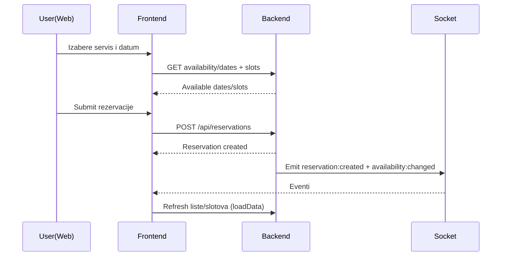

# Frontend prezentacija (React + Vite) — workflow rezervacije

Ovaj dokument je walkthrough za prezentaciju, ne test report ni formalni API ugovor. Implementacija u kodu i statički audit imaju prednost; browser/production runtime ponašanje nije ovdje dokazano.

- Referenca (mapa koda): [docs/codebase-map/FRONTEND.md](../codebase-map/FRONTEND.md)
- Aktuelni sažetak: [SOURCE_OF_TRUTH.md](../../SOURCE_OF_TRUTH.md)
- Arhitektura i evidence: [docs/audit/ARCHITECTURE.md](../audit/ARCHITECTURE.md), [docs/audit/FINDINGS.md](../audit/FINDINGS.md)

## 1) Kontekst (web slojevi)

```mermaid
flowchart LR
  publicSite[PublicSite(/)] -->|REST| backend[Backend(/api)]
  adminDash[AdminDashboard(/admin)] -->|REST+Socket.IO| backend
  backend --> db[(PostgreSQL)]
```

## 2) Ključne rute i stranice

### Public (site)
- `/rezervacija` → `frontend/src/pages/public/PublicReserve.tsx`
- (po potrebi) prikaz kreirane rezervacije → `frontend/src/pages/public/PublicReservationView.tsx`

### Admin (dashboard)
- `/admin/reservations` → `frontend/src/pages/Reservations.tsx`
- `/admin/reservations/calendar` → `frontend/src/pages/ReservationsCalendar.tsx`
- Povezane stranice u istom workflow-u:
  - `/admin/daily-log` (operativno zatvaranje)  
  - `/admin/finance` (KIF/KUF pregled)  
  - `/admin/notifications` (in-app notifikacije)  
  - `/admin/settings` (pravila i postavke koje utiču na rezervacije)

## 3) Realtime (Socket.IO) u web-u

Socket sloj je u `frontend/src/context/SocketContext.tsx`:
- uspostavlja konekciju prema `VITE_API_URL` (ili same-origin)
- šalje token kroz `auth: { token }`
- omogućava `useSocketEvent(event, handler)` helper

Najbitniji eventi za rezervacije:
- `reservation:created|updated|cancelled|confirmed|stylist_response`
- `availability:changed`
- `notification:new`

Primjer ponašanja u admin listi rezervacija: `frontend/src/pages/Reservations.tsx` radi `loadData()` i refresha listu na ove evente.

## 4) End-to-end workflow (web) — isti scenario, 2 pogleda

### 4.1 Public rezervacija (CLIENT/Guest → CLIENT)

Stranica `PublicReserve.tsx` vodi korisnika kroz selekciju i submit rezervacije.

**Koraci (happy path)**:
- **Odabir servisa**: autocomplete + podrška za više servisa (zbirno trajanje).
- **Dostupnost datuma**: poziv availability dates endpointa, UI disable datume bez slotova.
- **Dostupnost slotova**: za izabrani datum, učitava slotove i prikazuje start/end + broj dostupnih stilista.
- **Podaci klijenta / napomene**: forma sa kontaktom i napomenom (zavisno od auth stanja).
- **Kreiranje rezervacije**: `POST /api/reservations` i prikaz potvrde.
- **Realtime**: ekran sluša `availability:changed` da osvježi slotove (npr. kad admin/stilist promijeni rezervacije).

**Obavezni edge-case scenariji u UI-ju**:
- **Nema dostupnosti**: korisnik vidi da su svi datumi disabled ili da nema slotova za izabrani datum.
- **Slot “nestane”**: između učitavanja i submit-a, slot postane nedostupan → backend vraća grešku, UI prikazuje poruku i ponudi refresh slotova.
- **Loyalty (ako uključeno)**: UI može prikazati info o bodovima i maksimalnom popustu; backend je autoritativan za validaciju.

### 4.2 Admin pregled i operativne intervencije (SYSTEM_ADMIN/OWNER)

Stranica `Reservations.tsx` je centralni admin ekran za ovaj workflow.

**Šta admin vidi**:
- lista rezervacija sa filterima (datum range, status)
- detalj rezervacije (klijent, servis/i, potvrđeni stilist, stylistResponses, loyalty polja)
- akcije poput **admin cancel** (`POST /api/reservations/:id/admin-cancel`)

**Realtime u adminu**:
- na `reservation:*` evente, lista se automatski osvježava (soft realtime).
- na `notification:new`, relevantne stranice mogu osvježiti notifikacije badge/listu.

## 5) Statusi rezervacije (web labeli)

Admin UI mapira status u label i badge (primjer u `Reservations.tsx`):
- `PENDING`, `STYLIST_REVIEW`, `CONFIRMED`, `ATTENDANCE_CONFIRMED`, `IN_PROGRESS`, `COMPLETED`
- `CANCELLED_BY_CLIENT`, `CANCELLED_BY_STYLISTS`, `NO_SHOW`

Preporučena konzistentnost termina (web + mobile):
- `CANCELLED_BY_CLIENT` + `cancelReason === 'Nije potvrđen dolazak u roku'` prikazati kao **“Otkazano (nepotvrđen dolazak)”** (prema `SOURCE_OF_TRUTH.md`).

## 6) Minimalni dijagram: UI → API → realtime refresh



## 7) Operativni “šta ako” (web)

- **Attendance auto-otkaz**: admin vidi rezervaciju kao `CANCELLED_BY_CLIENT` i razlog “Nije potvrđen dolazak u roku”; availability se osvježava kroz `availability:changed`.
- **Reorder predlog**: admin vidi `rescheduleStatus='PENDING'` i predložena vremena (klijent treba accept/decline u svom kanalu).
- **Kašnjenje (delay warning)**: klijenti dobijaju notifikaciju (push/in-app), a web može prikazati badge i listu notifikacija.

